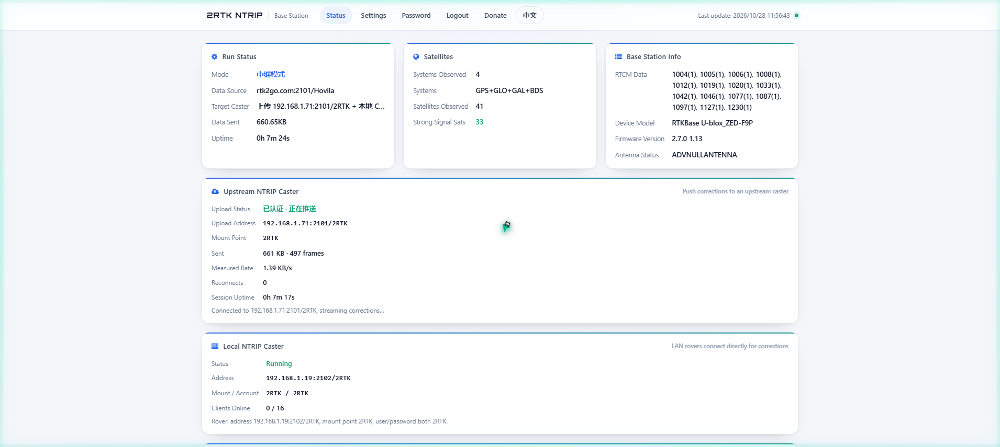
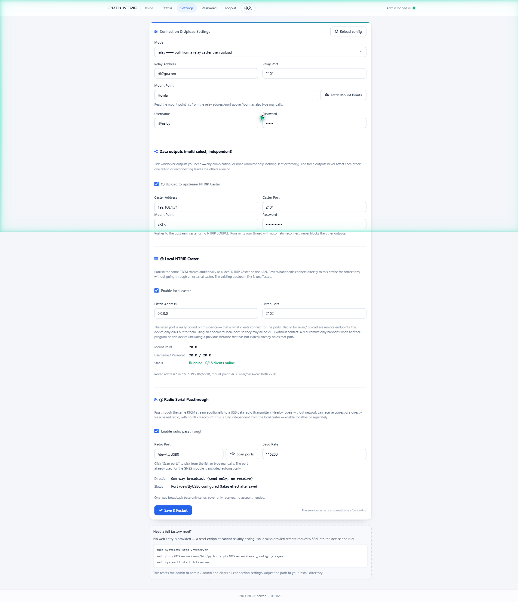
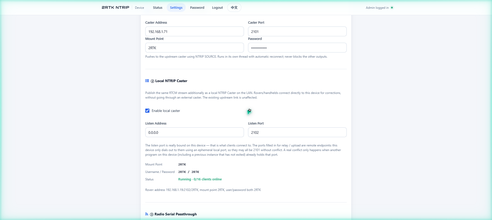

# 2RTK NTRIP Server

[](LICENSE)
[](#compatibility)
[](#requirements)
[](#web-ui)

> **One RTK module + one small Armbian box + your broadband = your own GNSS base station.**

A self-hosted NTRIP server for RTK base stations. It reads RTCM3 from a serial RTK module
(or relays the stream of another caster) and fans it out to three **independent** outlets:
push to your upstream NTRIP caster, serve a built-in LAN caster, and broadcast over a USB
radio datalink — any combination, each with its own switch.



---

## Contents

- [What it does](#what-it-does)
- [Features](#features)
- [Verified on real hardware](#verified-on-real-hardware)
- [Test suite](#test-suite)
- [Release highlights](#release-highlights)
- [Data flow](#data-flow)
- [Hardware](#hardware)
- [Requirements](#requirements)
- [Quick start](#quick-start)
- [Web UI](#web-ui)
- [Configuration](#configuration)
- [Read this first: antenna phase center](#read-this-first-antenna-phase-center)
- [Base-station calibration](#base-station-calibration)
- [Service management](#service-management)
- [Troubleshooting](#troubleshooting)
- [Compatibility](#compatibility)
- [Design notes](#design-notes)
- [Documentation](#documentation)
- [License & credits](#license--credits)
- [中文简介](#中文简介)

---

## What it does

A base station needs three things: a precise position, a continuous RTCM3 stream, and a way
to hand that stream to rovers. This project covers the last part — and nothing else — so it
runs happily on a 1 GHz ARM board with 512 MB of RAM.

You mount a geodetic antenna on the roof, run a feedline down to an RTK module, and plug the
module into a small Armbian box (a TV box, an OneCloud, a Raspberry Pi — anything with a USB
port). This program then:

- reads the RTCM3 stream from the module over USB serial (or pulls it from another caster),
- publishes it through any of three outlets you enable,
- shows live satellite/signal status, the base position on a map, and a raw log in the browser.

Configuration lives in a local SQLite file; there is no cloud account, no vendor service, and
no telemetry.

## Features

| | |
| --- | --- |
| **Base-station calibration** | Measures the antenna position on the device itself and writes it into the module: CORS/VRS survey, Survey-in, or manual entry. Supports Quectel LG290P / LC29HBS and Unicore N4. The resulting ECEF is stored in `calibration.db` and read back from RTCM 1005/1006 to prove that what was written is what gets broadcast. See [Base-station calibration](#base-station-calibration). |
| **Two sources** | `serial` — read RTCM3 from a USB RTK/GNSS module (auto-scans ports, auto-detects baud). `relay` — pull from any NTRIP caster, with a "Fetch Mount Points" button that reads the peer's source table. |
| **Outlet ① upstream push** | NTRIP 1.0 `SOURCE` push to your own caster, with automatic reconnect (5 s), bounded queue (512 frames, drop-oldest), and a dedicated thread — a dead upstream can never stall the serial port. |
| **Outlet ② built-in caster** | Serves the same stream on the LAN as a real NTRIP caster: `GET /` returns a SOURCETABLE, `GET /2RTK` requires Basic auth, supports NTRIP 1.0 (`ICY 200 OK`) and 2.0 clients, up to 16 clients with per-client queues. |
| **Outlet ③ radio datalink** | Transparent one-way broadcast of the same RTCM bytes to a USB radio modem's serial port, so rovers/UAVs with no network get corrections over the air — no NTRIP account needed. |
| **Live dashboard** | Satellites per constellation (GPS/GLO/GAL/BDS) with signal bars, RTCM message inventory (1004/1005/1012/1077/1087/1097/1127/1230 …), device model and firmware from the stream itself, 500-line live log. |
| **Map** | Base position from RTCM 1005/1006, drawn with 20 km / 50 km coverage circles (AMap in China, OpenStreetMap elsewhere, with mirror fallback). |
| **Bilingual UI** | English / 中文 switch in the header, remembered per browser. |
| **Security-minded defaults** | PBKDF2-hashed admin password, login lockout (5 failures → 5 min), no unauthenticated reset endpoint, exact station coordinates hidden from anonymous visitors. |

> A single-base RTK setup is limited by ionosphere/troposphere/orbit/multipath errors: roughly
> 20 km of useful range, sometimes 50 km with dual/multi-frequency receivers. It is not a
> replacement for a national CORS network — it is what you build when you want your own.

## Verified on real hardware

Every release is exercised end to end on an actual device, not only in unit tests. The two
field reports below are the raw record — including the failures, their root causes, and the
fixes that closed them. Both are worth reading before you trust the calibration page with a
permanent antenna.

| Report | What it covers |
| --- | --- |
| [Real-device full-chain test, 2026-11-03](docs/lg290p-realdevice-fullchain-2026-11-03.en.md) ([中文](docs/lg290p-realdevice-fullchain-2026-11-03.zh.md)) | Two sessions in one document. **First pass** (LG290P): one-click upgrade 2.2.3 → 3.x, mDNS access, CORS calibration that reached **RTK fixed**, and the stream pushed to a public caster — six defects found on hardware. **Second pass** (§12, LG290P swapped for an LC29H(BS) on a different USB port): five more, all of them contract gaps between the workflow layer and the drivers. |
| [LG290P CORS field test, 2026-11-02](docs/lg290p-cors-field-test-2026-11-02.zh.md) | First outdoor attempt: why the receiver never left DGPS quality, what was wrongly blamed on the sky view, and the command that actually fixed it. |

The short version of the 2026-11-03 run:

- **Upgrade** — 2.2.3 → 3.x through `update.sh`, configuration and calibration databases kept
  intact across three subsequent incremental upgrades.
- **Calibration** — CORS/VRS method, RTK fixed after **17 s** with 24 satellites, PDOP 1.54;
  60 samples over 63 s; result **1.1 cm** (E 3.1 mm / N 8.7 mm / U 6.1 mm); the coordinate read
  back from RTCM 1005 differed by at most **0.10 mm**, i.e. the RTCM quantization step.
- **Uplink** — authenticated and streaming on a public caster: 84 KB / 126 frames in two
  minutes, 664 B/s, zero reconnects; the caster's own source table reported the same position.
- **What hardware found that tests did not** — a 500 that fired on every *abort*, a misleading
  error when a read-only diagnosis was interrupted, a `NaN cm` deviation in the 1005 broadcast
  check, one bogus noise warning caused by mixing bytes with line counts, a stage timestamp
  that showed the task start time on all 13 rows, and a dropdown that opened anywhere but
  under its input. All fixed in 3.1, each with a regression test.
- **What the second pass added** — an `AttributeError` instead of module info, because the
  workflow calls 19 driver methods unconditionally while nothing forced a driver to implement
  them; a port scan that looked dead after a USB swap (candidates went into a `<datalist>`,
  failures into a footer box); a base-only module still being offered *CORS measure*; a stored
  antenna coordinate that a newly plugged module was not allowed to reuse; and records that kept
  only the coordinate form the module happened to output. All fixed in 3.1.1, with contract tests
  that now fail if any registered driver is missing part of the protocol surface.

## Test suite

`tests/test_contract.py` ships with the repository: **241 assertions**, standard library and this
project's own modules only — nothing to `pip install` beyond what the app already needs. Run it
on the device or on your laptop:

```bash
python -m unittest discover -s tests -t . -q     # 241 tests, ~3 s, 1 skipped when not on Linux
```

These are not "does the function return what it returned yesterday" tests. Each one pins a defect
that only showed up on hardware, so it cannot come back:

| Assertion | The field failure behind it |
| --- | --- |
| Every registered driver exposes the full 19-method protocol surface | one missing method = a 500 on *Read module info* |
| A base-only module is never offered *CORS measure* | LC29HBS ran a full CORS pass and produced a metre-level "success" |
| Coordinates round-trip between ECEF and lat/lon within 5 cm | records kept only whichever form the module happened to output |
| A stored antenna coordinate is reusable by any module | swapping the receiver made the page claim there was no history |
| The candidate baud list starts with the model's `DEFAULT_BAUD` | pure descending order burned 3 × 2 s timeouts on every fresh module |
| The candidate panel is attached to `<body>`, `position: fixed` | a native `<datalist>` opened anywhere but under its input |

The upgrade executor runs the same suite before installing anything (`rtkserver/upgrade/runner.py`,
step 3 of `verify()`): if the new version fails these assertions, the upgrade is refused and the
running install is left untouched. A release that breaks a contract cannot reach a device.

## Release highlights

**3.1** — usability and field fixes found by the run above:

- **Baud rate is asked, not guessed.** The calibration page now reads the module's own UART
  configuration (LG290P `PQTMCFGUART,R`, Unicore N4 `CONFIG`) right after identification,
  stores the answer per model in `calibration.db`, and tries that value first next time —
  instead of climbing 115200 → 230400 → 460800 and burning a 2 s timeout on every wrong step.
  The **first** run no longer guesses either: the model's `DEFAULT_BAUD` now leads the candidate
  list (`lg290p → 115200, 921600, 460800, 230400, 9600`), so a factory-fresh module answers on
  the first try. The manual states no factory default at all — it tells you to read the value
  back — so 115200 here is a bet backed by the manual's examples and the measured device, not a
  claim about the hardware.
  See [Serial port and baud rate](#serial-port-and-baud-rate).
- **Candidate lists open under their input.** `Scan serial ports` and `Fetch mount points`
  used to fill a native `<datalist>` whose popup the browser positioned anywhere it liked
  (an ancestor `transform` from the card animation was enough to break it). Replaced with a
  rendering-independent panel that hangs off `<body>` and is positioned from the input's own
  rectangle; the results also open by themselves once fetched.
- **The three outlet cards line up.** Upload / local caster / radio have 7, 4 and 6 rows
  respectively; they now share one height with the footnote pinned to the bottom edge.
- **The login page states the default credentials** (`admin` / `admin`) and tells you to
  change them — and the hint disappears once the password is no longer the factory default.
- **Module choice is explained.** The calibration page spells out what "auto detect" versus a
  pinned model actually changes: one identification query per registered model until one
  answers, or exactly one query with an explicit error naming the detected model on mismatch.

**3.1.1** — five defects from the second field session, where the LG290P was swapped for an
LC29H(BS) on a different USB port:

- **A missing driver method no longer means a 500.** "Read module info" died with
  `AttributeError: 'LC29HBSDriver' object has no attribute 'read_rtcm_config'`, because the
  pipeline calls a documented surface of methods on every driver while nothing forced a driver
  to provide them. The base class now answers `unsupported` for the whole optional surface, the
  LC29H(BS) driver got the five methods it was actually missing (`read_rtcm_config`,
  `config_rtcm`, `get/set_message_rate`, `disable_survey_in`), and a contract test asserts every
  registered driver exposes the full surface.
- **Port scan replies where you are looking.** Candidates and failure messages used to land in a
  `<datalist>` popup and a page-bottom error bar respectively; after a USB swap this read as
  "the button does nothing". Results now render as chips directly under the port input, a single
  port is filled in automatically, and enumeration failure is distinguished from "no device".
- **"Measure only" requires a rover.** It works by receiving CORS corrections, which a base-only
  module cannot do — the LC29H(BS) would have collected for the full duration and returned a
  metre-level coordinate that looks like a success. Now locked in the UI and rejected by the
  service for base-only models; unknown modules stay allowed.
- **Reusing a coordinate no longer depends on the module.** The reuse path was filtered by
  `module_sn`, so after swapping to the LC29H(BS) the page claimed no history existed — for an
  antenna that had been measured half an hour earlier. The phase-centre position belongs to the
  antenna, not to the module that measured it.
- **Coordinates are stored in both forms.** A record now always carries ECEF *and* lat/lon,
  converting in either direction (whatever the module or the operator supplied), and a pair that
  disagrees by more than 5 cm is corrected from ECEF with a warning, because ECEF is what actually
  goes out in the 1005 message.

**3.0** — the calibration subsystem:

- **On-device calibration** — `/calibrate` measures and writes the antenna position, no vendor
  PC tool needed. CORS/VRS, Survey-in and manual entry; LG290P / LC29HBS / Unicore N4.
- **`calibration.db`** — surveyed coordinates now live in their own database, so resetting the
  configuration or upgrading the program no longer risks losing them. Backed up and restored
  together with `2RTKserver.db` during upgrade and uninstall.
- **Uninstall left the browser** — it is SSH-only now (`uninstall.sh`). The old API answers
  `410 Gone` with instructions instead of silently 404-ing.
- **Hardening** — the upgrade rollback validates every archive member path before extracting;
  anonymous WebSocket clients no longer receive the log history.

Upgrading from 2.x: nothing to migrate by hand, but coordinates previously written only into
a module will not appear in the calibration history until you calibrate once more.

## Data flow

```
                       ┌──────────────── data sources ────────────────┐
  roof antenna ──feed──▶│ RTK module ──USB serial──┐                   │
                       │                          ├──▶ parse RTCM ──▶ web UI (stats/map/log)
  remote caster ───────▶│ NTRIP client (relay) ────┘        │
                       └───────────────────────────────────┼──────────┘
                                                           ▼
                                              M0 distribute() — fan-out, never blocks
                                                           │
                        ┌──────────────────────────────────┼──────────────────────────────────┐
                        ▼                                  ▼                                  ▼
              ① CasterUploader thread            ② LocalCaster (listen)            ③ RadioBridge thread
              SOURCE push, queue 512             NTRIP 1.0/2.0, ≤16 clients        serial write, 115200
              upstream:2101/mount                LAN:2102/2RTK                     /dev/ttyUSB0
```

Each outlet runs in its own thread with its own queue. Bytes are forwarded **verbatim** —
no re-framing, no re-encoding — exactly as a TCP/串口 passthrough should behave. Framing
(`0xD3` + 12-bit length + CRC24Q) is only done on the *parsing* side for statistics, with
byte-wise resynchronisation so a stream cut mid-frame still recovers.

## Hardware

A typical deployment (photos to be added):

```
   [ GNSS antenna, phase center surveyed ]
                 │  feedline
                 ▼
   [ RTK module: RTCM3 over USB serial ]
                 │  USB
                 ▼
   [ Armbian box: TV box / OneCloud / Pi ]──▶ LAN ──▶ rovers, handhelds, UAV ground link
                 │  USB (optional)
                 ▼
   [ USB radio modem ] ~~~ air ~~~▶ [ rover radio ]  (no network needed)
```

- **Antenna**: a geodetic/survey antenna on a stable mount, with the **antenna phase center
  (APC) coordinate surveyed in advance** and written into the module. See
  [Read this first](#read-this-first-antenna-phase-center).
- **Receiver**: any module that streams RTCM3 over serial and can be put into base mode —
  u-blox ZED-F9P, Unicore UM980/UM982, Septentrio mosaik, Trimble BD9xx, etc.
  *On-device calibration* (the `/calibrate` page) is available for modules with a built-in
  profile: **Quectel LG290P, Quectel LC29HBS, Unicore N4**. Other modules work fine as a data
  source and can still be given a coordinate with the vendor tool — see
  [Write the coordinate into the module](INSTALL.en.md#write-the-coordinate-into-the-module).
- **Host**: Armbian on an old TV box / OneCloud works fine (tested), as do Raspberry Pi,
  Orange Pi and any x86 mini PC. 512 MB RAM is plenty; the process idles well under 100 MB.
- **Radio (optional)**: any transparent USB data radio (e.g. 410–470 MHz modules) plus a
  matching receiver at the rover end.

<!-- 实物照片待补：把照片放到 docs/images/ 下，例如 hardware-01.jpg，然后取消下面注释 -->
<!--
| | |
| --- | --- |
|  |  |
|  |  |
-->

## Requirements

- Linux / Armbian / Debian / Ubuntu, Python **3.8+** (3.10+ recommended)
- A serial RTK module (or a remote caster in relay mode)
- Open outbound TCP for upstream push / relay; the LAN caster needs one free TCP port
- No root-only features beyond opening the serial device and binding a port above 1024

Python packages (`requirements.txt`): `pyserial`, `pyrtcm`, `flask`, `flask-sock`, and
`zeroconf` (optional — only for the `2rtk.local` address; the program runs without it).

## Quick start

Copy this **one line** into the device's terminal and press Enter. It installs `git` if
missing, tries the GitCode mirror first and falls back to GitHub, then runs the installer:

```bash
sudo apt-get install -y git && sudo rm -rf /tmp/2rtk-install && (sudo git clone --depth 1 https://gitcode.com/rampump/NTRIPserver.git /tmp/2rtk-install || (sudo rm -rf /tmp/2rtk-install && sudo git clone --depth 1 https://github.com/Rampump/2RTKserver.git /tmp/2rtk-install)) && sudo bash /tmp/2rtk-install/install.sh
```

When it finishes, the installer prints both ways in:

```
访问地址：
  本机 IP    : http://192.168.1.71:5757
  固定地址   : http://2rtk.local:5757   （Windows / macOS / iPhone，换网络也不用改）
  安卓 / 鸿蒙手机不解析 .local，请用上面的 IP 地址访问
```

The fixed address is read back from the running service, so it already accounts for a
rename to `2rtk-2.local` if another device on the LAN claimed `2rtk` first. Log in with
**`admin` / `admin`** — change the password immediately.

> **Copying from a Windows browser.** Paste it straight into the terminal; do not retype it.
> The line is plain ASCII with no line breaks and no smart quotes, so it survives copy/paste
> intact — but three Windows habits break it on Armbian:
> `CR LF` line endings (bash: `$'\r': command not found`), full-width punctuation
> （，；：""）and line-wrap cutting the command in half. If you must save it to a file,
> use LF, and run `sed -i 's/\r$//' file.sh` before executing.

Prefer doing it by hand:

```bash
git clone https://github.com/Rampump/2RTKserver.git
cd 2RTKserver
sudo ./install.sh
```

The installer creates a venv under `/opt/2RTKserver`, installs dependencies, writes a
systemd unit (`2rtkserver`, auto-start + auto-restart), and adds the `2rtkserver` helper
command. Full walkthrough: [INSTALL.en.md](INSTALL.en.md) · [INSTALL.md](INSTALL.md).

Running without the installer is also fine:

```bash
pip install -r requirements.txt
python3 server.py
```

## Web UI

**Status** (`/`) — satellites per constellation, RTCM inventory, live log, and the base
position on a map.


**Settings** (`/config`) — mode, the three outlet switches, and live status of each outlet on
the same page. Fields only appear (and become required) when their switch is on, so an unused
outlet can never block a save.



**Local caster block** — the listen port is the one port that is really bound on this device;
the ports typed for relay/upload are *remote* endpoints and never occupy a local port.



**Calibration** (`/calibrate`, new in 3.0) — pick a method, watch the stage progress and live
quality indicator, then review the resulting coordinate and its accuracy grade inline. The
history list lets you reuse a previous result, but only for the same module serial number.

**Maintenance** (`/upgrade`) — check for updates, one-click upgrade with automatic rollback,
and a pointer to the SSH-only uninstall.

## Fixed LAN address (`2rtk.local`)

The device announces itself over mDNS / DNS-SD, so you don't need to look up its IP first:

```
http://2rtk.local:5757
```

- Works on Windows 10/11, macOS, iPhone / iPad, and Linux with avahi installed.
- Also usable for NTRIP clients when the local caster is on: `2rtk.local:<listen port>/2RTK`
  (default `2rtk.local:2102/2RTK`).
- If another device on the LAN already uses the name `2rtk`, this one automatically falls
  back to `2rtk-2.local` (one line in the log — nothing to configure).
- The advertised address follows the device when DHCP hands out a new IP; the name stays.
- If the `zeroconf` package is missing, everything else keeps working — only this alias is gone.

**Troubleshooting `2rtk.local` won't open:** check the "Fixed LAN address" line on the status page first — if the name was already taken, it shows the actual fallback (`2rtk-2.local`). If the browser reports **502 / "this page isn't working" but the IP works**, a local proxy or VPN (Clash, v2rayN, corporate VPN) is forwarding `.local` to itself and cannot resolve it — add `*.local` to the proxy bypass list or turn the proxy off. Names also resolve per network: a phone on cellular data, or a PC on a different VLAN, will not see it. Quick check: `ping 2rtk.local` — if it answers with the device IP, mDNS is fine and the problem is the browser/proxy layer.

**Upgrading:** use `update.sh`, not `install.sh`. `install.sh` ends with `systemctl start`, which is a no-op for an already-running service, so the old code keeps running after the files are replaced.

**Android phones and tablets cannot resolve `.local` names — use the local IP shown on the status page instead (`http://<device-ip>:5757`).**

## Configuration

**Source** (pick one):

- `serial` — read from the module. Leave the port empty to auto-scan; baud 115200/230400/460800 depending on the module.
- `relay` — pull from another caster (`host:port/mountpoint`, with optional user/password).
  Useful for re-broadcasting a public stream locally, or for a second base as backup.

**Outlets** (multi-select, fully independent):

| Outlet | What it does | Default |
| --- | --- | --- |
| ① Upload to upstream caster | NTRIP `SOURCE` push, auto-reconnect, never blocks the source | `host:2101/mountpoint` |
| ② Local NTRIP caster | Serves the same stream to the LAN; any NTRIP client works | `0.0.0.0:2102`, mount `2RTK`, user/pass `2RTK` |
| ③ Radio datalink | One-way passthrough to a USB radio modem | port you pick (auto-scan) @ 115200 |

**Ports, and the one gotcha worth knowing:**

| Port | Whose port is it | Occupies the local host? |
| --- | --- | --- |
| `5757` | this web UI | yes |
| `2101` (relay / upload) | the **remote** caster | **no** — outbound connect uses an ephemeral local port |
| `2102` (local caster) | this device | **yes** — a real `bind()` |

So relay and upload may both use 2101 while the local caster uses 2102 — that is not a
conflict, and it is why the local caster defaults to 2102. A real conflict only happens when
another program on the device (including a previous instance that has not exited) already
holds the port you want to listen on. The settings page checks this before saving and, on
Linux, names the process holding the port.

### Serial port and baud rate

Leaving the baud field **empty** on the calibration page means "figure it out", not "use
115200". The order of attempts is fixed and every step is cheaper than the next:

1. **What you typed**, if you typed anything. An explicit value is never overridden — it is on
   screen, so silently ignoring it would be a lie.
2. **What this device last read back from the module.** Stored per model in
   `module_profiles.uart_baud`. This is the one that matters: a receiver reports its own UART
   configuration, so the answer comes from the hardware rather than from a table.
3. **The model's `DEFAULT_BAUD`** — the value the manual's examples use and the measured device
   ran at (LG290P: 115200). This is a bet, not a documented factory default: the protocol
   specification lists the accepted rates but says the default must be read back with `Get`.
4. **The rest of the vendor's documented table**, highest first (LG290P: 921600 / 460800 /
   230400 / 9600).
5. **A global fallback list**, only when the model is still unknown.

Step 3 is what makes the *first* run fast: a factory-fresh module answers on the first attempt
instead of burning three 2-second timeouts on 921600 / 460800 / 230400. Step 2 then makes every
later run instant: identification succeeds, the driver issues `$PQTMCFGUART,R` (Quectel) or
`CONFIG` (Unicore), and the reported value is remembered. The hardware panel shows it as
`UART1 115200 8N1` next to the firmware and serial number — if that line disagrees with
`Port @ baud` in the task header, you are talking to a different port than you think.

```bash
# what has been remembered so far
sqlite3 /opt/2RTKserver/calibration.db \
  "select model_key, uart_baud, updated_at from module_profiles;"
```

Two honest limitations:

- **Readback cannot replace the first connection.** A command sent at the wrong baud rate
  cannot be answered, so the port still has to be opened at some candidate rate before asking.
  Readback removes the *second and subsequent* guesses, not the first.
- **Not every model can be asked.** LC29HBS only has a write command (`PAIR864`), so its row
  stays empty and the documented table is used. The driver declares this instead of pretending.

Frame format is not negotiable on these modules: LG290P reports and accepts 8N1 with no flow
control, Unicore N4 accepts 8N1 only. If you see bytes arriving and no valid reply, the problem
is wiring or flow control, not the baud rate — see [Troubleshooting](#troubleshooting).

## Read this first: antenna phase center

Corrections are computed **relative to the antenna phase center (APC)**. If that coordinate is
wrong, every rover is shifted by the same amount, and no amount of software can fix it.

Survey the APC first (static session on a known point, or an existing control point), write
the resulting ECEF / lat-lon-height into the module, and verify it appears in RTCM 1005/1006 —
the map and the caster's STR record read it from there. Details and methods:
[INSTALL.en.md § Antenna Phase Center](INSTALL.en.md#important-locate-the-antenna-phase-center-first).

## Base-station calibration

New in 3.0. The web UI at **`/calibrate`** measures the antenna position and writes it into
the module, so you no longer need a vendor PC tool for the initial survey.

**Three methods**

| Method | When to use | What it needs |
| --- | --- | --- |
| `cors` | You have a CORS/NTRIP account with RTK corrections | Caster host/port, mountpoint, credentials. Typically 3–10 min to a fix. |
| `survey_in` | No external corrections available | Clear sky view; averages a single-point solution over 60 s – 15 min. Accuracy is **sub-meter**, not centimetre. |
| `manual` | You already surveyed the APC (control point, static session) | Latitude/longitude/height or ECEF, entered by hand. |

**Picking the module** — the select box is not decoration; it decides how identification runs:

| Selection | What the program does | Use it when |
| --- | --- | --- |
| *Unknown · auto detect* | Sends one identification query per registered model, in registry order, and stops at the first that answers. Costs 1–2 s and also probes optional commands (e.g. whether this firmware supports `PQTMSN`). | You do not know what is plugged in, or you are swapping boards. |
| A specific model | Sends exactly one query, for that model only. If the module answers but is a different model, the run fails with `Module mismatch: you selected X, detected Y` instead of writing base-station settings into a receiver it does not understand. | Repeat runs on a known installation — faster, and a wrong board can never be configured by accident. |

Either way the *actual* firmware string, not the label you picked, is what gets stored in the
calibration record and shown on the status page.

**What it actually does**

1. Takes an exclusive lease on the serial port. The data plane stops reading and gives the
   port up first — two readers on one `/dev/ttyUSB0` corrupt each other's byte stream.
   The lease is heartbeat-guarded: if the calibration thread dies, the main loop reclaims
   the port within 30 s instead of hanging forever.
2. Detects the module and applies the profile for its model (baud, command set, quirks).
3. Switches to rover, enables RTK, pins the fix rate, then **saves parameters and reboots**.
   This step is not optional: the RTK engine only re-initialises on a cold start, so a
   configuration that reads back correctly can still be inert. Skipping the reboot produces
   the classic symptom "differential data arrives, quality stays at 2 (DGPS) forever".
4. Streams GGA upstream for VRS, filters out implausible jumps (>500 m), and collects the
   position with a Kalman filter until 3D σ converges.
5. Writes the coordinate into the module, then **reads back RTCM 1005/1006** and compares.
   If what is broadcast does not match what was written, the run fails.
6. Stores the result in `calibration.db` (separate from the config DB, so it survives a
   configuration reset) and optionally applies the port as the data source.

**Accuracy is labelled, not assumed.** Each record carries `fixed` / `float` / `sub_meter`
/ `decimeter`. Under an obstructed sky — a rooftop corner, a window recess, a narrow alley —
the module may never reach a fixed solution. In that case the run does **not** fail: it
collects on the float solution and records the grade honestly. A float solution with a
0.6 m vertical spread is good enough to seed a base station, because the module keeps
smoothing its ECEF while broadcasting.

**Reusing a previous result.** The history list offers *reuse* only for records whose module
serial number matches the currently connected device. Coordinates from another module — or
the same module on a different antenna — are shown for reference but cannot be applied.

> Calibration writes to the module's NVM and reboots it. If you are calibrating a module
> that is currently serving as a base station, every rover loses corrections for the
> duration of the reboot.

## Service management

```bash
sudo 2rtkserver start | stop | restart | status
journalctl -u 2rtkserver -f          # live log
tail -f /opt/2RTKserver/server.log   # or the file log (1 MB × 3 rotation)
```

Update / uninstall:

```bash
sudo ./update.sh      # backs up the DB, copies new files, reinstalls deps, restarts
sudo ./uninstall.sh   # prompts to back up both DBs, then removes service + install dir
```

`update.sh` never touches `calibration.db` or `.calibration/`; `uninstall.sh` offers to copy
both databases (plus their `-wal`/`-shm`) to `/root/` before deleting anything.

One-line uninstall, for when the source tree is already gone (the two `y` answers are
"yes, uninstall" and "yes, back both databases up to `/root`"):

```bash
printf 'y\ny\n' | sudo bash /opt/2RTKserver/uninstall.sh
```

### In-browser upgrade

Available from **Config → Maintenance**, no SSH needed:

- **Check for updates** probes both repositories at once and shows the commit of each.
- **Upgrade now** pulls the newest code, verifies it (syntax compile, import smoke test),
  stops the service, waits for the listening ports to be really released, swaps the files,
  updates dependencies, starts the service and waits for the web port to answer. Any
  failure at any step rolls back automatically to the version you were running.
- The page loses connection while the service restarts — that is expected. It keeps
  polling and reports the outcome by itself; on failure it shows the reason and states
  that the previous version was restored.

**Uninstalling is deliberately not available from the browser.** It stops the service,
removes the systemd unit and deletes the whole install directory — a confirmation dialogue
is not enough protection against a mis-click on a device you may only reach over the
network. Use SSH:

```bash
sudo bash /opt/2RTKserver/uninstall.sh
```

The script asks twice: once to confirm, once to back up. If you say yes to the backup, both
`2RTKserver.db` (admin password + connection settings) and `calibration.db` (your surveyed
base coordinates, including any pending `-wal`) are copied to `/root/` before anything is
deleted. The old `/api/upgrade/uninstall` endpoint still answers, but with `410 Gone` and
the same instruction, so a stale bookmark explains itself instead of failing silently.

Two download sources are used, and they are **not** the same repository name:

| Source | URL | Notes |
| --- | --- | --- |
| GitCode mirror | `https://gitcode.com/rampump/NTRIPserver.git` | reachable from mainland China |
| GitHub | `https://github.com/Rampump/2RTKserver.git` | official source |

They are probed in parallel and the first reachable one wins, so a device that cannot
reach GitHub still upgrades from the mirror. Override them per-device without touching
code by writing `/opt/2RTKserver/.upgrade/sources.json` (see `rtkserver/upgrade/sources.py`).

Forgot the admin password? There is deliberately no web reset endpoint:

```bash
sudo systemctl stop 2rtkserver
sudo /opt/2RTKserver/venv/bin/python /opt/2RTKserver/reset_config.py --yes
sudo systemctl start 2rtkserver
```

## Troubleshooting

**`Address already in use` when the local caster starts.** Another process holds the listen
port. Find it and either free it or change the port:

```bash
ss -lntp | grep :2102
sudo lsof -i :2102
```

**Upload connects but times out.** Usually the upstream caster is not running, rejects the
mount point, or you pointed the upload at *this* device (`127.0.0.1` + the local caster's
port) — that self-loop is now rejected at save time.

**`Permission denied: /dev/ttyUSB0`.** Add the service user to `dialout`, or check
`ls -l /dev/ttyUSB0`. The default installer runs the service as root, so this mainly bites
manual installs.

**No satellites / empty dashboard.** The stream is arriving but no RTCM 1004/1012/1077-type
observations are in it — check that the module is in base mode and actually emitting MSM
messages.

**Map tiles blank.** Network restriction only; corrections are unaffected.

## Compatibility

Tested on Armbian (Debian- and Ubuntu-based) on ARM TV boxes and OneCloud/玩客云 class
devices, plus x86_64 Debian. Any Linux with Python 3.8+ and USB serial should behave the same.
`install.sh` covers Debian/Ubuntu package names; on other distributions install
`python3`, `python3-venv`, `python3-pip` manually and run `server.py` directly.

## Design notes

- **Single file, no build step.** `server.py` (~3.6k lines) holds the web app, the RTCM
  parser, the serial/relay loops, the uploader, the caster and the radio bridge. SQLite for
  config. Nothing to compile, nothing to containerise.
- **Blocking I/O is quarantined.** Every outlet owns a thread and a bounded queue; the source
  loop only ever enqueues. This is the difference between "one slow upstream pauses the serial
  port" and "three outlets fail independently".
- **Passthrough is bytes, not frames.** Outlets receive raw chunks; only the statistics parser
  re-frames, and it resynchronises byte by byte after a CRC failure so a mid-frame cut costs
  one frame, not the stream.
- **Restart-safe ports.** The local caster's accept loop uses a 1 s socket timeout, `stop()`
  does `shutdown()` then `close()`, and `start()` retries the bind with backoff — so
  "save and restart" does not leave the port wedged.

## Documentation

- [INSTALL.en.md](INSTALL.en.md) — English installation guide (incl. antenna phase center methods)
- [INSTALL.md](INSTALL.md) — 中文安装指南
- [`reset_config.py`](reset_config.py) — CLI reset of admin password and connection settings

Calibration design and field notes:

- [docs/auto-calibration-design.zh.md](docs/auto-calibration-design.zh.md) — full design:
  state machine, lease/watchdog, drivers, accuracy grading, DB schema and migrations
- [docs/cors-calibration-flow.zh.md](docs/cors-calibration-flow.zh.md) — step-by-step CORS
  calibration flow with the exact serial commands at each stage
- [docs/quectel-lg290p-calibration-commands.zh.md](docs/quectel-lg290p-calibration-commands.zh.md)
  — LG290P command reference (`PQTMCFG*` / `PQTMSVIN*`) plus a list of quirks and traps
- [docs/architecture-and-calibration-integration.zh.md](docs/architecture-and-calibration-integration.zh.md)
  — how the calibration package stays decoupled from the core (the `calibration` package can be
  deleted and the program still runs)
- [docs/lg290p-cors-field-test-2026-11-02.zh.md](docs/lg290p-cors-field-test-2026-11-02.zh.md)
  — real-hardware field test report, including the failures and their root causes
- [docs/lg290p-realdevice-fullchain-2026-11-03.en.md](docs/lg290p-realdevice-fullchain-2026-11-03.en.md)
  — English version of the end-to-end run on an actual Armbian box (upgrade, mDNS, CORS
  calibration to RTK fixed, NTRIP uplink verification, and the defects only hardware exposed)
- [docs/lg290p-realdevice-fullchain-2026-11-03.zh.md](docs/lg290p-realdevice-fullchain-2026-11-03.zh.md)
  — 同一次真机全链路测试的中文原始记录：一键升级 2.2.3 → 3.x、mDNS 访问、**拿到 RTK 固定解**的
  CORS 标定（24 颗星、PDOP 1.54、1.1 cm），以及把 RTCM 推到公网 Caster 的实测数据；
  并逐条列出六个只在真机上才暴露的缺陷、根因与修法

## License & credits

Licensed under [GNU GPLv3](LICENSE). Any distributed derivative must stay GPLv3.

- Author: 文七 (Wen Qi) — i@jia.by
- Started in 2024 as a personal base-station tool; the current data-source/outlet
  architecture, the radio datalink outlet, the bilingual UI and the hardening work were
  developed iteratively afterwards, with AI assistance for refactoring and review.
- Thanks to the RTKBase project for showing what a self-hosted base station should look like,
  and to the RTKLIB / pyrtcm communities for the protocol details.

Issues and PRs are welcome — especially field reports from other boards and other receiver
models.

---

## 中文简介

一个自建的 RTK 基准站 NTRIP 服务端：接一个 RTK 模块（天线架在楼顶，馈线拉到模块），模块插到刷了
Armbian 的机顶盒 / 玩客云这类小主机上，跑这个程序，用浏览器访问 `http://设备IP:5757` 就能配置和看状态。

三个数据出口互相独立、可任意勾选：上传到自己的 NTRIP Caster、同时开一个本地局域网的 Caster
给移动站/手簿直连、或者接一个 USB 数传模块把差分直接播给附近的流动站和无人机；数据源也可以反过来
选 relay，从别的 Caster 拉流再分发。

**3.0 起新增「标定」页（`/calibrate`）**：不用再拿厂家上位机去测天线坐标，直接在网页上把基准站
设好。支持 CORS/VRS 标定、Survey-in 自测量、手动输入三种方式，自动识别 Quectel LG290P /
LC29HBS 与 Unicore N4 模块；测出来的 ECEF 存进 `calibration.db`，写入后还会回读模块播发的
RTCM 1005 校验「写进去的 == 播出去的」。精度如实标注（固定解 / 浮动解 / 亚米级），
天线被挡住只能拿到浮动解时不会假装成功，也不会直接判失败。

**3.1 是本项目第一次真机全链路测试（2026-11-03，Armbian + LG290P）的产物**，报告见
[docs/lg290p-realdevice-fullchain-2026-11-03.zh.md](docs/lg290p-realdevice-fullchain-2026-11-03.zh.md)
（英文版：[.en.md](docs/lg290p-realdevice-fullchain-2026-11-03.en.md)）。那一轮实测中，
一键升级、mDNS 访问、CORS 标定（17 秒固定解、1.1 cm）、NTRIP 上传全部跑通，同时暴露出六个
只在真机上才出现的问题，3.1 逐条修完：

- **波特率改成"问模块"，不再一档档盲试**：识别成功后立刻回读模块自报的串口参数
  （Quectel `PQTMCFGUART,R`、Unicore `CONFIG`），按型号记进标定库，下次优先用这一档。
  **首轮也不猜**：该型号的 `DEFAULT_BAUD` 排在候选表第一位（`lg290p → 115200, 921600,
  460800, 230400, 9600`），出厂全新的模块第一档就通。手册其实没写出厂默认值、只要求用
  Get 命令回读，所以这个 115200 是"按手册示例和实测押注"，不是对硬件的断言。
- **候选列表回到输入框下面**：原来的原生 `<datalist>` 弹层会被卡片的 `transform` 动画影响、
  出现在离输入框很远的地方；现在改成挂在 `<body>` 上的自绘面板，坐标现算，扫完/读完全自动展开。
- **三个出口卡片等高**：上传 / 本地 Caster / 数传的行数本来就不一样（7 / 4 / 6），现在统一高度，
  底部说明贴底对齐。
- **登录页写明默认账号 `admin` / `admin`**，并提醒部署前改密；改过密码后这条提示自动消失。
- **型号选择有了说明**：写清「自动探测」和「指定型号」在流程上的差别，以及选错时会怎样报错。

**3.1.1 是第二轮真机测试（同一天，把 LG290P 拔掉、换 USB 口插上 LC29H(BS)）暴露的五个问题**：

- **驱动少一个方法不再等于一次 500**：「读取模块信息」直接报
  `AttributeError: 'LC29HBSDriver' object has no attribute 'read_rtcm_config'`。
  根因不是命令写错，而是流程层会无条件调用一整组方法（诊断读 RTCM 配置、备份逐项回读），
  而没有任何机制强制驱动实现它们。现在基类给整张可选协议面兜底（返回「不支持」而不是抛异常），
  LC29H(BS) 补齐真正缺的 5 条命令，并加了一条契约测试：每个已注册驱动都必须暴露完整协议面。
- **扫描串口的候选出现在你正在看的地方**：原来候选进 `<datalist>` 弹层、失败信息进页面底部
  全局框，换完 USB 口点一下看起来就是「没反应」。现在候选直接渲染成输入框下面的 chip，
  只有一个口时自动填入，并且把「枚举失败」和「确实没设备」分开报。
- **「只测坐标」要求模块能当流动站**：它靠接收 CORS 改正数来算位置，单基准站模块做不到 ——
  LC29H(BS) 会白跑整档采集再吐一个米级坐标，而那个坐标看起来像"成功"。
  现在前端锁死、后端再拒一次；未指定型号的未知模块仍然放行。
- **复用坐标不再看模块**：复用路径按 `module_sn` 过滤，换成 LC29H(BS) 后页面判定「本机没有历史
  坐标」，而那是半小时前刚在同一根天线上测出来的。相位中心坐标属于天线，不属于测它的模块。
- **坐标两种形态都落库**：一条记录必定同时有 ECEF 与经纬高，两个方向都能换算（取决于模块
  或人工给的是哪一种）；两者相差超过 5 cm 时以 ECEF 为准重算并告警，因为真正播进 1005 的是 ECEF。

### 测试套件

`tests/test_contract.py` 随仓库分发，**241 条断言**，只依赖标准库和本项目自己的模块，
不需要额外 `pip install` 任何东西。设备上和电脑上都能直接跑：

```bash
python -m unittest discover -s tests -t . -q     # 241 项，约 3 秒，非 Linux 跳过 1 项
```

这些测试不验证"函数今天和昨天返回值一样"，每一条都钉住一个**只在真机上才会出现**的缺陷：

- 每个已注册驱动必须暴露完整的 19 方法协议面 —— 少一个方法就是一次 500（「读取模块信息」）；
- 单基准站模块不许被允许「只测坐标」—— LC29HBS 曾白跑一整档 CORS 采集，最后吐一个米级"成功"；
- 坐标必须在 ECEF 与经纬高之间双向换算、误差 5 cm 内 —— 曾经只保留模块碰巧输出的那一种形态；
- 库里的天线坐标任何模块都能复用 —— 换个接收机后页面曾判定"本机没有历史坐标"；
- 波特率候选表必须以该型号的 `DEFAULT_BAUD` 打头 —— 纯降序让每块新模块白等 3 次 × 2 秒超时；
- 候选面板必须挂在 `<body>` 上并 `position: fixed` —— 原生 `<datalist>` 会开到离输入框很远的地方。

升级执行器在安装任何东西之前会跑同一套测试（`rtkserver/upgrade/runner.py`，`verify()` 第 3 步）：
新版本过不了这些断言就**拒绝升级**、保持当前安装不变。所以一个有契约缺陷的版本到不了设备。

安装、天线相位中心定位方法、故障排除见 [INSTALL.md](INSTALL.md)，本文件上方为英文说明。

### 一键安装

复制下面**这一整行**到 Armbian 终端里回车即可（缺 git 会先装 git；先试国内 GitCode 镜像，
连不上再退到 GitHub）：

```bash
sudo apt-get install -y git && sudo rm -rf /tmp/2rtk-install && (sudo git clone --depth 1 https://gitcode.com/rampump/NTRIPserver.git /tmp/2rtk-install || (sudo rm -rf /tmp/2rtk-install && sudo git clone --depth 1 https://github.com/Rampump/2RTKserver.git /tmp/2rtk-install)) && sudo bash /tmp/2rtk-install/install.sh
```

装完浏览器打开 `http://设备IP:5757`，账号密码都是 `admin`，进去第一件事改密码。

**从 Windows 复制粘贴的三个坑**（这一行是纯 ASCII、没有换行、没有中文标点，直接粘贴即可）：

1. 不要用记事本 / Word 中转再拷 —— 会引入 `CR LF`，Armbian 上 bash 直接报
   `$'\r': command not found`，脚本看起来"什么都没做"就退出了。
   必须存成文件时用 LF 换行，执行前先 `sed -i 's/\r$//' 文件名`。
2. 不要手打或输入法半途切换 —— 全角标点（`，` `；` `（` 和中文引号）会让命令变成非法语法。
3. 浏览器窗口太窄会把命令折行显示，复制时确认整行都在代码块里、末尾没有断掉。

### 一键升级

已经装过旧版本的，从 2.x 升到 3.x 也用这一行（同样先 GitCode 再 GitHub；`update.sh` 会保留
`2RTKserver.db`、`calibration.db`、`.calibration/` 和 `venv`，只换程序文件并重装依赖）：

```bash
sudo rm -rf /tmp/2rtk-update && (sudo git clone --depth 1 https://gitcode.com/rampump/NTRIPserver.git /tmp/2rtk-update || (sudo rm -rf /tmp/2rtk-update && sudo git clone --depth 1 https://github.com/Rampump/2RTKserver.git /tmp/2rtk-update)) && sudo bash /tmp/2rtk-update/update.sh
```

升级完成后浏览器里「系统维护」显示的版本应为 `3.1.1`。也可以在网页上点「检查更新 → 立即升级」，
效果一致：它会先备份、换文件、装依赖、启动服务，任何一步失败自动回滚到原版本。

> **从 2.x 升级特别注意**：3.0 首次启动会自动建 `calibration.db`（标定库）。旧的
> `2RTKserver.db` 不用动，配置和口令照旧；但如果旧库里曾手工存过坐标，升级后需要重新标定一次
> 才能进入标定页的历史列表。

卸载（源码目录已经删了也能用；两个 `y` 分别是"确认卸载"和"把两个数据库都备份到 /root"）：

```bash
printf 'y\ny\n' | sudo bash /opt/2RTKserver/uninstall.sh
```

### 用固定地址访问（不用记 IP）

程序启动后会通过 mDNS / DNS-SD 把自己广播为 `2rtk.local`，同一内网里：

- 电脑（Windows 10/11）、苹果手机 / 平板：直接打开 `http://2rtk.local:5757` 即可进配置页。
- 开了本地 Caster 时，NTRIP 客户端可以用 `2rtk.local:<监听端口>/2RTK`（默认 `2rtk.local:2102/2RTK`）。
- 换 Wi-Fi、路由器重新分配 IP 后名字不变，地址会自动跟着刷新。
- 同网段已有一台叫 `2rtk` 的设备时，本机会自动退为 `2rtk-2.local`（日志里有一行提示）。
- 首页「运行状态」卡里会同时显示 **本机 IP** 和 **固定地址**，第一次使用也能照着输。

**打不开 `2rtk.local` 时**，按这三步排：

1. **先看首页「固定地址」那一行** —— 名字被别的设备占了的话，这里显示的是实际的 `2rtk-2.local`。
2. **浏览器报 502 / 该网页无法正常工作，但用 IP 能打开** —— 99% 是本机代理或 VPN 软件（Clash、v2rayN、公司 VPN 等）把 `2rtk.local` 当外部域名转给了代理，而代理解析不了 `.local`。把 `*.local` 加进代理的直连 / 绕过列表，或临时关掉代理再试。这也是现场最常见的"打不开"原因，和程序无关。
3. **名字只在同一网段有效**：手机走 4G、电脑在别的 VLAN 都解析不到。

判断方法：在客户端机器上 `ping 2rtk.local`，能返回设备 IP 就说明 mDNS 正常，问题一定在浏览器/代理这一层。

**升级请用 `update.sh`，不要用 `install.sh`**：后者结尾是 `systemctl start`，对已在运行的服务是空操作，文件换了但进程还跑旧代码。

**版本号只认根目录的 `VERSION` 文件**（一行 `主.次.修`）：网页「系统维护」、控制台横幅、mDNS 广播都从这一份读，代码里没有硬编码版本号。发新版本时只改这一行，`install.sh` / `update.sh` / 网页升级会自动带上它。

**安卓手机 / 平板：系统不支持 .local 名字解析，请用首页显示的「本机 IP」访问（`http://设备IP:5757`）。**
