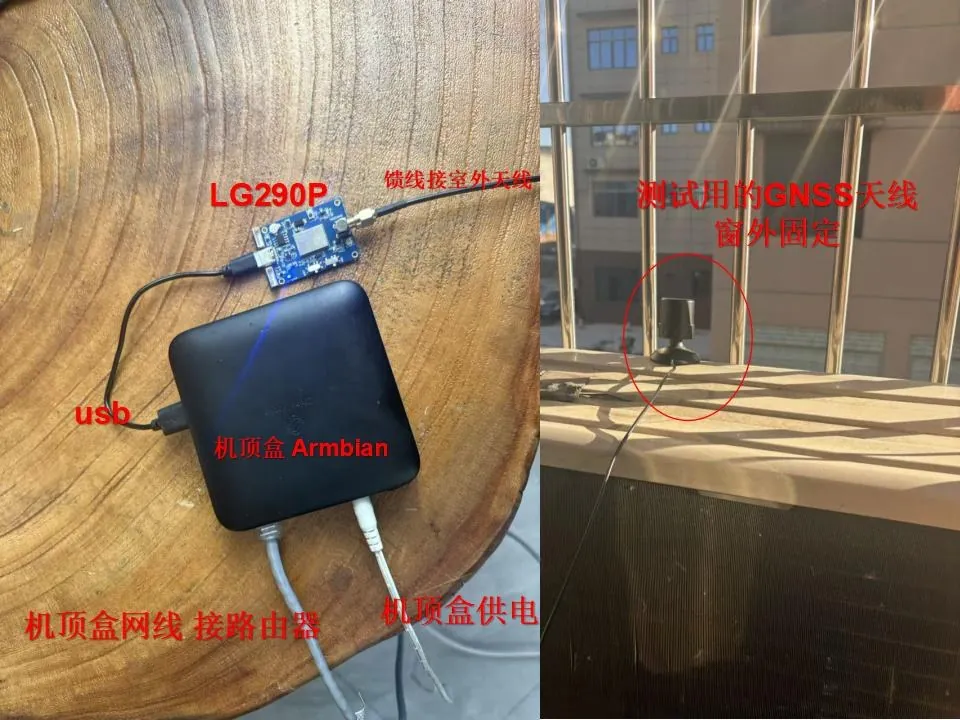
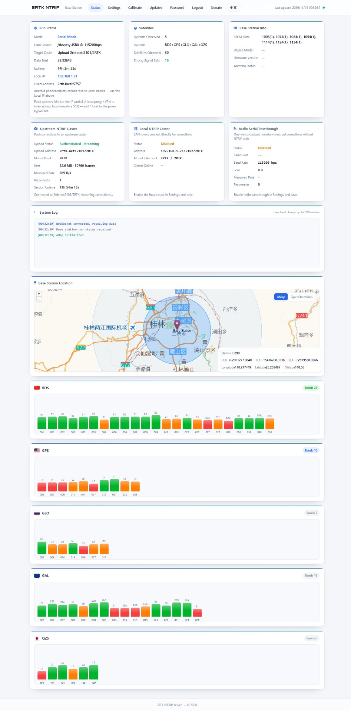
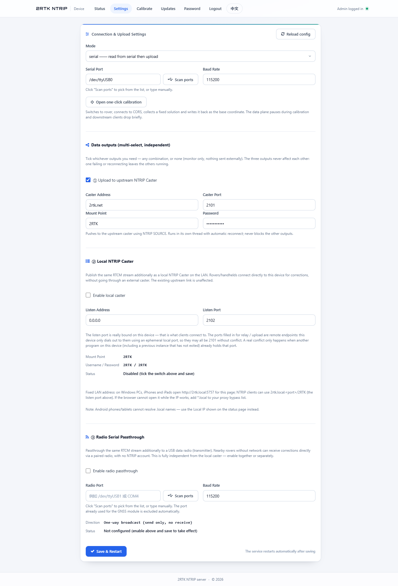
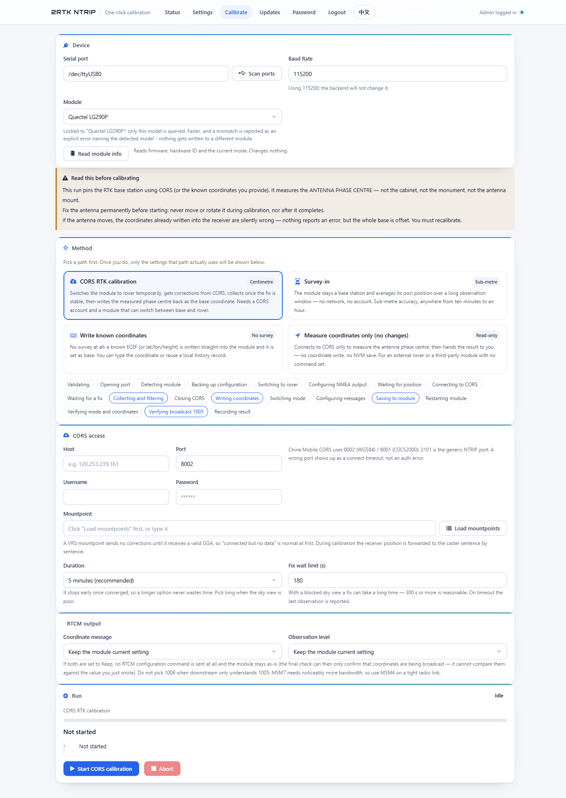

# 2RTK NTRIP Server

`GPLv3` · `Linux / Armbian` · `Python 3.8+` · `UI: English / 中文`

**English** · [中文](README.zh.md)

> One RTK base-station module + one small Armbian box + your broadband = your own GNSS base station.

A module that supports RTK base mode, wired over USB or UART into an Armbian-capable TV box,
Raspberry Pi, OneCloud, or Armbian dev board.
The program reads RTCM3 from the serial port and builds its own RTK base — or relays a mount
point sitting on another NTRIP caster:

1. It can forward to your own NTRIP caster or to RTK2GO and the like.
   For a self-hosted caster use <https://github.com/Rampump/NTRIPcaster>;
   for a quick test without running one, use <https://2rtk.com/test-caster/>.
2. It can serve a local NTRIP caster on the LAN at the same time.
3. It can also broadcast over a radio modem on a second serial port.



Wire it up as above, then mount the RTK antenna outdoors on a solid mount.

## Install

SSH or log in on the Armbian device, then paste **this entire line** into the terminal and hit Enter:

```bash
sudo apt-get install -y git && sudo rm -rf /tmp/2rtk-install && (sudo git clone --depth 1 https://gitcode.com/rampump/NTRIPserver.git /tmp/2rtk-install || (sudo rm -rf /tmp/2rtk-install && sudo git clone --depth 1 https://github.com/Rampump/2RTKserver.git /tmp/2rtk-install)) && sudo bash /tmp/2rtk-install/install.sh
```

It installs `git` if missing; it tries the GitCode mirror first and falls back to GitHub.
When it finishes, open `http://<device-ip>:5757` or `http://2rtk.local:5757` in a browser
(Windows / macOS / iOS / Linux).
The default login is **`admin`** for both username and password.

Full instructions: [INSTALL.en.md](INSTALL.en.md) · [中文](INSTALL.md).

**Complete tutorial (install → calibrate → publish):** [English](docs/tutorial.en.md) · [中文](docs/tutorial.zh.md)

## Features

- **Three independent outlets** — upstream caster push, local LAN caster, USB radio
  datalink. Enable any combination; a failing outlet never stalls the others.
- **Two kinds of source** — read RTCM3 from the module over USB serial, or relay from another
  caster (useful for re-broadcasting an upstream stream locally, or as a backup base).
- **Web calibration** (`/calibrate`) — survey the antenna position and write it into the
  module, no vendor PC tool needed. Supports CORS/VRS, Survey-in and manual entry; built-in
  profiles for Quectel LG290P, Quectel LC29H(BS) and Unicore N4. Every result is labelled
  `fixed` / `float` / `sub_meter` / `decimeter`.
- **Web upgrade** — check for updates, upgrade in one click, automatic rollback on failure,
  no SSH needed. Uninstall is deliberately SSH-only, with no browser entry point.

## Screenshots

**Status page** — source, all three outlets, live satellite and differential status at a glance.



**Configuration page** — outlets, source, and live status for each outlet.



**Calibration page** (`/calibrate`) — four mutually exclusive paths; pick one and the page
shows only the settings that path actually uses:

1. **CORS differential calibration** — the module is switched to rover temporarily, corrections
   are pulled from the CORS, and once a stable fix is reached the samples are collected and
   filtered, then written back as the base coordinate. Highest accuracy (centimetre level);
   needs a CORS account, and a module that can switch between base and rover mode.
2. **Survey-in self-convergence** — the module firmware averages its own position over a long
   window, no CORS and no account involved. Takes from a dozen minutes to an hour, the antenna
   must not move for the whole run, and the result is generally sub-metre — not centimetre.
3. **Write a known coordinate** — no survey at all: take a coordinate you already have and write
   it into the module, setting it as base. It can be typed in, reused from this device's history,
   or produced first with "measure only" and then written back.
4. **Measure only (do not touch the module)** — connect to the CORS, get the antenna coordinate,
   and stop there: no coordinate written, nothing saved to NVM. For an external rover, or for an
   unknown module with no command set: you get a coordinate back and configure the base yourself.



## How it fits together

```
   [ Geodetic antenna on a stable mount ]
                 │  feedline
                 ▼
   [ RTK module: RTCM3 over USB serial ]
                 │  USB
                 ▼
   [ Armbian box: TV box / OneCloud / Pi ]──▶ LAN ──▶ rovers, handhelds, UAV ground link
                 │  USB (optional)
                 ▼
   [ USB radio modem ] ~~~ air ~~~▶ [ rover radio ]  (no network needed)
```

**Source** (pick one):

- `serial` — read from the module. Leave the port empty to auto-scan.
- `relay` — pull from another caster (`host:port/mountpoint`, optional user/password).

**Outlets** (multi-select, fully independent):

| Outlet | What it does | Default |
| --- | --- | --- |
| ① Upload to upstream caster | NTRIP `SOURCE` push, auto-reconnect, never blocks the source | `host:2101/mountpoint` |
| ② Local NTRIP caster | Serves the same stream to the LAN; any NTRIP client works | `0.0.0.0:2102`, mount `2RTK` |
| ③ Radio datalink | One-way passthrough to a USB radio modem | auto-scanned port @ 115200 |

## Hardware

> **On real-hardware coverage**: only two modules are on hand — the **LG290P** and the
> **LC29HC** — so only those two have been tested on real hardware. The drivers and command
> sets for other models (LC29HBS, N4, …) follow the vendor manuals and are **not** yet
> verified on a device. Bear that in mind before use, and please open an issue if you hit
> something.

- **Antenna** — geodetic/survey grade on a stable mount, with the **antenna phase center
  (APC) coordinate** surveyed in advance. Corrections are computed relative to it; if it is
  wrong, every rover is shifted by the same amount and no software can fix that.
  See [INSTALL.en.md § Antenna Phase Center](INSTALL.en.md#important-locate-the-antenna-phase-center-first).
- **Receiver** — any module that streams RTCM3 over serial and can enter base mode:
  u-blox ZED-F9P, Unicore UM980/UM982, Septentrio mosaik, Trimble BD9xx, etc.
  *Web calibration* needs a built-in profile (LG290P / LC29HBS / N4); other modules still work
  as a data source, with the coordinate written by the vendor tool.
- **Host** — Armbian on an old TV box / OneCloud (tested), Raspberry Pi, Orange Pi, or any
  x86 mini PC. 512 MB RAM is plenty.
- **Radio (optional)** — any transparent USB data radio (e.g. 410–470 MHz) plus a matching
  receiver at the rover end.

<!-- 实物照片待补：把照片放到 docs/images/ 下，例如 hardware-01.jpg，然后取消下面注释 -->
<!--
| | |
| --- | --- |
|  |  |
|  |  |
-->

## Uninstall

Deliberately not available from the browser — it stops the service, removes the systemd unit
and deletes the install directory, and a confirmation dialogue is not enough protection on a
device you may only reach over the network.

```bash
sudo bash /opt/2RTKserver/uninstall.sh                       # interactive
printf 'y\ny\n' | sudo bash /opt/2RTKserver/uninstall.sh     # confirm + back both DBs up to /root
```

`2RTKserver.db` (admin password + settings) and `calibration.db` (your surveyed coordinates,
including pending `-wal`) are both copied to `/root/` before anything is deleted.

## Forgot the admin password?

There is deliberately no web reset endpoint.

```bash
sudo systemctl stop 2rtkserver
sudo /opt/2RTKserver/venv/bin/python /opt/2RTKserver/reset_config.py --yes
sudo systemctl start 2rtkserver
```

## Documentation

- [INSTALL.en.md](INSTALL.en.md) — installation, configuration, antenna phase center, troubleshooting
- [INSTALL.md](INSTALL.md) — 中文安装指南
- [CHANGELOG.md](CHANGELOG.md) — version history
- [`reset_config.py`](reset_config.py) — CLI reset of admin password and connection settings

Calibration design and field notes (mostly 中文):

- [docs/auto-calibration-design.zh.md](docs/auto-calibration-design.zh.md) — full design:
  state machine, lease/watchdog, drivers, accuracy grading, DB schema and migrations
- [docs/cors-calibration-flow.zh.md](docs/cors-calibration-flow.zh.md) — step-by-step CORS
  calibration flow with the exact serial commands at each stage
- [docs/quectel-lg290p-calibration-commands.zh.md](docs/quectel-lg290p-calibration-commands.zh.md)
  — LG290P command reference (`PQTMCFG*` / `PQTMSVIN*`) plus quirks and traps
- [docs/unicore-n4-commands-reference.zh.md](docs/unicore-n4-commands-reference.zh.md)
  — Unicore N4 (UM960/960L/980/982/UB9A0) command reference: MODE/CONFIG, RTCM/NMEA output,
  built-in NTRIP, network ports, and which commands the driver already covers
- [docs/calibration-four-methods-per-module.zh.md](docs/calibration-four-methods-per-module.zh.md)
  — four methods × three modules, side by side
- [docs/one-click-calibration-framework.zh.md](docs/one-click-calibration-framework.zh.md)
  — framework overview, the upstream entry point to the three documents above
- [docs/architecture-and-calibration-integration.zh.md](docs/architecture-and-calibration-integration.zh.md)
  — how the calibration package stays decoupled from the core
- [docs/cors-settle-stage-optimization.zh.md](docs/cors-settle-stage-optimization.zh.md)
  — why collecting right after the first fix is biased, and the settle-then-collect
  design with bin/jump guards (**P0+P1 implemented**, see its 实施记录 section)
- **Field reports** — real-hardware runs including the failures and root causes:
  [full-chain 2026-11-03](docs/lg290p-realdevice-fullchain-2026-11-03.en.md)
  ([中文](docs/lg290p-realdevice-fullchain-2026-11-03.zh.md)) ·
  [CORS field test 2026-11-02](docs/lg290p-cors-field-test-2026-11-02.zh.md)

## License & credits

Licensed under [GNU GPLv3](LICENSE). Any distributed derivative must stay GPLv3.

- Author: 文七 (Wen Qi) — i@jia.by
- Started in 2024 as a personal base-station tool; the data-source/outlet architecture, the
  radio datalink outlet, the bilingual UI and the hardening work were developed iteratively
  afterwards, with AI assistance for refactoring and review.
- Thanks to the RTKBase project for showing what a self-hosted base station should look like,
  and to the RTKLIB / pyrtcm communities for the protocol details.

Issues and PRs are welcome — especially field reports from other boards and other receiver
models.

---

## Appendix

The sections below are kept for operators who want the full picture: requirements, the fixed
LAN address, service management, ports, troubleshooting, compatibility and design notes.

### Requirements

- Linux / Armbian / Debian / Ubuntu, Python **3.8+** (3.10+ recommended)
- A serial RTK module (or a remote caster in relay mode)
- Open outbound TCP for upstream push / relay; the LAN caster needs one free TCP port
- No root-only features beyond opening the serial device and binding a port above 1024

Python packages (`requirements.txt`): `pyserial`, `pyrtcm`, `flask`, `flask-sock`, and
`zeroconf` (optional — only for the `2rtk.local` address).

### Ports, and the one gotcha worth knowing

| Port | Whose port is it | Occupies the local host? |
| --- | --- | --- |
| `5757` | this web UI | yes |
| `2101` (relay / upload) | the **remote** caster | **no** — outbound, ephemeral local port |
| `2102` (local caster) | this device | **yes** — a real `bind()` |

Relay and upload may both use 2101 while the local caster uses 2102 — not a conflict, and
why the local caster defaults to 2102.

### Fixed LAN address

The device announces itself over mDNS / DNS-SD, so you don't need to look up its IP:

```
http://2rtk.local:5757
```

- Works on Windows 10/11, macOS, iPhone / iPad, and Linux with avahi installed.
- Also usable for NTRIP clients: `2rtk.local:<listen port>/2RTK` (default `2rtk.local:2102/2RTK`).
- If another device already uses `2rtk`, this one falls back to `2rtk-2.local` — one line in
  the log, nothing to configure. The name follows the device across DHCP changes.
- Missing the `zeroconf` package? Everything else keeps working; only this alias is gone.

**Won't open?** Check the "Fixed LAN address" line on the status page first — if the name
was taken, it shows the actual fallback. If the browser reports **502 but the IP works**, a
local proxy or VPN (Clash, v2rayN, corporate VPN) is intercepting `.local`; add `*.local` to
the proxy bypass list. Quick check: `ping 2rtk.local` — an answer means mDNS is fine and the
problem is the browser/proxy layer.

**Android phones and tablets cannot resolve `.local`** — use the IP from the status page.

### Service management

```bash
sudo 2rtkserver start | stop | restart | status
journalctl -u 2rtkserver -f          # live log
tail -f /opt/2RTKserver/server.log   # or the file log (1 MB × 3 rotation)
```

### Upgrading

Already running an older version? Use `update.sh`, **not** `install.sh` — the latter ends with
`systemctl start`, a no-op for an already-running service, so the old code keeps running after
the files are replaced.

```bash
sudo rm -rf /tmp/2rtk-update && (sudo git clone --depth 1 https://gitcode.com/rampump/NTRIPserver.git /tmp/2rtk-update || (sudo rm -rf /tmp/2rtk-update && sudo git clone --depth 1 https://github.com/Rampump/2RTKserver.git /tmp/2rtk-update)) && sudo bash /tmp/2rtk-update/update.sh
```

`update.sh` keeps `2RTKserver.db`, `calibration.db`, `.calibration/` and `venv`, replacing
only program files and reinstalling dependencies. The same thing is available from
**Config → Maintenance → Upgrade now**: it pulls the newest code, verifies it (syntax
compile, import smoke test, contract tests), stops the service, waits for the ports to be
really released, swaps files, reinstalls dependencies, starts the service and waits for the
web port to answer. Any failure rolls back to the version you were running.

Two download sources are probed in parallel and the first reachable one wins — GitCode
mirror (`gitcode.com/rampump/NTRIPserver`) and GitHub (`github.com/Rampump/2RTKserver`).
The repository names differ; that is intentional. Override per device in
`/opt/2RTKserver/.upgrade/sources.json`.

### Troubleshooting

**`Address already in use` when the local caster starts.** Another process holds the port:

```bash
ss -lntp | grep :2102
```

**Upload connects but times out.** The upstream caster is not running, rejects the mount
point, or you pointed the upload at *this* device — that self-loop is rejected at save time.

**`Permission denied: /dev/ttyUSB0`.** Add the service user to `dialout`, or check
`ls -l /dev/ttyUSB0`. The installer runs the service as root, so this mainly bites manual
installs.

**No satellites / empty dashboard.** The stream arrives but carries no RTCM 1004/1012/1077-type
observations — check the module is in base mode and emitting MSM messages.

**Map tiles blank.** Network restriction only; corrections are unaffected.

**"Read module info" seems frozen.** It is scanning candidate baud rates; the page shows a
spinner, the current stage and elapsed time under the button. A factory-fresh module answers
on the first candidate — pin the model in the dropdown to skip the scan entirely.

More: [INSTALL.en.md § Troubleshooting](INSTALL.en.md).

### Compatibility

Tested on Armbian (Debian- and Ubuntu-based) on ARM TV boxes and OneCloud/玩客云 class
devices, plus x86_64 Debian. Any Linux with Python 3.8+ and USB serial should behave the same.
`install.sh` covers Debian/Ubuntu package names; on other distributions install `python3`,
`python3-venv`, `python3-pip` manually and run `server.py` directly.

### Design notes

- **No build step, no container.** Flask + SQLite + threads. Nothing to compile.
- **Blocking I/O is quarantined.** Every outlet owns a thread and a bounded queue; the source
  loop only enqueues. That is the difference between "one slow upstream pauses the serial
  port" and "three outlets fail independently".
- **Passthrough is bytes, not frames.** Outlets receive raw chunks; only the statistics parser
  re-frames, resynchronising byte by byte after a CRC failure, so a mid-frame cut costs one
  frame rather than the stream.
- **The calibration package is removable.** Delete `rtkserver/calibration/` and the program
  still runs — it is not woven into the data path.
- **Drivers own their protocol.** Command sets, baud tables, restart semantics and
  acknowledgement styles are declared per driver class, never in the workflow layer; contract
  tests fail if one model's behaviour leaks into another.
