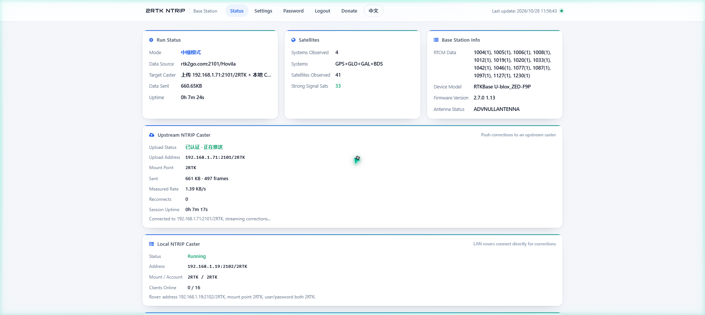
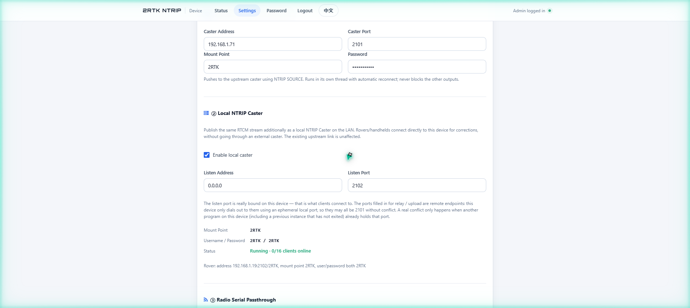

# 2RTK NTRIP Server

[](LICENSE)
[](#compatibility)
[](#requirements)
[](#web-ui)

> **One RTK module + one small Armbian box + your broadband = your own GNSS base station.**

A self-hosted NTRIP server for RTK base stations. It reads RTCM3 from a serial RTK module
(or relays the stream of another caster) and fans it out to three **independent** outlets:
push to your upstream NTRIP caster, serve a built-in LAN caster, and broadcast over a USB
radio datalink — any combination, each with its own switch.



---

## Contents

- [What it does](#what-it-does)
- [Features](#features)
- [Data flow](#data-flow)
- [Hardware](#hardware)
- [Requirements](#requirements)
- [Quick start](#quick-start)
- [Web UI](#web-ui)
- [Configuration](#configuration)
- [Read this first: antenna phase center](#read-this-first-antenna-phase-center)
- [Service management](#service-management)
- [Troubleshooting](#troubleshooting)
- [Compatibility](#compatibility)
- [Design notes](#design-notes)
- [Documentation](#documentation)
- [License & credits](#license--credits)
- [中文简介](#中文简介)

---

## What it does

A base station needs three things: a precise position, a continuous RTCM3 stream, and a way
to hand that stream to rovers. This project covers the last part — and nothing else — so it
runs happily on a 1 GHz ARM board with 512 MB of RAM.

You mount a geodetic antenna on the roof, run a feedline down to an RTK module, and plug the
module into a small Armbian box (a TV box, an OneCloud, a Raspberry Pi — anything with a USB
port). This program then:

- reads the RTCM3 stream from the module over USB serial (or pulls it from another caster),
- publishes it through any of three outlets you enable,
- shows live satellite/signal status, the base position on a map, and a raw log in the browser.

Configuration lives in a local SQLite file; there is no cloud account, no vendor service, and
no telemetry.

## Features

| | |
| --- | --- |
| **Two sources** | `serial` — read RTCM3 from a USB RTK/GNSS module (auto-scans ports, auto-detects baud). `relay` — pull from any NTRIP caster, with a "Fetch Mount Points" button that reads the peer's source table. |
| **Outlet ① upstream push** | NTRIP 1.0 `SOURCE` push to your own caster, with automatic reconnect (5 s), bounded queue (512 frames, drop-oldest), and a dedicated thread — a dead upstream can never stall the serial port. |
| **Outlet ② built-in caster** | Serves the same stream on the LAN as a real NTRIP caster: `GET /` returns a SOURCETABLE, `GET /2RTK` requires Basic auth, supports NTRIP 1.0 (`ICY 200 OK`) and 2.0 clients, up to 16 clients with per-client queues. |
| **Outlet ③ radio datalink** | Transparent one-way broadcast of the same RTCM bytes to a USB radio modem's serial port, so rovers/UAVs with no network get corrections over the air — no NTRIP account needed. |
| **Live dashboard** | Satellites per constellation (GPS/GLO/GAL/BDS) with signal bars, RTCM message inventory (1004/1005/1012/1077/1087/1097/1127/1230 …), device model and firmware from the stream itself, 500-line live log. |
| **Map** | Base position from RTCM 1005/1006, drawn with 20 km / 50 km coverage circles (AMap in China, OpenStreetMap elsewhere, with mirror fallback). |
| **Bilingual UI** | English / 中文 switch in the header, remembered per browser. |
| **Security-minded defaults** | PBKDF2-hashed admin password, login lockout (5 failures → 5 min), no unauthenticated reset endpoint, exact station coordinates hidden from anonymous visitors. |

> A single-base RTK setup is limited by ionosphere/troposphere/orbit/multipath errors: roughly
> 20 km of useful range, sometimes 50 km with dual/multi-frequency receivers. It is not a
> replacement for a national CORS network — it is what you build when you want your own.

## Data flow

```
                       ┌──────────────── data sources ────────────────┐
  roof antenna ──feed──▶│ RTK module ──USB serial──┐                   │
                       │                          ├──▶ parse RTCM ──▶ web UI (stats/map/log)
  remote caster ───────▶│ NTRIP client (relay) ────┘        │
                       └───────────────────────────────────┼──────────┘
                                                           ▼
                                              M0 distribute() — fan-out, never blocks
                                                           │
                        ┌──────────────────────────────────┼──────────────────────────────────┐
                        ▼                                  ▼                                  ▼
              ① CasterUploader thread            ② LocalCaster (listen)            ③ RadioBridge thread
              SOURCE push, queue 512             NTRIP 1.0/2.0, ≤16 clients        serial write, 115200
              upstream:2101/mount                LAN:2102/2RTK                     /dev/ttyUSB0
```

Each outlet runs in its own thread with its own queue. Bytes are forwarded **verbatim** —
no re-framing, no re-encoding — exactly as a TCP/串口 passthrough should behave. Framing
(`0xD3` + 12-bit length + CRC24Q) is only done on the *parsing* side for statistics, with
byte-wise resynchronisation so a stream cut mid-frame still recovers.

## Hardware

A typical deployment (photos to be added):

```
   [ GNSS antenna, phase center surveyed ]
                 │  feedline
                 ▼
   [ RTK module: RTCM3 over USB serial ]
                 │  USB
                 ▼
   [ Armbian box: TV box / OneCloud / Pi ]──▶ LAN ──▶ rovers, handhelds, UAV ground link
                 │  USB (optional)
                 ▼
   [ USB radio modem ] ~~~ air ~~~▶ [ rover radio ]  (no network needed)
```

- **Antenna**: a geodetic/survey antenna on a stable mount, with the **antenna phase center
  (APC) coordinate surveyed in advance** and written into the module. See
  [Read this first](#read-this-first-antenna-phase-center).
- **Receiver**: any module that streams RTCM3 over serial and can be put into base mode —
  u-blox ZED-F9P, Unicore UM980/UM982, Septentrio mosaik, Trimble BD9xx, etc.
- **Host**: Armbian on an old TV box / OneCloud works fine (tested), as do Raspberry Pi,
  Orange Pi and any x86 mini PC. 512 MB RAM is plenty; the process idles well under 100 MB.
- **Radio (optional)**: any transparent USB data radio (e.g. 410–470 MHz modules) plus a
  matching receiver at the rover end.

<!-- 实物照片待补：把照片放到 docs/images/ 下，例如 hardware-01.jpg，然后取消下面注释 -->
<!--
| | |
| --- | --- |
|  |  |
|  |  |
-->

## Requirements

- Linux / Armbian / Debian / Ubuntu, Python **3.8+** (3.10+ recommended)
- A serial RTK module (or a remote caster in relay mode)
- Open outbound TCP for upstream push / relay; the LAN caster needs one free TCP port
- No root-only features beyond opening the serial device and binding a port above 1024

Python packages (`requirements.txt`): `pyserial`, `pyrtcm`, `flask`, `flask-sock`.

## Quick start

```bash
git clone https://github.com/Rampump/2RTKserver.git
cd 2RTKserver
chmod +x install.sh
sudo ./install.sh
```

Then open `http://<device-ip>:5757` and log in with **`admin` / `admin`** — change the
password immediately.

The installer creates a venv under `/opt/2RTKserver`, installs dependencies, writes a
systemd unit (`2rtkserver`, auto-start + auto-restart), and adds the `2rtkserver` helper
command. Full walkthrough: [INSTALL.en.md](INSTALL.en.md) · [INSTALL.md](INSTALL.md).

Running without the installer is also fine:

```bash
pip install -r requirements.txt
python3 server.py
```

## Web UI

**Settings** — mode, the three outlet switches, and live status of each outlet on the same
page. Fields only appear (and become required) when their switch is on, so an unused outlet
can never block a save.


**Local caster block** — the listen port is the one port that is really bound on this device;
the ports typed for relay/upload are *remote* endpoints and never occupy a local port.



## Configuration

**Source** (pick one):

- `serial` — read from the module. Leave the port empty to auto-scan; baud 115200/230400/460800 depending on the module.
- `relay` — pull from another caster (`host:port/mountpoint`, with optional user/password).
  Useful for re-broadcasting a public stream locally, or for a second base as backup.

**Outlets** (multi-select, fully independent):

| Outlet | What it does | Default |
| --- | --- | --- |
| ① Upload to upstream caster | NTRIP `SOURCE` push, auto-reconnect, never blocks the source | `host:2101/mountpoint` |
| ② Local NTRIP caster | Serves the same stream to the LAN; any NTRIP client works | `0.0.0.0:2102`, mount `2RTK`, user/pass `2RTK` |
| ③ Radio datalink | One-way passthrough to a USB radio modem | port you pick (auto-scan) @ 115200 |

**Ports, and the one gotcha worth knowing:**

| Port | Whose port is it | Occupies the local host? |
| --- | --- | --- |
| `5757` | this web UI | yes |
| `2101` (relay / upload) | the **remote** caster | **no** — outbound connect uses an ephemeral local port |
| `2102` (local caster) | this device | **yes** — a real `bind()` |

So relay and upload may both use 2101 while the local caster uses 2102 — that is not a
conflict, and it is why the local caster defaults to 2102. A real conflict only happens when
another program on the device (including a previous instance that has not exited) already
holds the port you want to listen on. The settings page checks this before saving and, on
Linux, names the process holding the port.

## Read this first: antenna phase center

Corrections are computed **relative to the antenna phase center (APC)**. If that coordinate is
wrong, every rover is shifted by the same amount, and no amount of software can fix it.

Survey the APC first (static session on a known point, or an existing control point), write
the resulting ECEF / lat-lon-height into the module, and verify it appears in RTCM 1005/1006 —
the map and the caster's STR record read it from there. Details and methods:
[INSTALL.en.md § Antenna Phase Center](INSTALL.en.md#important-locate-the-antenna-phase-center-first).

## Service management

```bash
sudo 2rtkserver start | stop | restart | status
journalctl -u 2rtkserver -f          # live log
tail -f /opt/2RTKserver/server.log   # or the file log (1 MB × 3 rotation)
```

Update / uninstall:

```bash
sudo ./update.sh      # backs up the DB, copies new files, reinstalls deps, restarts
sudo ./uninstall.sh   # prompts to back up the DB, then removes service + install dir
```

Forgot the admin password? There is deliberately no web reset endpoint:

```bash
sudo systemctl stop 2rtkserver
sudo /opt/2RTKserver/venv/bin/python /opt/2RTKserver/reset_config.py --yes
sudo systemctl start 2rtkserver
```

## Troubleshooting

**`Address already in use` when the local caster starts.** Another process holds the listen
port. Find it and either free it or change the port:

```bash
ss -lntp | grep :2102
sudo lsof -i :2102
```

**Upload connects but times out.** Usually the upstream caster is not running, rejects the
mount point, or you pointed the upload at *this* device (`127.0.0.1` + the local caster's
port) — that self-loop is now rejected at save time.

**`Permission denied: /dev/ttyUSB0`.** Add the service user to `dialout`, or check
`ls -l /dev/ttyUSB0`. The default installer runs the service as root, so this mainly bites
manual installs.

**No satellites / empty dashboard.** The stream is arriving but no RTCM 1004/1012/1077-type
observations are in it — check that the module is in base mode and actually emitting MSM
messages.

**Map tiles blank.** Network restriction only; corrections are unaffected.

## Compatibility

Tested on Armbian (Debian- and Ubuntu-based) on ARM TV boxes and OneCloud/玩客云 class
devices, plus x86_64 Debian. Any Linux with Python 3.8+ and USB serial should behave the same.
`install.sh` covers Debian/Ubuntu package names; on other distributions install
`python3`, `python3-venv`, `python3-pip` manually and run `server.py` directly.

## Design notes

- **Single file, no build step.** `server.py` (~3.6k lines) holds the web app, the RTCM
  parser, the serial/relay loops, the uploader, the caster and the radio bridge. SQLite for
  config. Nothing to compile, nothing to containerise.
- **Blocking I/O is quarantined.** Every outlet owns a thread and a bounded queue; the source
  loop only ever enqueues. This is the difference between "one slow upstream pauses the serial
  port" and "three outlets fail independently".
- **Passthrough is bytes, not frames.** Outlets receive raw chunks; only the statistics parser
  re-frames, and it resynchronises byte by byte after a CRC failure so a mid-frame cut costs
  one frame, not the stream.
- **Restart-safe ports.** The local caster's accept loop uses a 1 s socket timeout, `stop()`
  does `shutdown()` then `close()`, and `start()` retries the bind with backoff — so
  "save and restart" does not leave the port wedged.

## Documentation

- [INSTALL.en.md](INSTALL.en.md) — English installation guide (incl. antenna phase center methods)
- [INSTALL.md](INSTALL.md) — 中文安装指南
- [`reset_config.py`](reset_config.py) — CLI reset of admin password and connection settings

## License & credits

Licensed under [GNU GPLv3](LICENSE). Any distributed derivative must stay GPLv3.

- Author: 文七 (Wen Qi) — i@jia.by
- Started in 2024 as a personal base-station tool; the current data-source/outlet
  architecture, the radio datalink outlet, the bilingual UI and the hardening work were
  developed iteratively afterwards, with AI assistance for refactoring and review.
- Thanks to the RTKBase project for showing what a self-hosted base station should look like,
  and to the RTKLIB / pyrtcm communities for the protocol details.

Issues and PRs are welcome — especially field reports from other boards and other receiver
models.

---

## 中文简介

一个自建的 RTK 基准站 NTRIP 服务端：接一个 RTK 模块（天线架在楼顶，馈线拉到模块，天线相位中心的
ECEF 坐标提前测好写进模块），模块插到刷了 Armbian 的机顶盒 / 玩客云这类小主机上，跑这个程序，
用浏览器访问 `http://设备IP:5757` 就能配置和看状态。

三个数据出口互相独立、可任意勾选：上传到自己的 NTRIP Caster、同时开一个本地局域网的 Caster
给移动站/手簿直连、或者接一个 USB 数传模块把差分直接播给附近的流动站和无人机；数据源也可以反过来
选 relay，从别的 Caster 拉流再分发。

安装、天线相位中心定位方法、故障排除见 [INSTALL.md](INSTALL.md)，本文件上方为英文说明。
