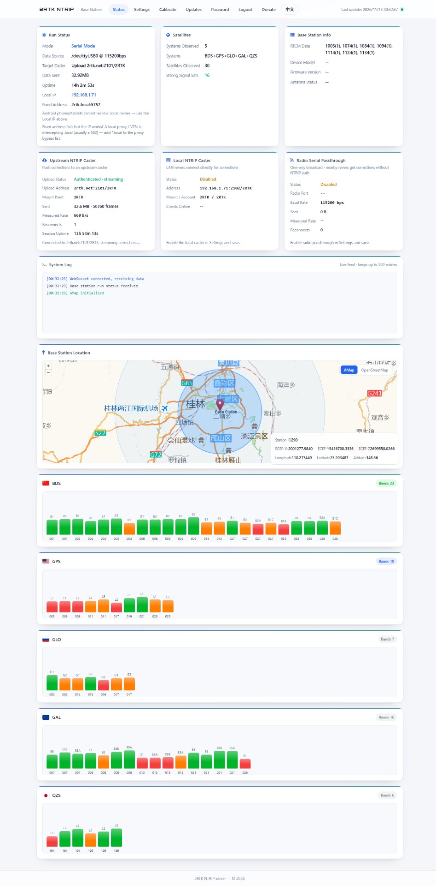
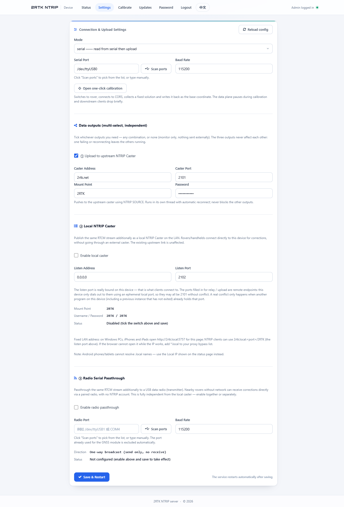
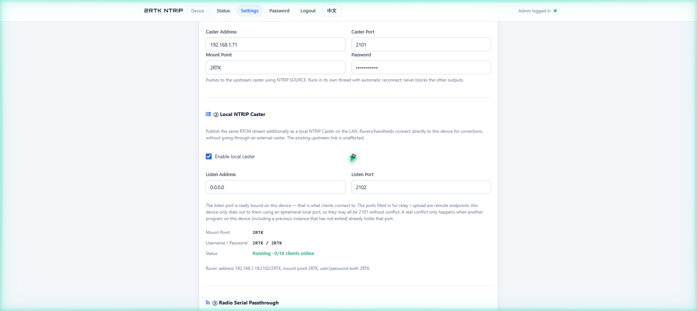

# 2RTK NTRIP Server

[](LICENSE)
[](#兼容性)
[](#运行要求)

[English](README.md) · **中文**

> 一个 RTK 模块 + 一个小主机 + 宽带 = 你自己的 GNSS 基准站。

自建的 RTK 基准站 NTRIP 服务端。从串口 RTK 模块读 RTCM3（或 relay 别的 Caster 的流），
分发到**三个互相独立**的出口：上传到上游 Caster、开一个局域网内置 Caster、
通过 USB 数传模块播发 —— 任意组合，各有各的开关。基准站标定直接在浏览器里做。



## 一键安装

复制下面**这一整行**到设备终端里回车：

```bash
sudo apt-get install -y git && sudo rm -rf /tmp/2rtk-install && (sudo git clone --depth 1 https://gitcode.com/rampump/NTRIPserver.git /tmp/2rtk-install || (sudo rm -rf /tmp/2rtk-install && sudo git clone --depth 1 https://github.com/Rampump/2RTKserver.git /tmp/2rtk-install)) && sudo bash /tmp/2rtk-install/install.sh
```

缺 `git` 会先装 `git`；先试国内 GitCode 镜像，连不上再退到 GitHub。
装完浏览器打开 `http://设备IP:5757`，账号密码都是 **`admin`**，进去第一件事改密码。

已经装过旧版本？用 [`update.sh`](#升级) 或网页里的 **系统维护 → 立即升级**，
配置和已测坐标都会保留。

完整说明见 [INSTALL.md](INSTALL.md) · [English](INSTALL.en.md)。

> **从 Windows 复制粘贴的坑**：直接粘贴，不要手打。这一行是纯 ASCII、没有换行，
> 能完整黏贴过去；但 `CR LF` 换行、全角标点（，；：）、以及窗口太窄导致命令折行，
> 这三种情况都会让它失败。

## 功能

- **三个独立出口** —— 上传上游 Caster、局域网内置 Caster、USB 数传播发。
  任意勾选组合；某个出口挂了不会拖住另外两个。
- **两种数据源** —— 从模块经 USB 串口读 RTCM3，或 relay 别的 Caster
  （适合把上游流在本地再播一遍，或做备用基准站）。
- **网页端标定**（`/calibrate`）—— 测量天线位置并写进模块，不用厂家上位机。
  支持 CORS/VRS、Survey-in、手动输入；内置 Quectel LG290P、Quectel LC29H(BS)、
  Unicore N4 的型号档案。每条结果都标注 `fixed` / `float` / `sub_meter` / `decimeter`
  —— 天线被挡住时给一个诚实的等级，而不是假装成功。
- **写后回读校验** —— 写入坐标后回读 RTCM 1005/1006 逐项比对，
  播出去的和写进去的不一致就判失败。
- **自动识别模块** —— 波特率是从模块**回读**的，不是猜的；按型号记住，下次直接用。
  波特率框留空即可，程序自己判断。
- **固定地址访问** —— `http://2rtk.local:5757`，Windows / macOS / iOS / Linux 都能解析，
  不用记 IP。名字被占用时自动退成 `2rtk-2.local`。
- **中英双语界面** —— 运行时随时切换。
- **自包含** —— 配置存 SQLite，没有云账号、没有厂商服务、没有遥测。
  1 GHz ARM 板 + 512 MB 内存跑得动。
- **网页升级** —— 检查更新、一键升级、失败自动回滚，不用 SSH。
  卸载刻意只留 SSH，不给浏览器入口。

## 截图

| 配置页 —— 出口、数据源、各出口实时状态 |
| --- |
|  |

| 本地 Caster —— 本机唯一真正 bind 的端口 |
| --- |
|  |

**标定页**（`/calibrate`）—— 选方式、看阶段进度与实时质量指示，最后当场给出坐标与精度等级。
历史列表可以复用之前的结果（前提是同一根天线）。

**系统维护**（`/upgrade`）—— 检查更新、一键升级（自动回滚），以及仅 SSH 的卸载说明。

## 系统构成

```
   [ 楼顶大地型天线，稳固安装 ]
                 │  馈线
                 ▼
   [ RTK 模块：RTCM3 over USB 串口 ]
                 │  USB
                 ▼
   [ Armbian 主机：机顶盒 / 玩客云 / 树莓派 ]──▶ 局域网 ──▶ 流动站、手簿、无人机地面链路
                 │  USB（可选）
                 ▼
   [ USB 数传模块 ] ~~~ 空中 ~~~▶ [ 流动站数传 ]  （不需要任何网络）
```

**数据源**（二选一）：

- `serial` —— 从模块读。串口留空则自动扫描。
- `relay` —— 从别的 Caster 拉流（`host:port/mountpoint`，可选用户名密码）。

**出口**（可多选，完全独立）：

| 出口 | 作用 | 默认值 |
| --- | --- | --- |
| ① 上传上游 Caster | NTRIP `SOURCE` 推送，自动重连，永不阻塞数据源 | `host:2101/mountpoint` |
| ② 局域网 Caster | 把同一路流服务给局域网，任意 NTRIP 客户端可连 | `0.0.0.0:2102`，挂载点 `2RTK` |
| ③ 数传播发 | 单向透传到 USB 数传模块 | 自动扫描端口 @ 115200 |

**端口，以及唯一值得记住的那个坑**：

| 端口 | 这是谁的端口 | 占不占本机？ |
| --- | --- | --- |
| `5757` | 本程序的网页界面 | 占 |
| `2101`（relay / 上传） | **远端** Caster 的 | **不占** —— 出站连接用的是临时本地端口 |
| `2102`（本地 Caster） | 本机的 | **占** —— 真的 `bind()` 了 |

所以 relay 和上传可以同时用 2101，而本地 Caster 用 2102，这不冲突 ——
也正是本地 Caster 默认 2102 的原因。

## 硬件

- **天线** —— 大地测量 / 测量型，稳固安装，**天线相位中心（APC）坐标要事先测好**。
  差分是相对相位中心算的；这个坐标错了，所有流动站都会整体偏移，软件救不回来。
  方法见 [INSTALL.md § 先定位天线相位中心点](INSTALL.md#重要先定位天线相位中心点)。
- **接收机** —— 任何能通过串口输出 RTCM3、能进入基准站模式的模块：
  u-blox ZED-F9P、Unicore UM980/UM982、Septentrio mosaik、Trimble BD9xx 等。
  **网页端标定**需要内置型号档案（LG290P / LC29HBS / N4）；其他模块照样能当数据源用，
  坐标用厂家工具写进去即可。
- **主机** —— 老机顶盒 / 玩客云刷 Armbian（已实测）、树莓派、香橙派，
  或任意 x86 小主机。512 MB 内存足够。
- **数传（可选）** —— 任意透明传输的 USB 数传模块（如 410–470 MHz），
  流动站端配一个对应接收机。

<!-- 实物照片待补：把照片放到 docs/images/ 下，例如 hardware-01.jpg，然后取消下面注释 -->
<!--
| | |
| --- | --- |
|  |  |
|  |  |
-->

## 运行要求

- Linux / Armbian / Debian / Ubuntu，Python **3.8+**（建议 3.10+）
- 一个串口 RTK 模块（或 relay 模式下的一台远端 Caster）
- 上传 / relay 需要出站 TCP；局域网 Caster 需要一个空闲 TCP 端口
- 除了打开串口设备和 bind 1024 以上端口，不需要任何 root 特权功能

依赖（`requirements.txt`）：`pyserial`、`pyrtcm`、`flask`、`flask-sock`，
以及 `zeroconf`（可选 —— 只用于 `2rtk.local`，不装也能跑）。

## 固定地址访问

程序启动后通过 mDNS / DNS-SD 把自己广播出去，不用先查 IP：

```
http://2rtk.local:5757
```

- Windows 10/11、macOS、iPhone / iPad、装了 avahi 的 Linux 都能解析。
- NTRIP 客户端也能用：`2rtk.local:<监听端口>/2RTK`（默认 `2rtk.local:2102/2RTK`）。
- 局域网里已有设备占了 `2rtk`，本机会自动退成 `2rtk-2.local` —— 日志里一行提示，
  不用配任何东西。DHCP 换了 IP，这个名字照样跟着走。
- 没装 `zeroconf` 包？其他功能照常，只是没有这个别名。

**打不开怎么办？** 先看状态页上的「固定地址」那一行 —— 名字被占用时它显示的是实际的
退让名。如果浏览器报 **502 但 IP 能开**，是本机代理或 VPN（Clash、v2rayN、公司 VPN）
把 `.local` 劫走了，把 `*.local` 加进代理绕过列表。快速判断：`ping 2rtk.local`，
有回应说明 mDNS 正常，问题在浏览器/代理层。

**安卓手机和平板不解析 `.local`** —— 用状态页上的 IP 访问。

## 服务管理

```bash
sudo 2rtkserver start | stop | restart | status
journalctl -u 2rtkserver -f          # 实时日志
tail -f /opt/2RTKserver/server.log   # 或看文件日志（1 MB × 3 轮转）
```

### 升级

用 `update.sh`，**不要**用 `install.sh` —— 后者结尾的 `systemctl start`
对已在运行的服务是空操作，文件换完了旧代码还在跑。

```bash
sudo rm -rf /tmp/2rtk-update && (sudo git clone --depth 1 https://gitcode.com/rampump/NTRIPserver.git /tmp/2rtk-update || (sudo rm -rf /tmp/2rtk-update && sudo git clone --depth 1 https://github.com/Rampump/2RTKserver.git /tmp/2rtk-update)) && sudo bash /tmp/2rtk-update/update.sh
```

`update.sh` 会保留 `2RTKserver.db`、`calibration.db`、`.calibration/` 和 `venv`，
只换程序文件并重装依赖。网页上 **系统维护 → 立即升级** 效果一致：拉取最新代码、
校验（语法编译、导入冒烟、契约测试）、停服务、等端口真正释放、换文件、装依赖、
起服务、等网页端口应答。任何一步失败都自动回滚到原版本。

两个下载源并行探测，先通的赢 —— GitCode 镜像（`gitcode.com/rampump/NTRIPserver`）
和 GitHub（`github.com/Rampump/2RTKserver`）。两边仓库名不一样，这是有意的。
可在 `/opt/2RTKserver/.upgrade/sources.json` 里按设备覆盖。

### 卸载

刻意不给浏览器入口 —— 它会停服务、删 systemd 单元、删掉整个安装目录，
在你只能远程访问的设备上，一个确认对话框不足以拦住误点。

```bash
sudo bash /opt/2RTKserver/uninstall.sh                       # 交互式
printf 'y\ny\n' | sudo bash /opt/2RTKserver/uninstall.sh     # 确认卸载 + 两个库都备份到 /root
```

`2RTKserver.db`（管理员口令 + 连接设置）和 `calibration.db`（你实测的基准站坐标，
含未合并的 `-wal`）都会在删除任何东西之前先拷到 `/root/`。

### 忘记管理员密码？

刻意没有网页重置接口。

```bash
sudo systemctl stop 2rtkserver
sudo /opt/2RTKserver/venv/bin/python /opt/2RTKserver/reset_config.py --yes
sudo systemctl start 2rtkserver
```

## 故障排除

**本地 Caster 启动时报 `Address already in use`。** 端口被别的进程占了：

```bash
ss -lntp | grep :2102
```

**上传能连上但超时。** 上游 Caster 没开、拒绝了挂载点，或者你把上传指到了**本机**
（`127.0.0.1` + 本地 Caster 端口）—— 这种自环现在在保存时就被拒绝。

**`Permission denied: /dev/ttyUSB0`。** 把服务用户加进 `dialout`，或检查
`ls -l /dev/ttyUSB0`。安装脚本是以 root 跑服务的，所以这主要影响手动安装。

**没有卫星 / 面板空的。** 流是通的，但里面没有 1004/1012/1077 这类观测数据 ——
检查模块是否处于基准站模式、是否真的在发 MSM 电文。

**地图瓦片空白。** 只是网络限制，不影响差分数据。

**「读取模块信息」像是卡住了。** 它在逐档扫描波特率；按钮下方有转圈、当前阶段和已用时间。
出厂全新的模块第一档就通；在型号下拉框里指定型号可以完全跳过扫描。

更多见 [INSTALL.md § 故障排除](INSTALL.md)。

## 兼容性

已在 Armbian（Debian / Ubuntu 系）的 ARM 机顶盒、玩客云类设备，以及 x86_64 Debian 上测过。
任何有 Python 3.8+ 和 USB 串口的 Linux 应该都一样。`install.sh` 覆盖的是
Debian/Ubuntu 的包名；别的发行版请手动装 `python3`、`python3-venv`、`python3-pip`，
直接跑 `server.py`。

## 设计取舍

- **没有构建步骤，没有容器。** Flask + SQLite + 线程，没有东西要编译。
- **阻塞 I/O 被隔离。** 每个出口一个线程 + 一个有界队列，数据源循环只负责入队。
  这就是"一个慢上游拖住串口"和"三个出口各自失败互不影响"的区别。
- **透传的是字节，不是帧。** 出口拿到的是原始数据块；只有统计解析器会重新分帧，
  且 CRC 失败后逐字节重新同步 —— 帧中间被切断只损失一帧，不损失整条流。
- **标定包可以整个删掉。** 删掉 `rtkserver/calibration/`，程序照常运行，
  它没有织进数据通路里。
- **驱动自己拥有协议。** 命令集、波特率表、重启语义、应答风格都由各驱动类声明，
  绝不写进流程层；某个型号的行为一旦渗到别的型号，契约测试就会变红。

## 文档

- [INSTALL.md](INSTALL.md) —— 安装、配置、天线相位中心、故障排除
- [INSTALL.en.md](INSTALL.en.md) — English installation guide
- [CHANGELOG.md](CHANGELOG.md) —— 版本更新记录
- [`reset_config.py`](reset_config.py) —— 命令行重置管理员口令与连接设置

标定设计与现场记录：

- [docs/auto-calibration-design.zh.md](docs/auto-calibration-design.zh.md) ——
  完整设计：状态机、租约/看门狗、驱动、精度分级、库结构与迁移
- [docs/cors-calibration-flow.zh.md](docs/cors-calibration-flow.zh.md) ——
  逐步走 CORS 标定流程，标出每个阶段的确切串口命令
- [docs/quectel-lg290p-calibration-commands.zh.md](docs/quectel-lg290p-calibration-commands.zh.md)
  —— LG290P 命令参考（`PQTMCFG*` / `PQTMSVIN*`）与踩过的坑
- [docs/calibration-four-methods-per-module.zh.md](docs/calibration-four-methods-per-module.zh.md)
  —— 四种方式 × 三个模块逐行对照
- [docs/one-click-calibration-framework.zh.md](docs/one-click-calibration-framework.zh.md)
  —— 框架总览，上面三份文档的上游入口
- [docs/architecture-and-calibration-integration.zh.md](docs/architecture-and-calibration-integration.zh.md)
  —— 标定包如何与核心解耦
- **真机测试报告** —— 含失败、根因与修法：
  [全链路 2026-11-03](docs/lg290p-realdevice-fullchain-2026-11-03.zh.md)
  （[English](docs/lg290p-realdevice-fullchain-2026-11-03.en.md)）·
  [CORS 外场测试 2026-11-02](docs/lg290p-cors-field-test-2026-11-02.zh.md)

## 许可与致谢

以 [GNU GPLv3](LICENSE) 发布。任何分发出去的衍生作品必须保持 GPLv3。

- 作者：文七 — i@jia.by
- 2024 年起作为个人基准站工具开始，之后逐步演进出现在这套"数据源 / 出口"架构、
  数传出口、双语界面与各项加固，重构与审查过程中有 AI 协助。
- 感谢 RTKBase 项目展示了自建基准站该长什么样，
  感谢 RTKLIB / pyrtcm 社区提供的协议细节。

欢迎提 issue 和 PR —— 尤其是来自其他板子、其他接收机型号的现场反馈。
