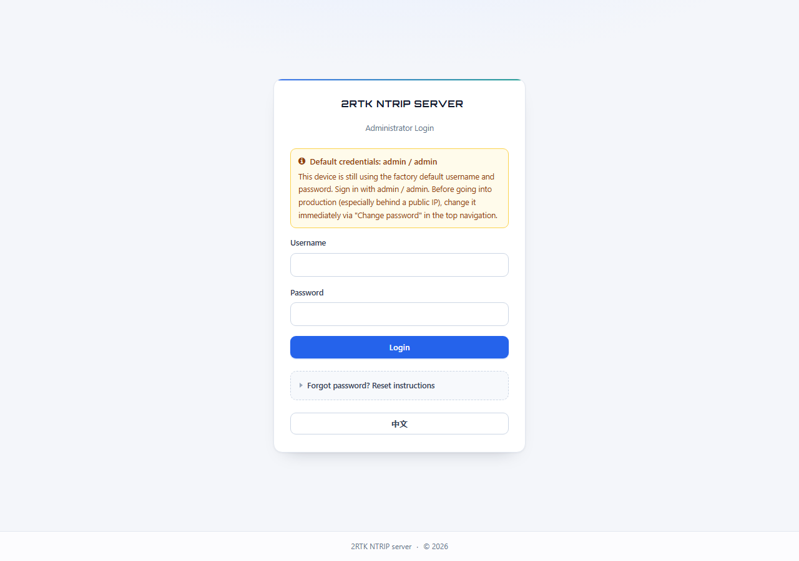
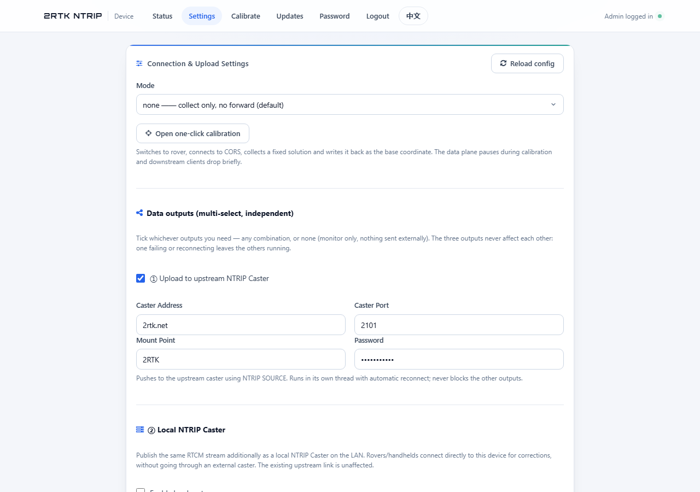
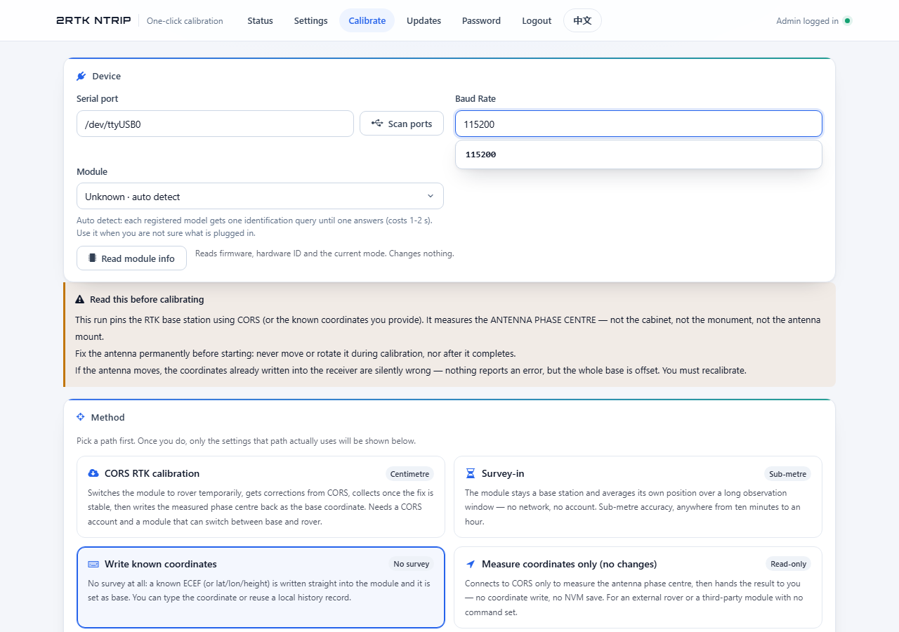
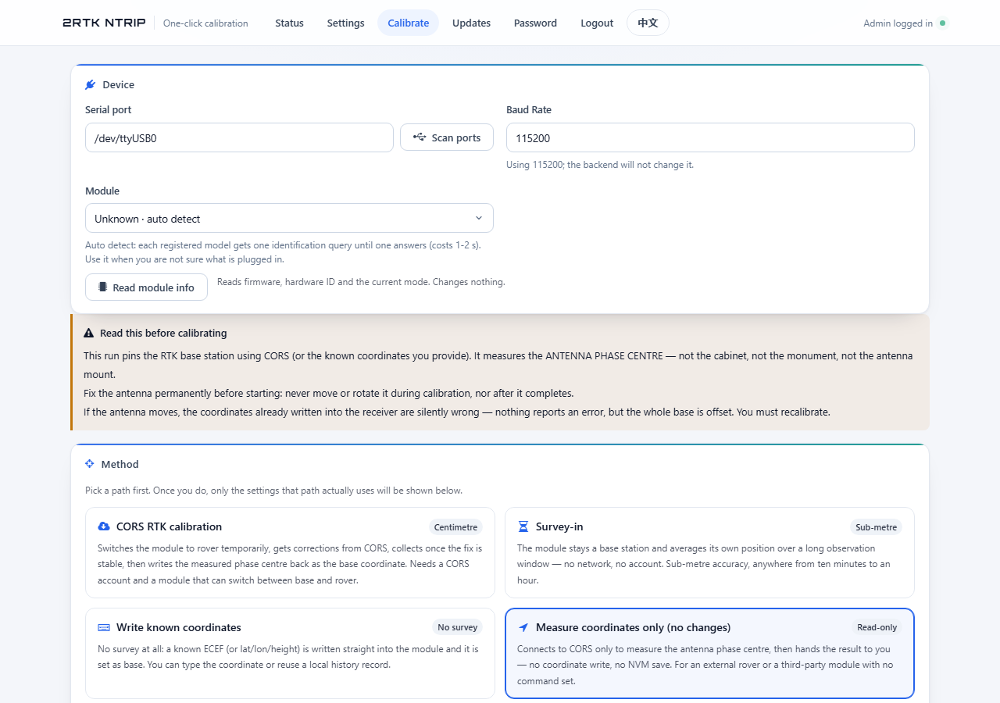
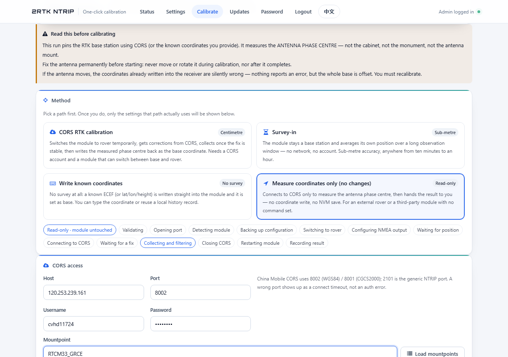
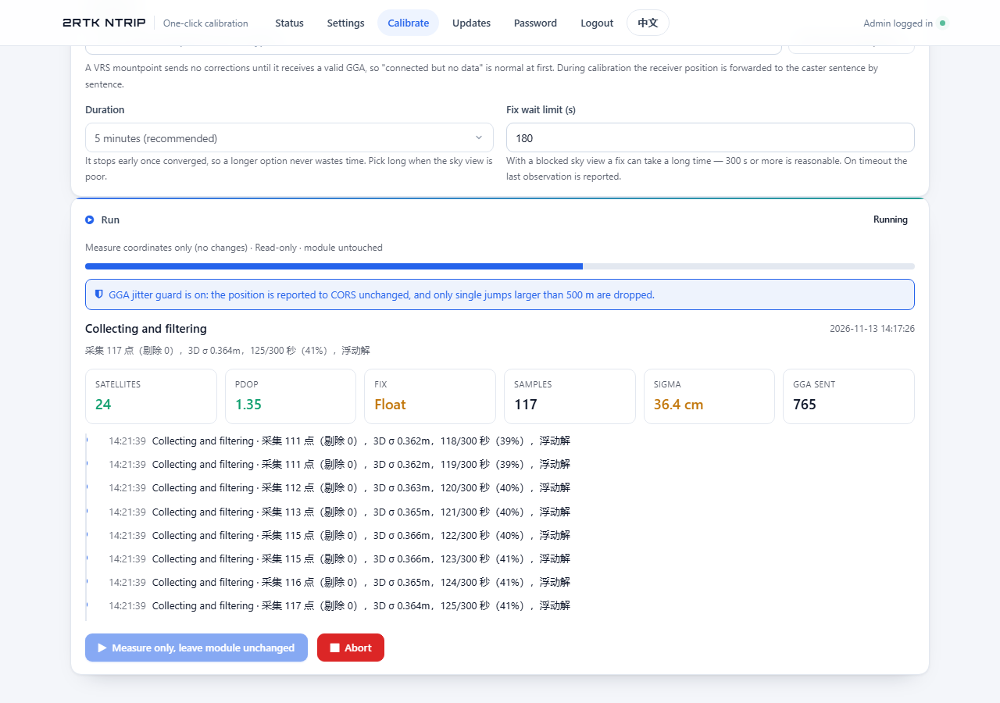
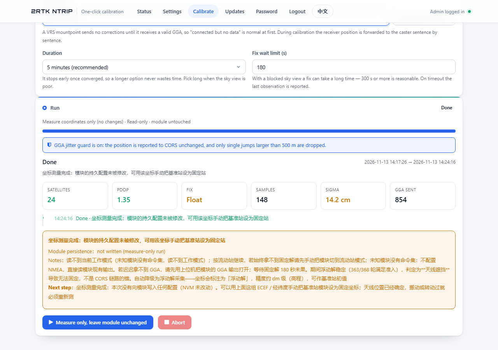

# Measuring the Antenna Phase Centre with a Rover Module (Measure-Only Calibration)

> 中文版：[tutorial-rover-measure.zh.md](tutorial-rover-measure.zh.md)
> All screenshots use the **English** Web UI.

The coordinate a base station broadcasts must be the **antenna phase centre (APC)** —
not the enclosure, not the monument, not the antenna mount.
When all you have is a **rover module** (or a third-party module with no command set
that the program cannot identify), and you must not — or cannot — change its configuration,
use the fourth calibration method: **Measure coordinates only (no changes)**.

It connects to a CORS, measures the antenna coordinate, and stops:
**no coordinate write, no message configuration, no NVM save, no module reboot**.
You then take that coordinate and give it to the base-station module
("Write known coordinates").

---

## 1. When to use this path

| Situation | Method |
| --- | --- |
| Dual-mode module (e.g. LG290P), want the coordinate written into the base in one run | CORS RTK calibration |
| Module firmware can converge on its own, no network wanted | Survey-in |
| You already have a coordinate and only need to write it | Write known coordinates |
| **External rover / module with no command set, you only need the antenna coordinate** | **Measure coordinates only** ← this guide |

Prerequisites:

- 2RTKserver installed and running; Web UI reachable (default `http://<device-ip>:5757`).
- The antenna is **permanently fixed** with a clear sky view. Never move or rotate it
  during calibration, or afterwards.
- A working NTRIP / CORS account.
- The rover module must emit **NMEA GGA** over serial, and its **RX must accept RTCM3**
  corrections (both TX and RX wired).
- VRS mountpoints require a GGA uplink before they generate corrections. The program
  forwards GGA sentence by sentence — nothing to do manually.

---

## 2. Step 1 — set the data source to `none` (essential)



Log in as administrator. The `中文` button in the top bar switches the UI to English.



Go to **Settings → Mode**, choose **none — collect only, no forward (default)**,
then click **Save & Restart**.

**Why this matters**: in `none` mode the main program starts no data-plane module and
therefore **does not hold the serial port**. Calibration needs exclusive access to it.
If the source stays on `serial`, both sides read the same bytes.
The status page will show "Waiting for configuration" afterwards — expected, not a fault.
Set Mode back to `serial` once calibration is finished to resume normal streaming.

> Downstream NTRIP clients are interrupted for the duration of the run
> (the confirmation dialog quotes ~420 seconds). This is normal.

---

## 3. Step 2 — device settings on the Calibrate page



- **Serial port**: usually filled in automatically (`/dev/ttyUSB0` in this run).
- **Baud rate**: **enter the module's real baud rate explicitly** (`115200` here).
  Leaving it empty makes the program enumerate common rates; on an unidentifiable
  module that can take several minutes and still fail. With an explicit value the page
  shows *Using 115200; the backend will not change it* and skips the scan entirely.
- **Module**: leave **Unknown · auto detect**. Do not force a model on a module
  that has no command set.

"Read module info" is optional. A module with no command set will be reported as
"no driver claimed this module" — **that is fine**, because `external_rover` depends only
on the module's NMEA output, not on any driver command. In this run detection failed,
while the port kept streaming standard `$GNRMC` / `$GNGGA` at 10 Hz
(24–26 satellites, PDOP 0.56–1.45).

---

## 4. Step 3 — choose "Measure coordinates only (no changes)"



Under **Method**, pick the fourth card **Measure coordinates only (no changes)** (Read-only).
The page then shows only the settings this path actually uses, plus its stage chain:

```
Read-only · module untouched → Validating → Opening port → Detecting module
→ Backing up configuration → Switching to rover → Configuring NMEA output
→ Waiting for position → Connecting to CORS → Waiting for a fix
→ Collecting and filtering → Closing CORS → Restarting module → Recording result
```

---

## 5. Step 4 — CORS settings and choosing the mountpoint



| Field | This run |
| --- | --- |
| Host | `120.253.239.161` |
| Port | `8002` (WGS84; `8001` is CGCS2000, `2101` is the generic NTRIP port) |
| Username / Password | your CORS account (**never put real credentials in public docs/screenshots**) |
| Mountpoint | `RTCM33_GRCE` |
| Duration | `5 minutes (recommended)` |
| Fix wait limit | `180` s |

**Load mountpoints** fetches the full sourcetable. Choose by module capability, not by
copying someone else's mountpoint:

1. **Find the constellations the module supports** from its GSV sentences. This module
   emits `GPGSV` (GPS), `BDGSV` (BeiDou), `GAGSV` (Galileo) and `GLGSV` (GLONASS),
   with **no QZSS** — a four-constellation receiver.
2. **Read `format-details` in the sourcetable**. Under this account:
   - `RTCM33_GRCE` = `4sat-11freq`, RTCM 3.3, MSM4
     `1074/1084/1094/1124(1)` + `1005/1033(10)` → **GPS + GLO + GAL + BDS, an exact match**
   - `RTCM33_GRCEJ` = `5sat-16freq`, adds `1114` (QZSS) — useless for this module,
     just extra downlink bytes
   - `RTCM30_GR` (RTCM 3.0 legacy), `RTCM33_C` (BeiDou only) and `RTCM23_G` (RTCM 2.3)
     are all less portable than MSM4
3. **Conclusion**: four-constellation rover → `RTCM33_GRCE`. If your module really
   supports QZSS, switch to `RTCM33_GRCEJ` (5sat-16freq).

> "Connected but no data" for the first moments is normal: a VRS mountpoint generates
> its virtual reference station only after receiving a valid GGA uplink.

---

## 6. Step 5 — start, then leave it alone

Click **Measure only, leave module unchanged**. The confirmation dialog restates
"no coordinate write, no NVM save" and the expected downtime; click **Start**.

**Do not interfere afterwards**: don't unplug/replug the serial device, don't change
Settings, don't send vendor commands. Calibration holds the port under a lease and
returns it when done.



Stages and what the read-only path actually does:

| Stage | Read-only behaviour |
| --- | --- |
| `HOLD` / `OPEN` | wait for the data plane to yield, open the port exclusively |
| `DETECT` / `BACKUP` | try to identify the model, take a config snapshot; unknown model is fine |
| `ROVER_SETUP` | if the mode cannot be read, **assume rover** — no mode-switch command is sent |
| `NMEA_SETUP` | if GGA is already flowing, **not a single byte is written** |
| `GGA_WAIT` → `CORS_CONNECT` | wait for a position, connect to CORS, start the GGA uplink |
| `FIX_WAIT` | wait for quality 4 (fixed); on timeout it downgrades to float collection |
| `COLLECT` | 1 Hz sampling, jump rejection, Kalman filtering |
| `CORS_CLOSE` → `INJECT` → `DONE` | disconnect, store the result, release the lease |

**What never happens**: writing a coordinate, configuring RTCM/NMEA messages,
`SAVEPAR`, or rebooting the module. If the module happens to be in base mode, it is
switched to rover **in RAM only**, and switched back on success, failure or abort.

---

## 7. Step 6 — reading the result



The `Done` panel shows satellites, PDOP, FIX quality, samples, sigma and GGA uplink
count. The result box explicitly states
**Module persistence: not written (measure-only run)**.

The coordinate and its statistics are also written into `calibration.db`
(reusable from the history list on the Calibrate page):

| Field | Meaning |
| --- | --- |
| `ecef_x/y/z`, `lat/lon/height` | antenna phase centre ( **height is ellipsoidal** ) |
| `accuracy_grade` | `fixed` / `float` / `sub_meter` / `decimeter` |
| `samples`, `duration` | kept samples, actual collection seconds |
| `raw_sample_std_e/n/u` | raw sample standard deviation, East / North / Up |
| `nvm_state` | always `not_written` on this path |
| `cors_mountpoint_used` | the mountpoint actually used |

`verdict=skipped` and `verified=0` are also expected: nothing was written, so there is
no "written vs broadcast" 1005 check to run.

To use the coordinate on the base station: fit the base module → choose
**Write known coordinates** → enter this ECEF, or the lat/lon/height triple
(ellipsoidal height — not altitude above sea level, not the antenna-to-ground distance).

---

## 8. Field run, 2026-11-13

| Item | Value |
| --- | --- |
| Host | Armbian box `192.168.1.71`, 2RTKserver 3.1.3 |
| Serial | CH340 `/dev/ttyUSB0` @ 115200 |
| Module | rover with no command set (`module_model=passive`), NMEA at 10 Hz |
| Data source | set to `none` beforehand |
| CORS | `120.253.239.161:8002/RTCM33_GRCE` |
| Task | `20261113-141726-818`, 14:17:26 → 14:24:16, 410 s lease |
| Collection | 148 samples / 157 s, `gga_forwarded=854`, `gga_jump_dropped=0` |
| **ECEF (m)** | **X = −2001285.0706　Y = 5416708.8726　Z = 2699549.037** |
| **Lat / Lon / H** | **25.203467999° N　110.277513656° E　ellipsoidal height 150.8031 m** |
| Grade | `accuracy_grade=float` (float solution), UI reports **decimeter** |
| Sigma | UI 14.2 cm; `filter_sigma3d = 0.237693 m`; `accuracy = 0.60058` |
| Raw sample std | E 0.2421 m / N 0.4428 m / U 0.3257 m |
| Module state | `nvm_state=not_written`, `readonly=true`, GGA/RMC still streaming afterwards |

**Why this run produced a float, not a fix**: `FIX_WAIT` ran the full 180 s with GGA
quality stuck at 5 (RTK float), so the program applied `on_slow=adopt` and downgraded
to float collection, labelling the result honestly. The log attributes this to
**antenna obstruction, not a CORS link failure** — evidence: 854 GGA sentences were
forwarded and quality rose from 1 (single) to 5 (float), so corrections did reach the
module; 363/368 rounds met the float admission criteria.
This coordinate is **decimetre grade**, suitable as a base-station initial value.
For a centimetre-grade fix, improve the antenna's zenith sky view and re-measure.

---

## 9. Troubleshooting

| Symptom | Diagnosis / action |
| --- | --- |
| "Read module info" says no driver claimed the module | Normal for a module with no command set; `external_rover` needs no driver — but confirm GGA is actually flowing |
| CORS connected but no data | VRS mountpoint waiting for GGA; fine as long as `gga_forwarded` keeps growing |
| Quality stuck at 5 | Float solution: obstruction, long baseline or ionosphere. Check the zenith view before blaming the account |
| No GGA at all | Enable GGA with the vendor tool, or check whether TX/RX are reversed |
| Resume normal streaming | Settings → Mode back to `serial` (or `relay`) → Save & Restart |

---

## 10. Appendix: stage timeline of this run

```
14:17:26  HOLD / OPEN          exclusive serial lease acquired
14:17:26  DETECT               model identification attempted (unknown → passive)
14:18:14  BACKUP / ROVER_SETUP mode unreadable → assume rover
14:18:16  NMEA_SETUP           no command set: leave NMEA untouched, read existing output
14:18:16  GGA_WAIT             waiting for a position
14:18:18  CORS_CONNECT         connected to 120.253.239.161:8002/RTCM33_GRCE
14:18:18  FIX_WAIT             quality 1 → 5, 24–25 sats, PDOP 1.29–1.45
14:21:18  [FLOAT-DOWNGRADE]    180 s without a fix, float stable 363/368 → downgrade
14:21:39  COLLECT              148 samples, 3D σ 0.2377 m
14:24:16  CORS_CLOSE → INJECT → DONE
14:24:16  lease returned (410 s)
```
