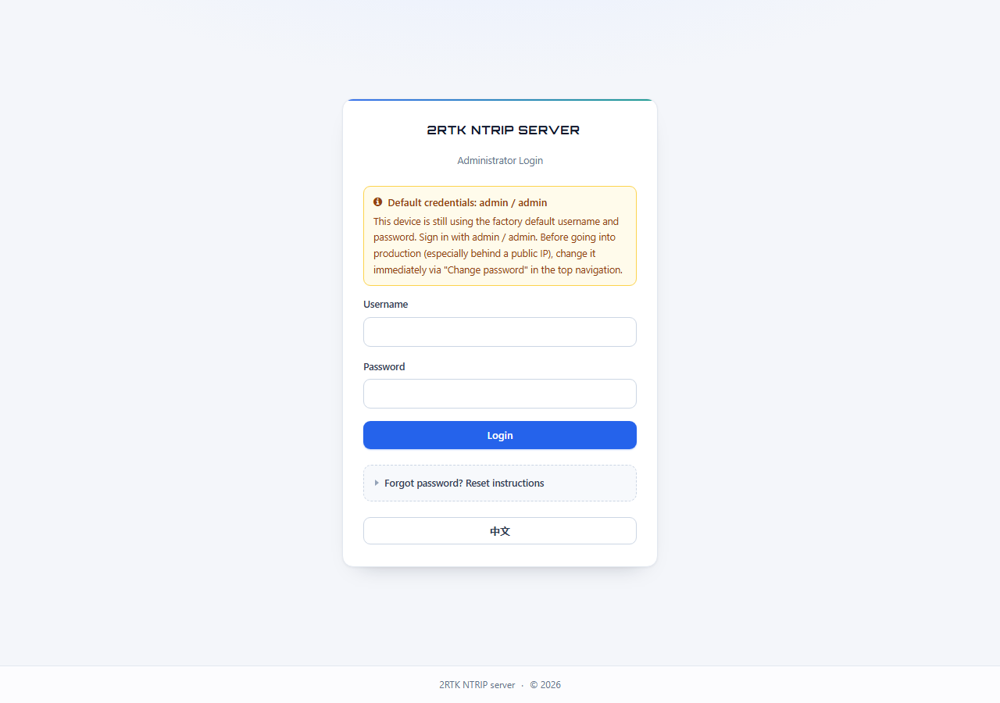
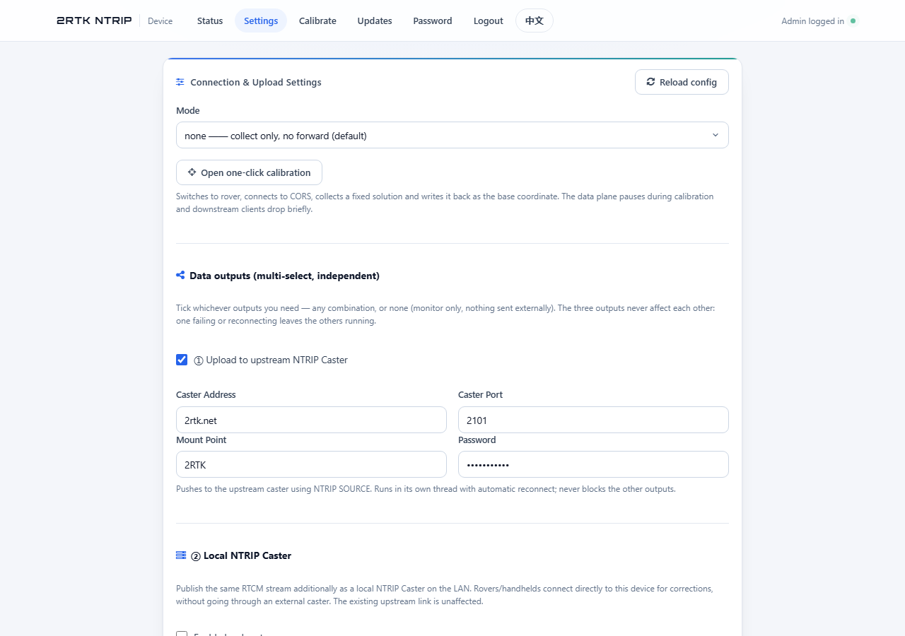
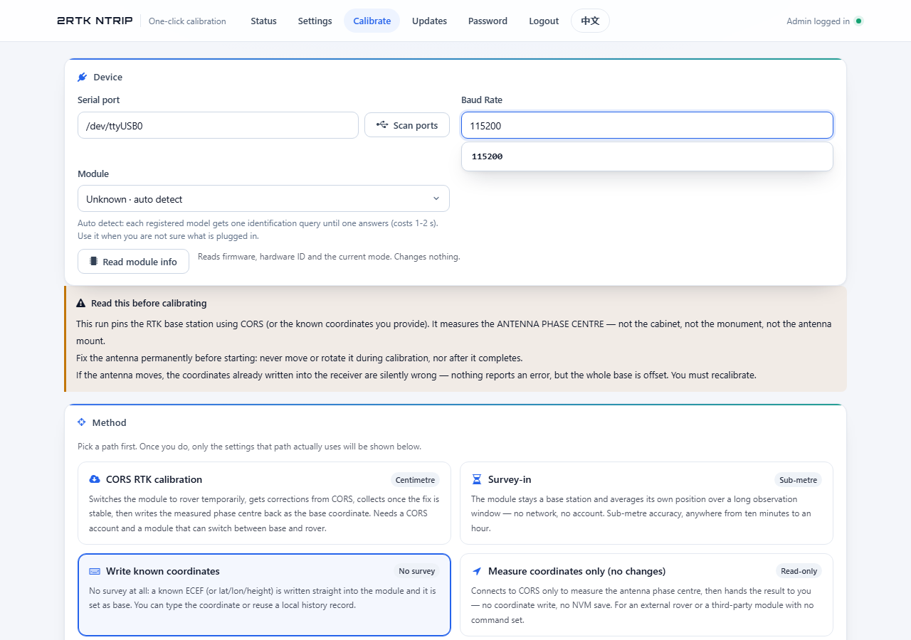
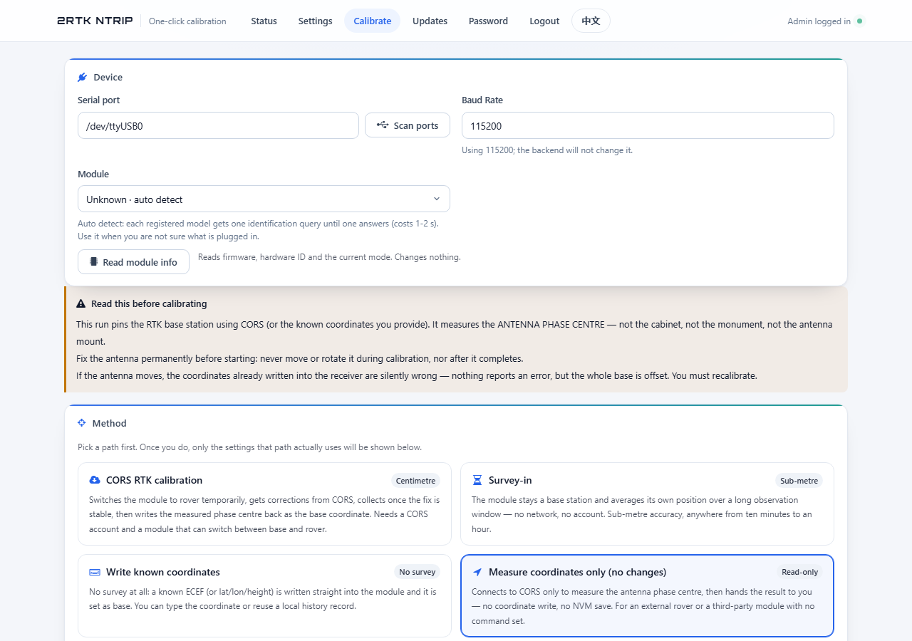
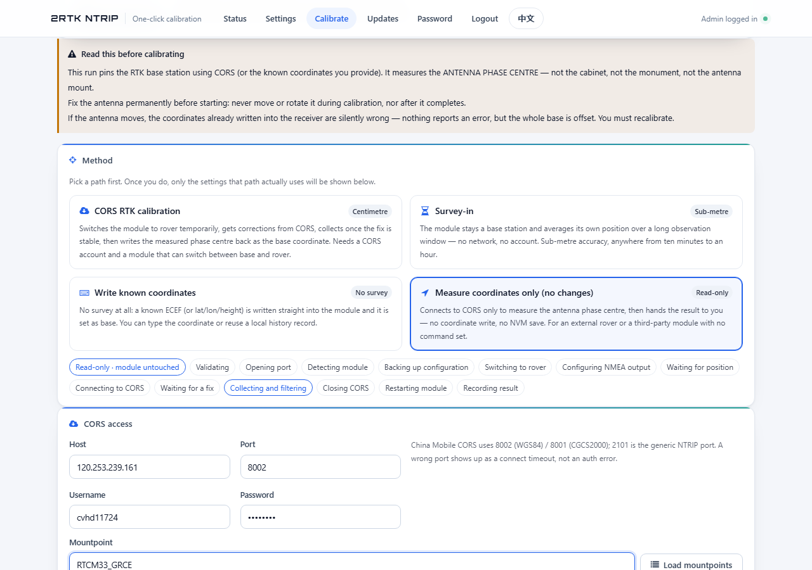
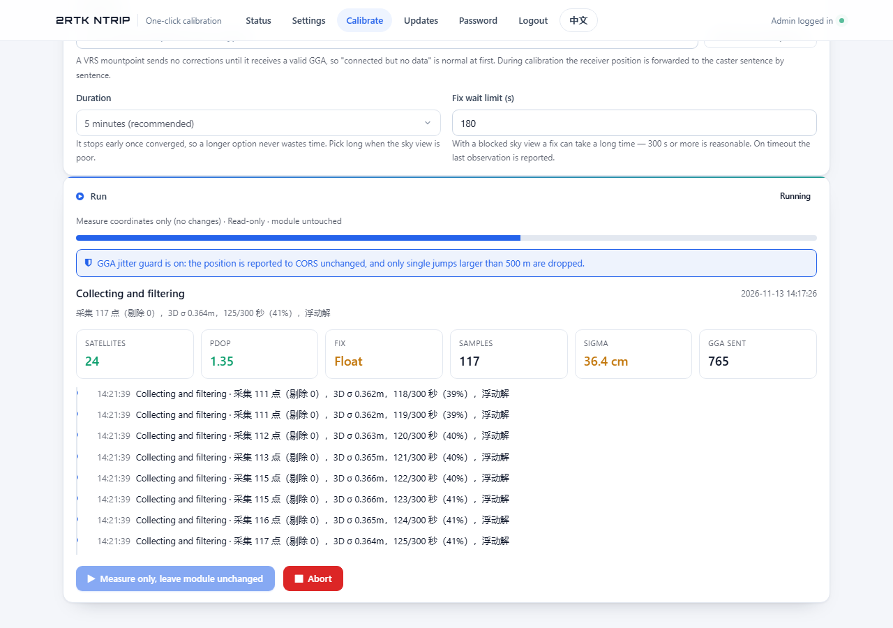
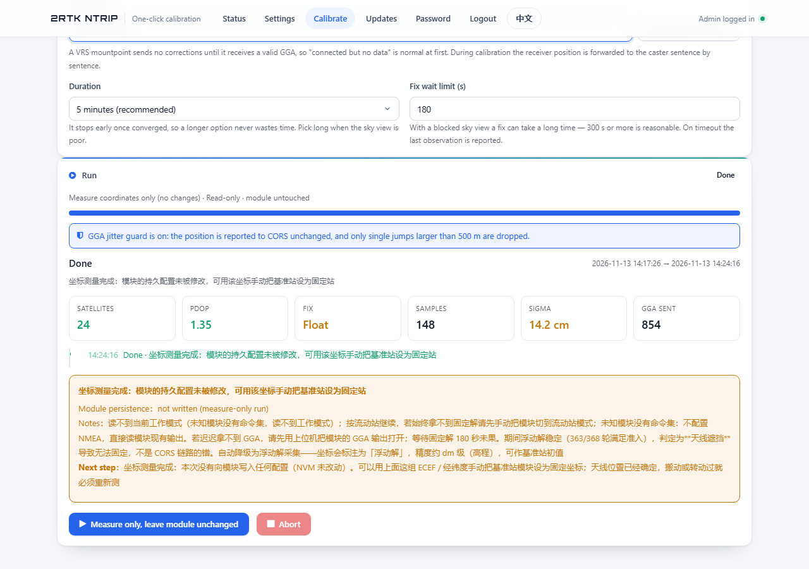

# 用流动站模块测量天线相位中心坐标（只测不写标定）

> 对应英文版：[tutorial-rover-measure.en.md](tutorial-rover-measure.en.md)
> 本文所有界面截图均为 Web 端**英文模式**。

基准站播发的坐标，必须是**天线相位中心（APC）**的坐标，而不是机箱、墩标或天线座的位置。
如果你手上只有一块**流动站模块**（或一块没有命令集、程序认不出来的第三方模块），
不想也不能改它的配置，却需要先测出这根天线的坐标，就用标定页的第四种方式
**「只测坐标（不改模块）」/ Measure coordinates only**。

它连 CORS 拿差分、测出天线坐标就结束：**不写坐标、不配报文、不保存 NVM、不重启模块**。
测到的坐标再拿去给基准站模块用（标定页的「写入已知坐标」）。

---

## 1. 什么时候用这条路径

| 场景 | 用哪种 |
| --- | --- |
| 双模模块（LG290P 等），想一步到位写进基准站 | CORS 差分标定 |
| 模块固件能自己收敛，不想联网 | Survey-in 自收敛 |
| 已经有坐标，只想写进模块 | 写入已知坐标 |
| **外接流动站 / 无命令集模块，只要一个天线坐标** | **只测坐标（不改模块）** ← 本文 |

前置条件：

- 2RTKserver 已安装并运行，Web 端可访问（默认 `http://设备IP:5757`）。
- 天线**永久固定**、天顶视野尽量开阔；标定期间和之后都不能移动或转动天线。
- 一个有效的 NTRIP / CORS 账号。
- 流动站模块：串口能输出 **NMEA GGA**，且 **RX 能接收 RTCM3 差分**（TX/RX 都要接）。
- VRS 挂载点需要客户端先上送 GGA 才播发改正数，程序会自动逐句转发，不用手动处理。

---

## 2. 第一步：把数据源设为 `none`（关键）



用管理员账号登录，右上角 `中文` 按钮可切到英文界面。



进入 **Settings → Mode**，选 **none —— collect only, no forward (default)**，
然后点 **Save & Restart**。

**为什么必须做这一步**：`none` 模式下主程序不启动任何数据模块，也就**不会占用串口**。
标定包要独占串口跟模块通信；如果数据源还停在 `serial`，两边会抢同一路字节。
保存后状态页会显示「等待配置」，这是预期状态，不是故障。标定结束后把 Mode 改回 `serial` 即可恢复常态。

> 标定期下游 NTRIP 客户端会短暂断流（确认框里会提示约 420 秒），属正常。

---

## 3. 第二步：标定页的设备设置



- **Serial port**：一般已自动填好（本例 `/dev/ttyUSB0`）。
- **Baud rate**：**手动填模块实际波特率**（本例 `115200`）。
  留空会让程序逐档枚举常见波特率，未知模块可能要扫 3 分钟以上还识别失败；
  显式填写后，页面会提示 *Using 115200; the backend will not change it*，直接跳过扫描。
- **Module**：保持 **Unknown · auto detect**。这块模块没有命令集，不要硬选一个型号。

「Read module info」是可选的。无命令集的模块会被报成「没有驱动认领这块模块」，
**这是正常的，不影响后续**——`external_rover` 这条路径本来就只依赖模块输出的 NMEA，
不依赖任何驱动命令。本例实测：识别失败，但串口持续输出标准
`$GNRMC` / `$GNGGA`（10 Hz，24–26 颗星，PDOP 0.56–1.45）。

---

## 4. 第三步：选择「只测坐标（不改模块）」



在 **Method** 里选第四张卡片 **Measure coordinates only (no changes)**（Read-only）。
选中后页面只显示这条路径真正会用到的设置，并列出阶段链：

```
Read-only · module untouched → Validating → Opening port → Detecting module
→ Backing up configuration → Switching to rover → Configuring NMEA output
→ Waiting for position → Connecting to CORS → Waiting for a fix
→ Collecting and filtering → Closing CORS → Restarting module → Recording result
```

---

## 5. 第四步：填 CORS，并判断挂载点



| 字段 | 本例 |
| --- | --- |
| Host | `120.253.239.161` |
| Port | `8002`（WGS84；`8001` 是 CGCS2000，`2101` 是通用 NTRIP 端口） |
| Username / Password | 你的 CORS 账号（**不要写进公开文档/截图**） |
| Mountpoint | `RTCM33_GRCE` |
| Duration | `5 minutes (recommended)` |
| Fix wait limit | `180` 秒 |

点 **Load mountpoints** 可以拉回完整 sourcetable。挂载点不要照抄别人给的名字，按模块能力选：

1. **先看模块支持哪些星座**。抓一条 GSV 就能看出来：本例同时有
   `GPGSV`（GPS）、`BDGSV`（北斗）、`GAGSV`（Galileo）、`GLGSV`（GLONASS），
   **没有 QZSS**。也就是四星座接收机。
2. **再看 sourcetable 的 format-details**。这份账号下：
   - `RTCM33_GRCE` = `4sat-11freq`，RTCM 3.3，MSM4
     `1074/1084/1094/1124(1)` + `1005/1033(10)` → **GPS + GLO + GAL + BDS，正好对齐**
   - `RTCM33_GRCEJ` = `5sat-16freq`，多一条 `1114`（QZSS）——本例模块用不上，
     只会增加无效下行数据
   - `RTCM30_GR` 是 RTCM 3.0 老格式、`RTCM33_C` 是单北斗、`RTCM23_G` 是 RTCM 2.3，
     都不如 MSM4 通用
3. **结论**：四星座流动站 → 选 `RTCM33_GRCE`。若你的模块确实支持 QZSS，
   再换 `RTCM33_GRCEJ`（五星十六频）。

> 连上后短时间内「connected but no data」是正常的：VRS 挂载点要先收到有效 GGA
> 才生成虚拟参考站数据。程序会把模块的 GGA 逐句上送。

---

## 6. 第五步：启动并让程序自己跑完

点 **Measure only, leave module unchanged**，确认框会再次声明
「no coordinate write, no NVM save」以及数据面暂停时长，点 **Start**。

**启动后不要干预**：不要去拔插串口、不要改配置页、不要发任何厂商命令。
标定包通过租约独占串口，跑完会自己归还。



阶段含义（只读路径的实际行为）：

| 阶段 | 只读路径做什么 |
| --- | --- |
| `HOLD` / `OPEN` | 等数据面让位，独占打开串口 |
| `DETECT` / `BACKUP` | 尝试识别型号并留一份配置快照；认不出来就按未知模块继续 |
| `ROVER_SETUP` | 读不到工作模式时**按流动站继续**，不发切模式命令 |
| `NMEA_SETUP` | 已经在输出 GGA 就**一个字节都不发** |
| `GGA_WAIT` → `CORS_CONNECT` | 等定位、连 CORS、开始上送 GGA |
| `FIX_WAIT` | 等质量位 4（固定解）；到 `Fix wait limit` 仍不固定会降级采集 |
| `COLLECT` | 按 1 Hz 采集、剔除跳变、卡尔曼滤波 |
| `CORS_CLOSE` → `INJECT` → `DONE` | 断 CORS、结果落库、归还租约 |

**不会发生的动作**：写坐标、配 RTCM/NMEA 报文、`SAVEPAR`、模块重启。
若模块当前是基准站，只会在 **RAM** 里临时切到流动站，成功/失败/中止三条路径都会切回。

---

## 7. 第六步：读结果



页面 `Done` 面板给出卫星数、PDOP、FIX 质量、样本数、σ、GGA 上送次数，
结果框会明确写出 **Module persistence: not written (measure-only run)**。

坐标与精度同时写进 `calibration.db`（标定页历史列表可复用），关键字段：

| 字段 | 含义 |
| --- | --- |
| `ecef_x/y/z`、`lat/lon/height` | 天线相位中心坐标（**height 是椭球高**） |
| `accuracy_grade` | `fixed` / `float` / `sub_meter` / `decimeter` |
| `samples`、`duration` | 有效样本数、实际采集秒数 |
| `raw_sample_std_e/n/u` | 原始样本在东/北/高方向的标准差 |
| `nvm_state` | 只读路径恒为 `not_written` |
| `cors_mountpoint_used` | 本次实际用的挂载点 |

`verdict=skipped`、`verified=0` 也是正常的：这条路径**没有写入**，
自然不需要做「写进去 vs 播发出来」的 1005 核对。

把坐标用到基准站：换上基准站模块 → 标定页选 **写入已知坐标** →
填这组 ECEF，或填经纬高（高程必须是**椭球高**，不是海拔，也不是天线到地面的距离）。

---

## 8. 本次实测结果（2026-11-13）

| 项目 | 值 |
| --- | --- |
| 主机 | Armbian 盒子 `192.168.1.71`，2RTKserver 3.1.3 |
| 串口 | CH340 `/dev/ttyUSB0` @ 115200 |
| 模块 | 无命令集流动站模块（`module_model=passive`），NMEA 10 Hz |
| 数据源 | 已先设为 `none` |
| CORS | `120.253.239.161:8002/RTCM33_GRCE` |
| 任务 | `20261113-141726-818`，14:17:26 → 14:24:16，占用 410 秒 |
| 采集 | 148 点 / 157 秒，`gga_forwarded=854`，`gga_jump_dropped=0` |
| **ECEF (m)** | **X = −2001285.0706　Y = 5416708.8726　Z = 2699549.037** |
| **经纬高** | **25.203467999° N　110.277513656° E　椭球高 150.8031 m** |
| 精度 | `accuracy_grade=float`（浮动解），页面标注 **decimeter（分米级）** |
| σ | 页面 14.2 cm；`filter_sigma3d = 0.237693 m`；`accuracy = 0.60058` |
| 原始样本标准差 | E 0.2421 m / N 0.4428 m / U 0.3257 m |
| 模块状态 | `nvm_state=not_written`，`readonly=true`，标定后 GGA/RMC 照常输出 |

**为什么这次是浮动解而不是固定解**：`FIX_WAIT` 等满 180 秒，质量位始终为 5（RTK 浮动），
程序按 `on_slow=adopt` 自动降级采集，并把结果如实标成「浮动解」。
日志判定为**天线遮挡导致无法固定，不是 CORS 链路故障**——证据是 GGA 上送了 854 次、
质量位从单点（1）升到了浮动（5），说明差分确实送进模块了；363/368 轮满足浮动准入。
这一版坐标是**分米级**，适合当基准站初值；要厘米级固定解，需改善天线天顶视野后重测。

---

## 9. 常见问题

| 现象 | 判断 / 处理 |
| --- | --- |
| 「Read module info」报没有驱动认领 | 无命令集模块属正常，`external_rover` 不依赖驱动；但要先确认串口确实在输出 GGA |
| CORS 已连接但没有数据 | VRS 挂载点在等 GGA，正常；`gga_forwarded` 在涨就没事 |
| 质量位一直是 5 | 浮动解：天线遮挡、基线过长或电离层活跃；先查天顶视野，别急着换账号 |
| 完全没有 GGA | 用厂商上位机把 GGA 输出打开，或检查 TX/RX 是否接反 |
| 想恢复常态推流 | Settings → Mode 改回 `serial`（或 `relay`）→ Save & Restart |

---

## 10. 附：本次阶段时间线（只读路径）

```
14:17:26  HOLD / OPEN          取得串口独占权
14:17:26  DETECT              尝试识别型号（未知，按 passive 继续）
14:18:14  BACKUP / ROVER_SETUP 读不到模式，按流动站继续
14:18:16  NMEA_SETUP          未知模块没有命令集：不配置 NMEA，直接读现有输出
14:18:16  GGA_WAIT            等待模块输出定位
14:18:18  CORS_CONNECT        已连接 120.253.239.161:8002/RTCM33_GRCE
14:18:18  FIX_WAIT            质量 1 → 5，24–25 星，PDOP 1.29–1.45
14:21:18  [FLOAT-DOWNGRADE]   180 秒未固定，浮动解稳定 363/368 轮，降级采集
14:21:39  COLLECT             148 点，3D σ 0.2377 m
14:24:16  CORS_CLOSE → INJECT → DONE
14:24:16  租约归还（占用 410 秒）
```
