# 2RTKserver — Complete Tutorial

> Build a full-featured RTK base station from scratch on a low-cost ARM box, a Raspberry Pi, or any Linux machine.

**Version covered:** 3.1.3
**Tested on:** Amlogic S905L3B box running Armbian (Ubuntu 22.04, aarch64), Quectel LG290P module on a CH340 USB-serial adapter.

---

## Contents

1. [What 2RTKserver Is](#1-what-2rtkserver-is)
2. [What You Need](#2-what-you-need)
3. [Hardware Wiring](#3-hardware-wiring)
4. [Installing on a Fresh System](#4-installing-on-a-fresh-system)
5. [First Login and the Status Page](#5-first-login-and-the-status-page)
6. [Serial Port Configuration](#6-serial-port-configuration)
7. [Coordinate Calibration](#7-coordinate-calibration)
8. [Uploading to a Cloud NTRIP Caster](#8-uploading-to-a-cloud-ntrip-caster)
9. [Relay Mode](#9-relay-mode)
10. [Built-in Local Caster](#10-built-in-local-caster)
11. [Radio Telemetry Passthrough](#11-radio-telemetry-passthrough)
12. [Maintenance](#12-maintenance)
13. [Appendix A — Supported Modules](#appendix-a--supported-modules)
14. [Appendix B — Common Problems](#appendix-b--common-problems)

---

## 1. What 2RTKserver Is

2RTKserver turns a GNSS receiver module into a **standalone RTK base station**. It reads raw RTCM 3 correction data from the module over a serial port and distributes it over the network, so rovers in the field can reach centimetre-level positioning.

It is more than a data pump. It also:

- **Calibrates the base position** to centimetre accuracy by driving the module through the required command sequences automatically.
- **Restores the module** to its pre-calibration state if anything fails, so a botched calibration never leaves the receiver stuck in the wrong mode.
- **Injects station metadata** so rovers know where the base is and which coordinate frame it uses.
- **Serves a web interface** for configuration, live monitoring, and firmware checks.

### Three operating modes

| Mode | What it does | When to use it |
|---|---|---|
| `none` | Reads the module and displays data locally. No output. | Bench testing, first-time verification |
| `serial` | Reads the module over serial and distributes over NTRIP. | **Normal base station operation** |
| `relay` | Pulls a stream from *another* caster and re-distributes it. | Bridging networks, extending coverage |

### Where the data can go

Three outputs are available, and they are **independent** — enable any combination:

1. **Cloud NTRIP Caster** — push your stream to a public server.
2. **Local NTRIP Caster** — serve the stream directly from the box on your own LAN.
3. **Radio telemetry** — push corrections out a second serial port to a UHF radio.

---

## 2. What You Need

### Hardware

| Item | Notes |
|---|---|
| Linux host | Any ARM SBC, mini PC, or old laptop. Tested on Amlogic S905L3B + Armbian. |
| GNSS module | Quectel LG290P (multi-band, recommended), u-blox ZED-F9P, Unicore UM980/N4, or Quectel LC29H. |
| USB-serial adapter | CH340, CP2102, FT232, or the module's own USB port. |
| GNSS antenna | **Must have a clear view of the sky.** This matters more than any other single factor. |
| Antenna cable | Low-loss coax, kept short. Every extra metre costs signal. |

> **📷 PHOTO PLACEHOLDER — hardware-overview**
> *Needed: the full kit laid out on a table — the box, the GNSS module, the USB-serial adapter, the antenna, and the antenna cable.*

### Network

- The host must be able to reach your CORS provider (for the CORS calibration method) or your cloud caster.
- For LAN access, you need to know the host's IP address.

### Accounts

- **CORS account** — only for the CORS one-click calibration method. A typical provider gives you: host, port, username, password, and a mount point name.
- **Cloud caster account** — only if you plan to publish your stream.

---

## 3. Hardware Wiring

There are only a few connections:

```
   ┌──────────────┐   USB    ┌───────────────┐   UART    ┌─────────────┐
   │   Linux box  │ ───────► │ USB-serial    │ ────────► │ GNSS module │
   │              │          │ adapter       │  (CH340)  │  (LG290P)   │
   └──────────────┘          └───────────────┘           └──────┬──────┘
                                                                │ SMA
                                                                ▼
                                                         ┌─────────────┐
                                                         │   Antenna   │
                                                         └─────────────┘
```

1. Wire the GNSS module to the USB-serial adapter: `TX → RX`, `RX → TX`, `GND → GND`. Power the module according to its datasheet.
2. Plug the adapter into a USB port. It appears as `/dev/ttyUSB0` (CH340) or `/dev/ttyACM0` (native USB CDC).
3. Screw the antenna onto the module's SMA connector and **place it where it can see the sky.** Do not put it under a metal roof or against a wall — the base station cannot calibrate itself without satellite reception.

> **📷 PHOTO PLACEHOLDER — wiring-closeup**
> *Needed: close-up of the module wired to the USB-serial adapter showing TX/RX/GND, plus a shot of the antenna mounted outdoors.*

### Verify the adapter is detected

Before installing anything, confirm the system sees it:

```bash
ls -l /dev/ttyUSB* /dev/ttyACM* 2>/dev/null
```

Expected output:

```
crw-rw---- 1 root dialout 188, 0 Nov 11 05:20 /dev/ttyUSB0
```

If nothing appears, the adapter is not being recognised. Try a different USB port or cable before going further.

---

## 4. Installing on a Fresh System

### 4.1 Get the source onto the host

```bash
cd ~
git clone <your-repository-url> 2RTKserver
cd 2RTKserver
```

If you have no git access, copy the project folder over with `scp` or a USB stick. The installer does a plain copy rather than a git clone, so a source tarball works fine.

### 4.2 Run the installer

```bash
sudo bash install.sh
```

The installer will:

1. Install system packages (`python3`, `python3-venv`, `python3-pip`).
2. Create a virtual environment at `/opt/2RTKserver/venv`.
3. Install Python dependencies from `requirements.txt`.
4. Copy the application into `/opt/2RTKserver`.
5. Register and start the `2rtkserver` systemd service.

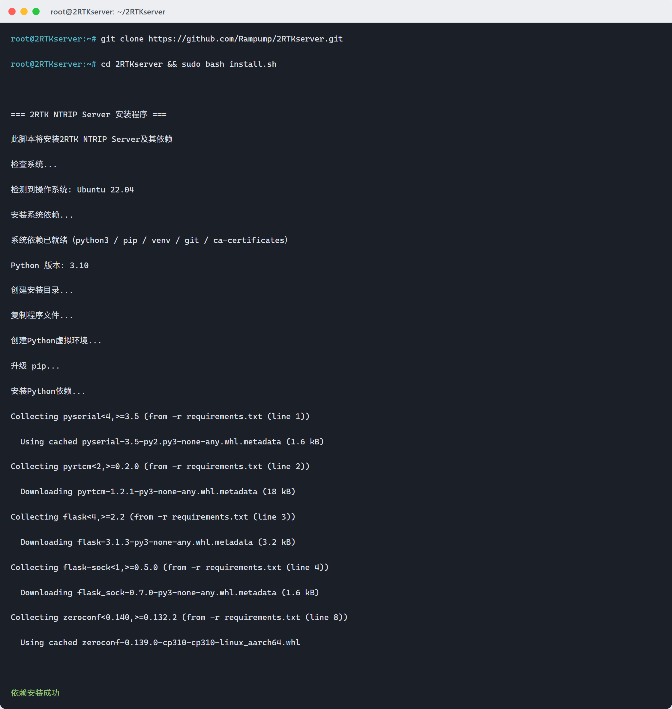

*Package installation. On a slow ARM box this can take several minutes — that is normal.*

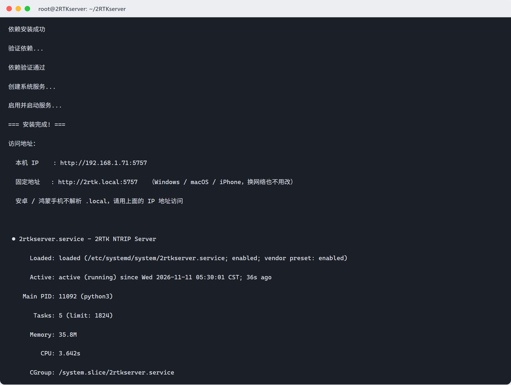

*Installation complete. Note the access URL reported at the end.*

> **📷 PHOTO PLACEHOLDER — install-console**
> *Needed (optional): a photograph of a real screen showing the installer output, for a "real console" feel. The screenshots above are terminal captures.*

### 4.3 Confirm the service is running

```bash
systemctl status 2rtkserver
```

Expect `active (running)`. If not:

```bash
journalctl -u 2rtkserver -n 50 --no-pager
```

The journal names the actual cause — usually a missing Python package or a permission problem under `/opt/2RTKserver`.

### 4.4 Removing an existing installation

If you are reinstalling over an older version, uninstall first so no stale files remain:

```bash
cd /opt/2RTKserver
sudo bash uninstall.sh
```

The uninstaller stops and removes the service. Your database and calibration records are preserved. Remove `/opt/2RTKserver` manually if you want a completely clean slate.

> **Upgrading rather than reinstalling?** Run `sudo bash update.sh` inside `/opt/2RTKserver`. It keeps your configuration and data.

---

## 5. First Login and the Status Page

### 5.1 Open the web interface

From any machine on the same network, browse to:

```
http://<host-ip>:5757
```

The installer prints the exact address. On networks that support mDNS you can also use:

```
http://2rtk.local:5757
```

> **Note:** Android devices cannot resolve `.local` names — use the IP address. If `2rtk.local` fails on Windows or macOS, a proxy or VPN is probably intercepting it; add `*.local` to your proxy bypass list.

### 5.2 Log in

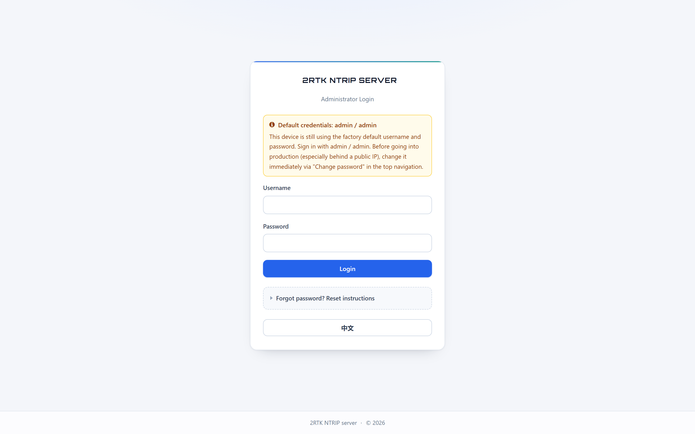

*The login page. Default credentials are `admin` / `admin`.*

**Change the password immediately.** Go to **Change Password** in the top navigation after your first login. The login page shows a warning banner while the default password is still in use.

> **Security note:** this web interface is intended for a trusted LAN. Do not expose port 5757 directly to the internet. For remote access, put it behind a VPN.

### 5.3 The status page

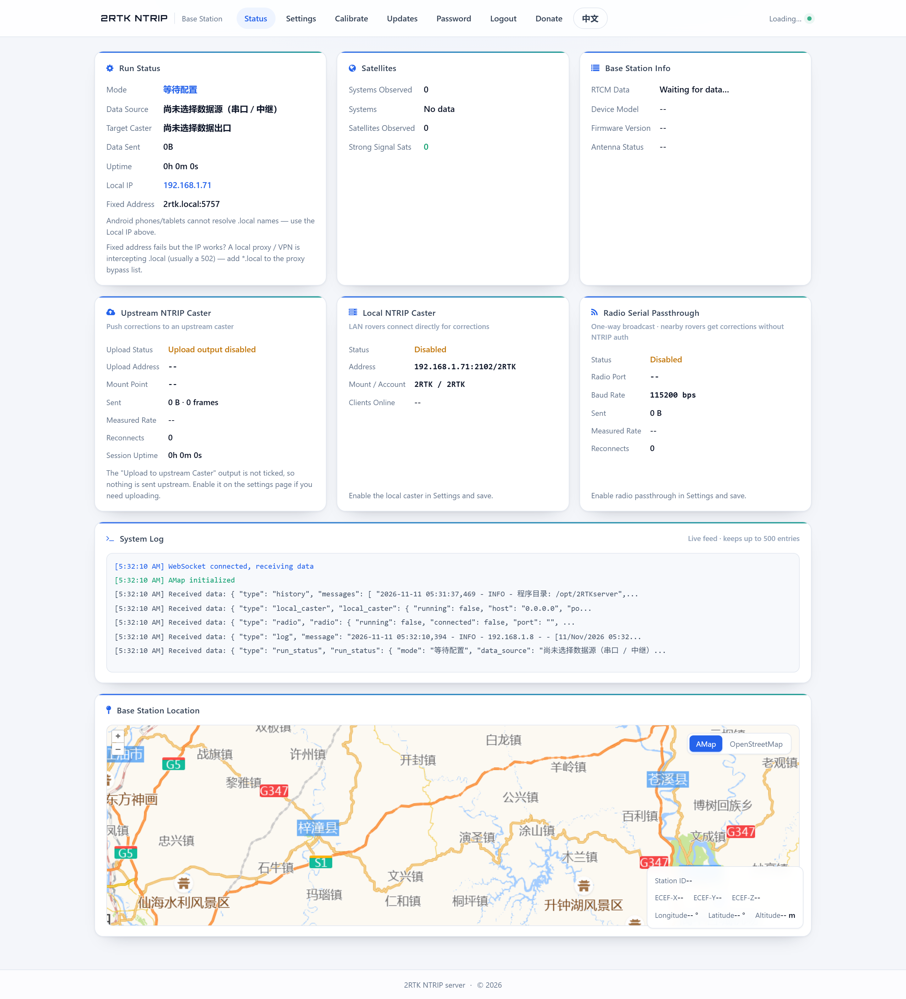

*The status page before configuration — no data flowing yet.*

The status page is your main operational view:

| Field | Meaning |
|---|---|
| Mode | Current operating mode (`none` / `serial` / `relay`) |
| Serial port | Port and baud rate in use |
| Satellites | Number of satellites currently tracked |
| Systems | Which constellations are present (GPS, GLONASS, Galileo, BDS, QZSS) |
| Position | The base station's current coordinates |
| RTCM output | Which message types are being emitted |
| Uptime | How long the current session has been running |

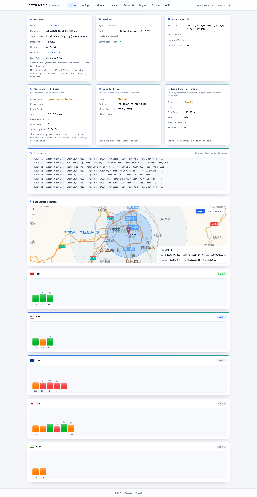

*The status page with live data — satellites tracked, position solved, RTCM messages flowing.*

> The status page updates over a WebSocket, so satellite counts and positions refresh continuously without reloading.

---

## 6. Serial Port Configuration

Go to **Configuration** (`/config`).


*The configuration page. Mode is `none` here; we will change it to `serial`.*

### 6.1 Set the mode

Choose **Mode → `serial`**. This tells the server to read the module over serial and distribute the data.

### 6.2 Find the serial port

Two options:

**Option A — Scan.** Click **Scan Ports**. The server enumerates available serial devices and populates a dropdown.

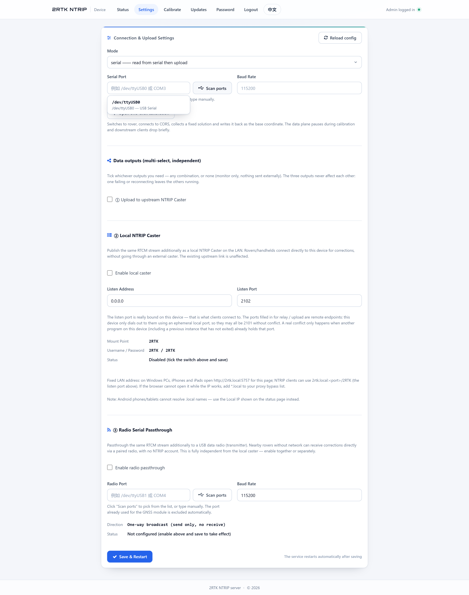

*After scanning, the detected port is offered in the dropdown.*

**Option B — Type it in.** If you already know the port, enter `/dev/ttyUSB0` or `/dev/ttyACM0`.

> **Telling them apart:** CH340/CP2102/FT232 adapters appear as `/dev/ttyUSB0`. Modules with native USB (many u-blox boards) appear as `/dev/ttyACM0`. If several USB-serial devices are plugged in, unplug the module and re-run the scan — whichever port disappeared is the module.

### 6.3 Set the baud rate


*Port and baud rate filled in.*

| Module | Typical baud rate |
|---|---|
| Quectel LG290P | 115200 or 460800 |
| u-blox ZED-F9P | 38400 (USB CDC ignores baud) |
| Unicore UM980 | 115200 |
| Quectel LC29H | 115200 |

**Not sure? Try 115200 first.** The calibration routine probes multiple baud rates automatically, so a wrong guess there is recoverable. For normal data flow, though, the value must be correct.

### 6.4 Verify data is flowing

Click **Save & Restart**. The page redirects and the service restarts. Then:

1. Go back to the **Status** page.
2. Within 10–20 seconds the satellite count should climb and the position should resolve.
3. The RTCM output section should list message types such as `1005`, `1074`, `1094`, `1114`, `1124`, `1134`.

Satellites but no position means the antenna is probably indoors or obstructed. Nothing at all means the port or baud rate is wrong.

> **What the RTCM message numbers mean:**
> `1005`/`1006` = base station position and antenna metadata · `1074`/`1084`/`1094`/`1114`/`1124`/`1134` = GPS/GLONASS/Galileo/QZSS/BDS/NavIC observations (MSM4) · `1230` = GLONASS code-phase biases.
>
> The `1005` message is what tells a rover *where your base is*. Without it, the rover receives corrections but cannot apply them.

---

## 7. Coordinate Calibration

A base station only produces useful corrections if it knows **its own position** very precisely. One metre of error in the base position becomes one metre of error in every rover's output. Calibration is how the base learns its position.

Open **Calibrate** in the top navigation.

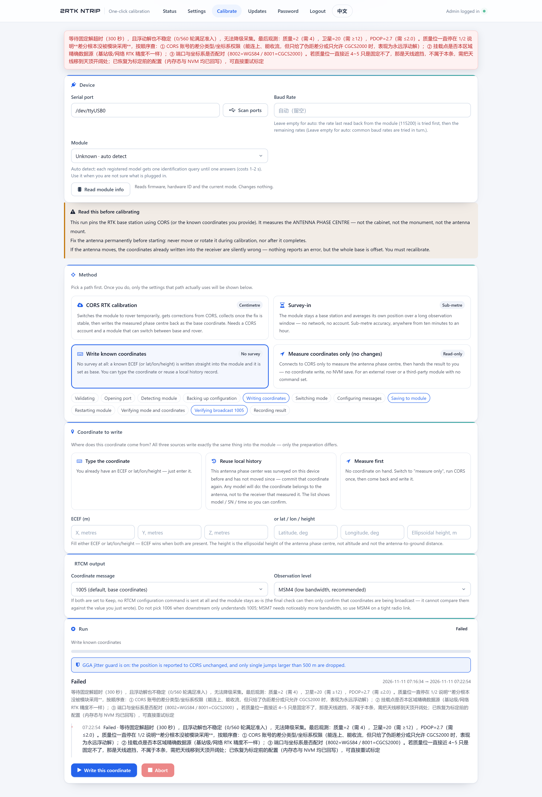

*The calibration page. The first step is verifying the hardware connection.*

### 7.1 The Four Methods

The calibration page offers up to four methods. **Which ones appear depends on what your module supports** — a receiver that can only act as a rover cannot perform a self-survey, and so on.

| Method | What it does | Accuracy | Time | Requires |
|---|---|---|---|---|
| **CORS one-click fix** | Streams corrections from a public CORS network into the module, waits for a fixed solution, then averages the position. | Centimetre | 5–10 min | Dual-mode module, CORS account, network |
| **Measure only** | Same principle, but the position comes from an **external rover** rather than the module itself. | Centimetre | 5–10 min | Dual-mode module, external rover, CORS account |
| **Survey-in** | The module averages its own single-point position over a long period. | Decimetre | 15–60 min | Single-mode module |
| **Manual** | You enter known coordinates. | Depends on your survey | Instant | A surveyed point |

**Which should you use?** With a CORS account and a dual-mode module, use **CORS one-click fix** — it is the most accurate and the most automatic. If your module cannot switch into rover mode, use **survey-in**. If you already have surveyed coordinates for the point, use **manual**.

### 7.2 CORS One-Click Fix

This is the main event. Here is what happens under the hood, so you know what to expect:

1. **The server asks the data plane to release the serial port.** It cannot calibrate while simultaneously streaming.
2. **It identifies the module** by sending version queries and reading responses.
3. **It backs up the current configuration** so it can be restored if anything fails.
4. **It switches the module into rover mode** and configures the required NMEA output.
5. **It connects to the CORS mount point** and pipes the corrections into the module's serial port.
6. **It waits for a fixed solution.** This requires good sky visibility: the quality indicator must reach 4 for 30 consecutive seconds.
7. **It collects samples** for the configured duration (default 300 s), rejects outliers beyond 3σ, and averages the remainder.
8. **It writes the averaged position** to the module as the fixed base coordinates.
9. **It restores the module to base mode**, replays the message configuration, restarts, and verifies.

#### Step 1 — Detect the module

Click **Detect Module**.

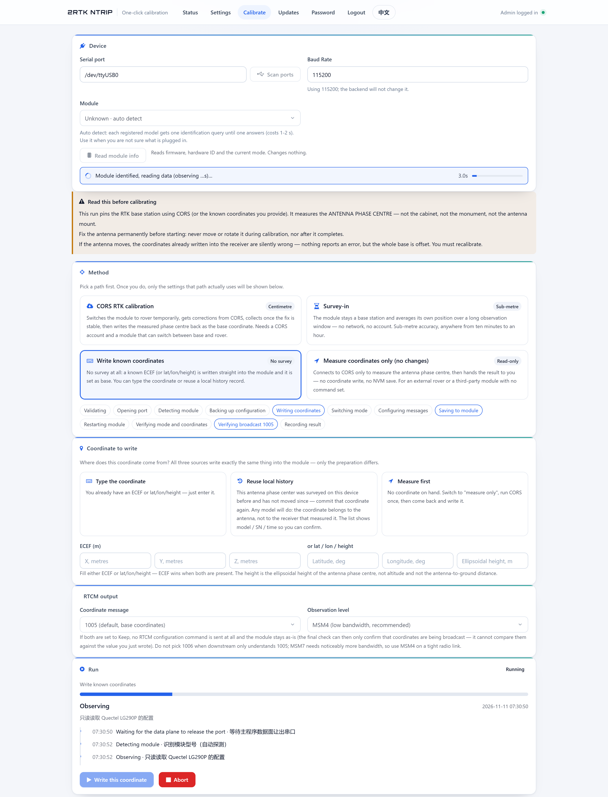

*Detection in progress — the server is probing the serial port.*

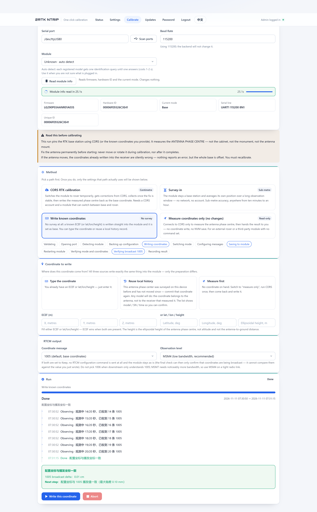

*Module identified, with firmware version and capabilities.*

If detection fails, the usual causes are: the serial port is still held by the main data thread (wait a few seconds and retry), the baud rate is wrong, or the module is unpowered.

#### Step 2 — Choose the method

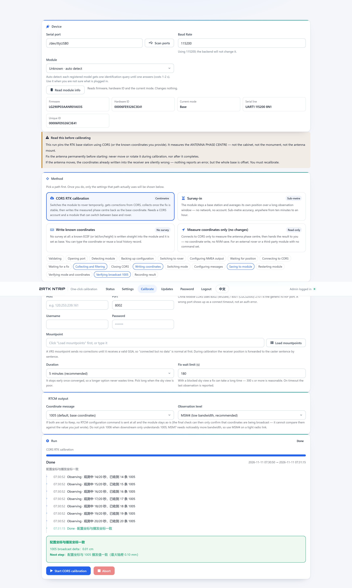

*Method selection. CORS one-click fix is selected.*

#### Step 3 — Enter the CORS account

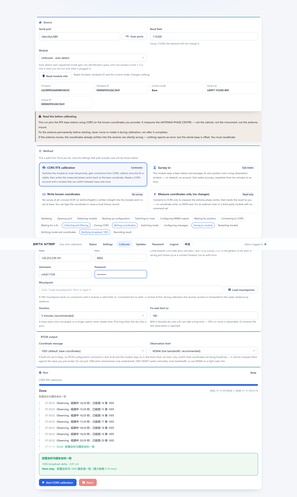

*Entering the CORS provider details.*

| Field | What to enter |
|---|---|
| Host | The provider's server address, e.g. `120.253.239.161` |
| Port | The port for the coordinate system you want — see the note below |
| Username | Your CORS account name |
| Password | Your CORS account password |

> **Port and coordinate system are paired.** A typical provider offers the *same* mount points on multiple ports, one per datum:
> - `8002` → WGS84
> - `8001` → CGCS2000
>
> Pick the wrong port and you will often still connect and receive data — but the position never reaches a fixed solution, because the correction frame does not match what the module expects. **If you are stuck at float forever, check this first.**

#### Step 4 — Fetch and select the mount point

Click **Fetch Mount Points**.

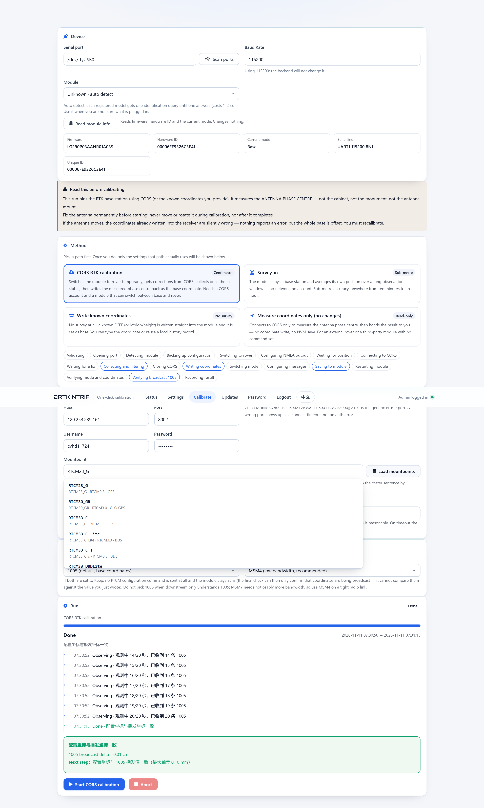

*The mount point list retrieved from the provider.*

Choose one that:

- **Covers your area** — mount point names usually encode the region or network.
- **Broadcasts multi-constellation, multi-frequency data** — names containing `RTCM33`, `5G16F` (five systems, sixteen frequencies) and similar indicate this.

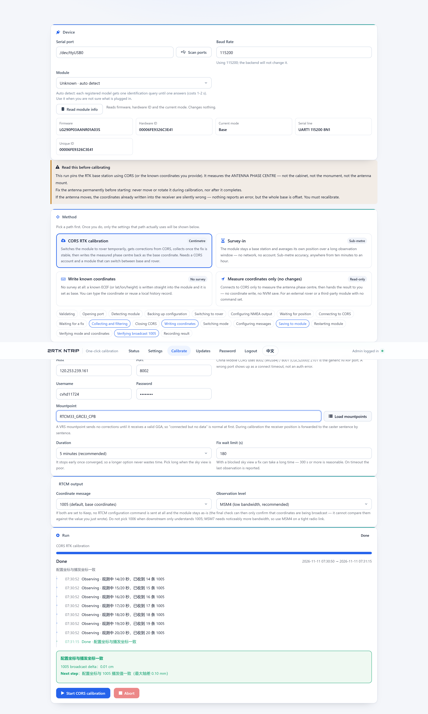

*Mount point selected.*

Once everything is entered, the page summarises the task.


*All parameters entered. Review before starting.*

#### Step 5 — Start and confirm

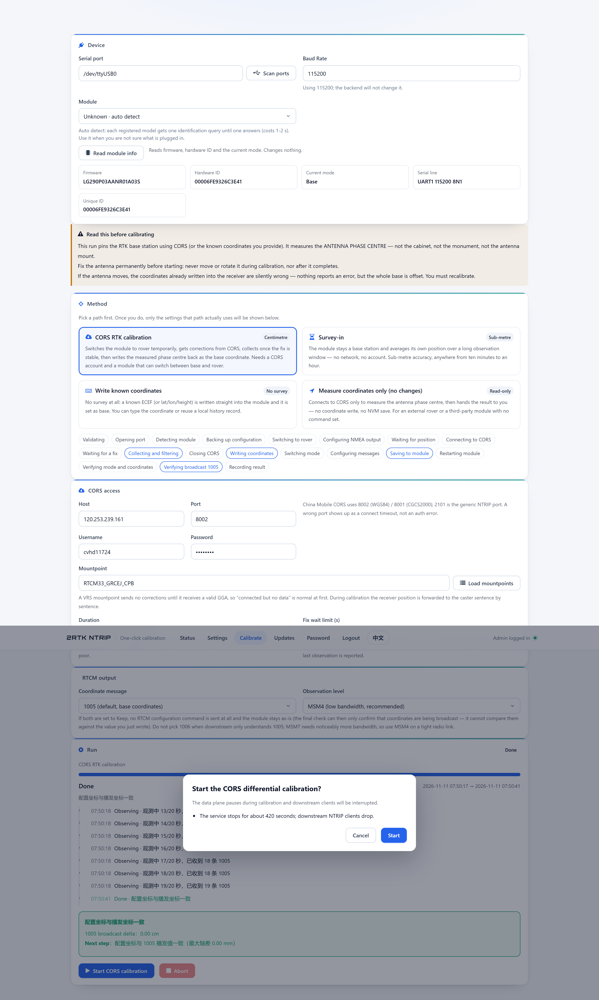

*The confirmation dialog. Read it — it states the antenna must not move.*

> **Before you click start:** the antenna must be firmly mounted and must not move for the whole calibration. The routine discards samples showing jumps larger than 500 m, but a wobbly antenna will simply prevent a fixed solution from ever happening.

Click **Start**.

#### Step 6 — Let it run


*Calibration running — the stage indicator shows where the routine is.*

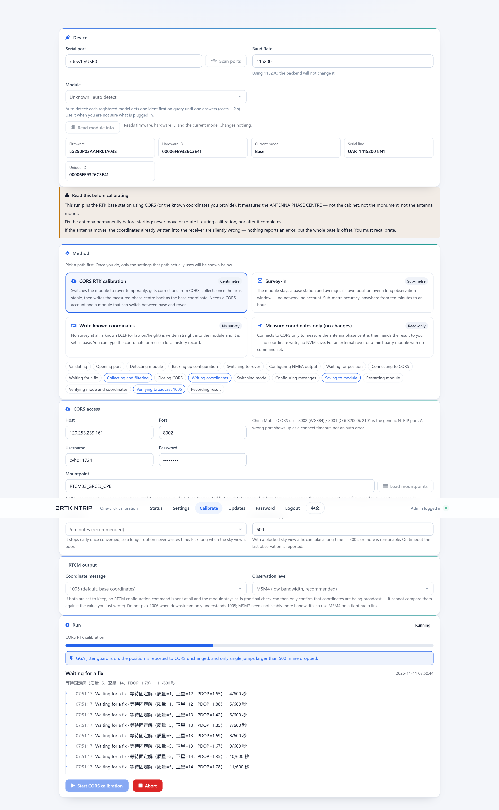

*In `FIX_WAIT`: the live metrics panel shows quality, satellites, PDOP, and how long the fix has held.*

The `FIX_WAIT` stage is where patience is required. Two numbers in the metrics panel tell you whether it is going well:

- **Quality** — must climb to `4`. If it sits at `1` or `2`, the corrections are not reaching the module or the sky view is poor.
- **Fixed for** — must reach 30 seconds continuously. If it keeps resetting to 0, the fix is dropping out; something is unstable.

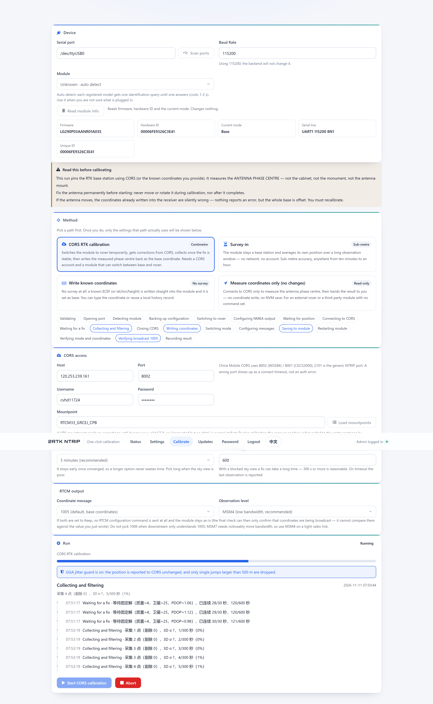

*In `COLLECT`: samples arriving, with the running count, spread, and convergence shown.*

Collection is short compared to the wait. The routine stops early once the sample spread converges; in a good run this takes well under a minute.

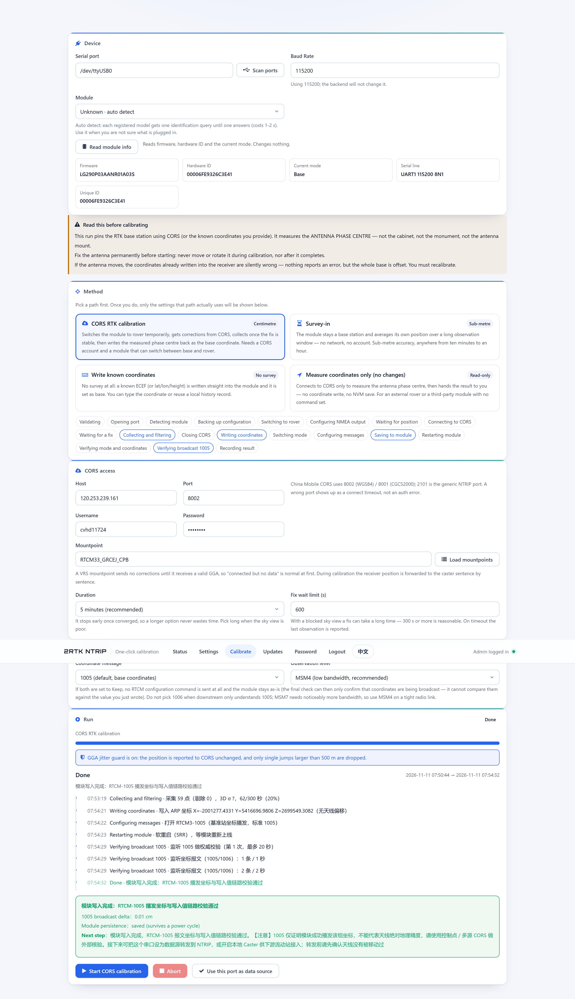

*`DONE`. The result panel appears with the final coordinates and accuracy.*

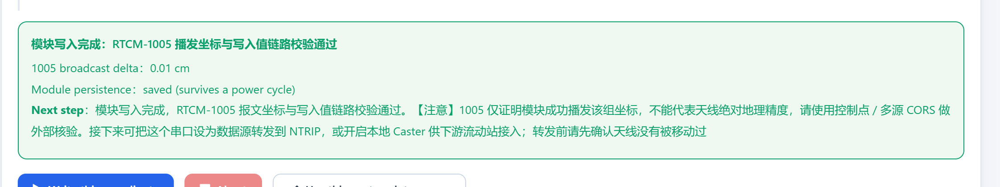

*The summary card: sample count, standard deviation, and the coordinates written to the module.*


*The stage timeline — how long each phase took. Useful when a run is slow and you want to know which phase ate the time.*

Read the summary card like this:

| Field | What it tells you |
|---|---|
| Samples | How many position samples went into the average. More is better, but 60+ is already solid. |
| Std dev | Horizontally how tightly the samples clustered. **Under 5 cm is good**; above 20 cm, check the antenna and CORS quality. |
| Coordinates | What was written to the module. These are what rovers will be positioned relative to. |

Compare the recorded spread to what the metrics showed live. A tight live fix that produces a wide sample spread usually means the antenna moved, or the module lost and regained the fix mid-collection.

The stage indicator walks through these phases:

| Stage | What is happening |
|---|---|
| `HOLD` | Waiting for the data thread to release the serial port |
| `OPEN` | Opening the serial port exclusively |
| `DETECT` | Identifying the module |
| `BACKUP` | Saving the current configuration |
| `ROVER_SETUP` | Switching the module to rover mode |
| `NMEA_SETUP` | Configuring GGA/GSA output |
| `RTK_REINIT` | Restarting the module to start RTK solving |
| `GGA_RATE_CHECK` | Measuring the actual GGA output rate |
| `GGA_WAIT` | Waiting for a position |
| `CORS_CONNECT` | Connecting to the CORS mount point |
| `FIX_WAIT` | **Waiting for a fixed solution — this is the long one** |
| `COLLECT` | Averaging the position samples |
| `CORS_CLOSE` | Disconnecting from CORS |
| `SAVE` | Writing the position to the module |
| `RESTART` | Restarting the module |
| `VERIFY_MODE` | Confirming the module is back in base mode |
| `VERIFY_RTCM` | Confirming RTCM output resumed |
| `DONE` | Complete |

**Do not close the page, do not restart the server, and do not touch the antenna.** The routine runs on its own; no intervention is needed.

#### What "fixed solution" means

The module reports a quality indicator in its GGA sentence:

| Quality | Meaning | Usable for a base station? |
|---|---|---|
| 1 | Single point | No |
| 2 | DGPS / float | No |
| 4 | **RTK fixed** | **Yes** |
| 5 | RTK float | No |

The routine requires quality 4 for 30 continuous seconds, with at least 12 satellites and PDOP ≤ 2.0. If that does not happen within 180 seconds, it attempts a fallback to a float solution — but only if the float solution is stable enough. If neither works, the calibration fails and the module is restored.

**What a good run looks like.** From a field calibration on an LG290P with a CORS mount point:

| Metric | Value |
|---|---|
| Time to fix | ~48 s from entering `FIX_WAIT` |
| Fix held | 70 s continuous (requirement: 30 s) |
| Quality | 4 |
| Satellites | 22–35 |
| PDOP | 0.9 |
| Samples collected | 81 |
| Standard deviation | 1.9 cm |
| `1005` broadcast delta | 0.01 cm |

That last row is worth explaining. After writing the position, the routine reads the module's `1005` message back and compares the ECEF coordinates it actually broadcasts against what was written. A delta near zero means the module accepted the position and is broadcasting it identically. A large delta means the write did not take — usually because the module rejected the command or restarted before applying it.

### 7.3 Measure Only (External Rover)

**Measure Only** covers a specific situation: you want to fix the base position, but the base module cannot operate as a rover, or you already have a rover obtaining a fixed solution at the base's location.

How it differs from CORS one-click fix:

- The base module is **not** switched into rover mode.
- The correction stream is **not** fed into the base module.
- A **separate rover** — on your phone, a handheld controller, or another receiver — provides the fixed position.

Use this when your base module is rover-incapable but you still want a surveyed position rather than a survey-in average.

> **Note:** for a module that can only act as a rover, `external_rover` is the *only* method offered. In that case you supply coordinates from your surveying equipment.

### 7.4 Survey-In

Survey-in is the self-contained option — no CORS account, no network.

The module averages its own single-point position over a long period. Configure:

| Parameter | Meaning | Typical value |
|---|---|---|
| Observation count | How many fixes to average | 2000–5000 |
| Accuracy limit | Stop early once estimated accuracy beats this | 2.0 m |
| Minimum duration | Minimum time before it may stop | 5–15 min |

**Accuracy expectation:** survey-in is limited by the module's single-point accuracy, typically 1–2 m. It is *not* a substitute for CORS calibration. Use it when nothing better is available, or when decimetre accuracy suffices for your application.

The routine monitors convergence and stops only when the position is stable — a running 3σ spread below 2 cm held for 60 seconds.

### 7.5 Manual Coordinates

If you have already surveyed the point with professional equipment, enter the coordinates directly:

| Input | Format |
|---|---|
| Latitude | Decimal degrees, e.g. `25.203523` |
| Longitude | Decimal degrees, e.g. `110.277483` |
| Ellipsoidal height | Metres, e.g. `138.316` |

The server writes these to the module as the fixed base position. **Make sure the coordinate frame matches** what your rover expects — WGS84 is the usual choice, though CGCS2000 is used in some Chinese contexts. Getting this wrong produces a constant offset in every rover's output.

### 7.6 What the Calibration Actually Writes

After a successful calibration the module holds:

- **The averaged ECEF position** — the arithmetic mean of the accepted samples after 3σ outlier rejection (not the module's internal Kalman output).
- **The RTCM message configuration** — which message types, at what rate.
- **Base mode** — the module is left operating as a base station, not a rover.

The server also records a **calibration history** in its database: method used, sample count, final spread, resulting coordinates. This is what the status page displays as the base position.

> **Why the 1005 message matters:** the base position is broadcast to rovers in the `1005` (or `1006`) RTCM message. A rover receiving `1074` and friends but no `1005` has no idea where the base is and cannot compute a correction. If your rovers never fix, check that `1005` appears in the RTCM output list on the status page.

### 7.7 Troubleshooting Calibration

The routine is deliberately verbose when it fails — it reports which check failed and what it observed. Common failures:

#### "Module not responding" during detection

The serial port is held by something else, usually the main data thread finishing its previous cycle.

- Wait 20 seconds and retry.
- If it persists, stop the service, calibrate, then start the service again.

#### "Waiting for fixed solution timed out" — quality stuck at 1 or 2

The most common calibration failure. The error message lists what to check, in order:

1. **CORS account permissions.** Some accounts only provide code-phase (DGPS) corrections, or only authorise a specific coordinate frame. You connect and receive data, but the module never applies the corrections. Verify with your provider.
2. **Mount point relevance.** A mount point from a distant network or a different accuracy class may not help. Prefer one advertised as base-station-grade and covering your region.
3. **Port and frame pairing.** As in §7.2 — `8002` is WGS84, `8001` is CGCS2000. A mismatch produces exactly this symptom.
4. **Antenna obstruction.** If quality hovers near 4–5 but never locks, this is the cause. Move the antenna to open sky.

#### "GLONASS observations present but no MT1230"

A warning, not a failure:

> *This mount point broadcasts GLONASS observations (1084) but does not broadcast MT1230 code-phase biases. The module can track GLONASS but usually cannot include it in ambiguity resolution, which significantly reduces the fix success rate.*

Treat it as a hint about correction-stream completeness, **not as a verdict on your CORS account.** Here is the full picture, because the naive reading of this warning is wrong and we measured it.

The audit line that triggers the warning looks like this:

```
[CORS_DOWNLINK] 976 B/s, MSM4=GPS+GLONASS+Galileo+QZSS+BDS, 1005=30帧, 1230=缺失
```

Five constellations, nearly a kilobyte per second, station position present — and `1230` missing. Nothing in that line looks like a fault, which is exactly why it is worth printing: the link is healthy, the byte counter climbs, the satellite count even improves. Without the audit you would never know the stream was incomplete.

**But "incomplete" does not mean "unusable".** Same module, same account, same antenna, same day — the only variable is the mount point:

| Mount point | MT1230 | Result | Samples | Raw σ after convergence | `verify_delta` |
|---|---|---|---|---|---|
| `RTCM33_GRCEJ` | no | **DONE** | 60 | **5.4 / 7.9 / 1.2 cm** (E/N/U) | 0.0001 m |
| `RTCM33_GRCEJ_CPB` | yes | **DONE** | 81 | 19.8 / 75.8 / 6.0 cm (E/N/U) | 0.0000 m |

Both fixed. The mount point **without** `1230` produced the tighter, more consistent solution — 9.6 cm overall accuracy against 78.6 cm. So `1230` is a real and desirable property of a correction stream, but it is not the thing that decides whether you get a fix.

What actually decided the outcome that week was upstream of the mount point entirely:

| Elapsed | Quality | Satellites | PDOP | Stage message | Note |
|---|---|---|---|---|---|
| 0 s | 1 | 11 | 99.99 | waiting for 0/300 s | module freshly started |
| 60 s | 1 | 13 | 4.44 | waiting for 29/300 s | |
| 180 s | 1 | 14 | 3.58 | waiting for 117/300 s | |
| 250 s | 2 | 18 | 1.96 | waiting for 242/300 s | |
| 370 s | 2 | 20 | 2.7 | timeout | float hit rate 0/560 |

Quality climbed `1 → 2` during that run, so the corrections *were* being applied — the link worked. But quality never reached `4`. Re-running the identical mount point after an explicit module restart, with the antenna left in the same place, gave quality `4` within a minute and completed normally (record #1 above).

Four things worth carrying away:

1. **`1230` is a quality signal, not a gate.** If you have a choice, prefer a mount point that broadcasts it. If you do not, calibrate anyway — you will very likely still fix. Do not burn hours hunting for a `1230` mount point when the real problem is that your module has been running for six hours.
2. **Restart the module before you diagnose the CORS account.** A module that has been powered up for a long time accumulates a stale almanac, a drifted clock model, or a stuck tracking channel, and its quality indicator will sit at `2` no matter how good the corrections are. Power-cycle, wait for a full re-acquisition, then try again. This one habit resolves most "CORS is broken" reports.
3. **The failure diagnostic lists causes; it does not rank them.** The routine points at account permissions, mount point relevance, and module state. All three were "correct" in the failed run above — and none of them was the cause.
4. **A high satellite count is not evidence of anything.** Twenty satellites at PDOP 1.96 with quality stuck at `2` is a receiver-tracking problem, not a sky-view problem.

#### "Float solution unstable"

The routine attempted a float fallback but could not get a stable one — only 7 of 349 candidate epochs met the admission criteria. Same causes as above: frame mismatch, account permissions, or antenna obstruction.

#### Quality stuck at 1 and "float solution unstable" — check the module's MSM output first

This one is worth its own section, because every outward sign points at the CORS account and none of them is the actual cause.

Symptom, in order:

1. The module reaches `FIX_WAIT` and sits there. Quality stays at `1` (single point) the whole time.
2. The routine reports `[FLOAT-DOWNGRADE]` but the float hit rate is terrible — the log shows something like `292/344` on a *good* run versus `7/349` on a bad one.
3. Calibration ends `FAILED` with "float solution unstable".
4. Meanwhile the status page shows a healthy stream at several hundred bytes per second.

The trap: hundreds of bytes per second does not mean the stream is usable. A base station emitting only `1005` is a perfectly valid, perfectly useless stream — it carries the antenna position and nothing else. No satellite observations means no rover anywhere can fix against it.

**Verify it from the module, not from the UI.** Ask the module what it is actually configured to emit:

```
$PQTMCFGMSGRATE,W,RTCM3-107X,1,0        # GPS MSM4   }
$PQTMCFGMSGRATE,W,RTCM3-108X,1,0        # GLONASS     }
$PQTMCFGMSGRATE,W,RTCM3-109X,1,0        # Galileo     } one shared rate
$PQTMCFGMSGRATE,W,RTCM3-111X,1,0        # QZSS        } for all systems
$PQTMCFGMSGRATE,W,RTCM3-112X,1,0        # BeiDou      }
$PQTMCFGMSGRATE,W,RTCM3-113X,1,0        # NavIC       }
$PQTMCFGMSGRATE,W,RTCM3-1005,1          # station position
```

Read back and look at the second field. A broken module answers `...,0,0` — rate zero — for every MSM entry while `1005` stays at `1`:

```
$PQTMCFGMSGRATE,OK,RTCM3-107X,0,0*7D     ← 0 = disabled
$PQTMCFGMSGRATE,OK,RTCM3-112X,0,0*79     ← 0 = disabled
$PQTMCFGMSGRATE,OK,RTCM3-1005,1*0A       ← 1 = enabled
```

**How it happens.** A calibration that fails partway restores the module from the backup taken at `BACKUP`, which is the state the module was in *before* calibration started. If MSM rates were already zero at that point — because of an earlier interrupted run, a factory reset, or a module that shipped in a rover profile — the rollback faithfully puts back a module that emits `1005` only. `MSG_SETUP` is supposed to configure MSM4, but rollback runs before it, and on the next attempt the module cannot help the calibration either: as a rover it receives the CORS corrections but has no observations of its own to combine them with, so quality never leaves `1`.

It is a self-reinforcing state. Every failed run restores the broken configuration.

**The fix.** Write the rates back and persist them:

1. Set `RTCM3-1005` to `0` first. This silences the serial line — at 10 Hz, `1005` alone fills the receive buffer and swallows the replies to your own commands.
2. Write `1,0` to all six MSM entries.
3. Read each one back to confirm.
4. Restore `RTCM3-1005` to `1`.
5. Send `$PQTMSAVEPAR` to write to NVM, then `$PQTMSRR` to reboot.

Afterwards the serial stream should show the full set:

```
1005 x15   1074 x14   1094 x15   1114 x3   1124 x15
```

Re-run calibration. On our test unit the float hit rate went from `7/349` to `292/344` and the run completed `DONE` instead of `FAILED`, with the broadcast `1005` coordinate matching the written coordinate to within 0.1 mm.

> **A note on the two `PQTMCFGMSGRATE` quirks.** The statement name for MSM is always `RTCM3-107X` — one bucket shared by *all* constellations. Writing a per-constellation name such as `RTCM3-1074` returns `ERROR,1`. And the `<Offset>` field is mandatory: `PQTMCFGMSGRATE,W,{name},{rate},{offset}`. Omit it and you get `ERROR,1` as well.

#### Everything looks fine but quality still will not reach 4

Separate problem, physical rather than logical. Read what the routine reports at `FIX_WAIT`:

```
quality=1  sats=9  pdop=99.99
```

`FIX_MIN_SATS` is **12** and `FIX_MAX_PDOP` is **2.0**. Nine satellites and an infinite PDOP will never qualify, no matter how good your account is. That is sky view, not software:

- Move the antenna to clear sky, ideally with no wall, roof edge, or tree above 30° elevation.
- Give the module 2–3 minutes after boot before calibrating; a cold almanac inflates PDOP.
- Raise "wait for fixed solution" to 300 seconds or more. `FIX_WAIT_TIMEOUT` defaults to 180.
- If you genuinely cannot get 12 satellites, the routine falls back to a float solution when `allow_float_collect` is set, and writes the coordinate with its real precision recorded. That is a legitimate outcome — a float coordinate converged to a few centimetres beats no base station at all — but the log will say so, and you should not present it as a centimetre-grade site.

#### The module was left in rover mode

If a calibration is interrupted between the rover-mode switch and the restore step — power loss, service killed — the module may be left as a rover. Symptoms: the main service fails to start the data plane, and the module emits no base-station RTCM.

The server restores from its backup on every handled failure, including restarts. A hard power cut during the write window is the one case it cannot cover. In that case re-run calibration — the routine detects rover mode and returns the module to base mode as part of the restore path.

---

## 8. Uploading to a Cloud NTRIP Caster

Once the base is calibrated and streaming, publishing the stream lets rovers anywhere use it.

### 8.1 Set up the caster side

On your NTRIP caster server, create:

- A **mount point** — a name for your stream, e.g. `2RTK`.
- A **password** for that mount point, which uploading clients must supply.
- An **upload account** — username and password.

Note the caster's **host** and the **port** it accepts uploads on (commonly `2101`).

### 8.2 Configure the upload in 2RTKserver

Go to **Configuration** and, under **Data Outputs**, tick **① Upload to cloud NTRIP Caster**.

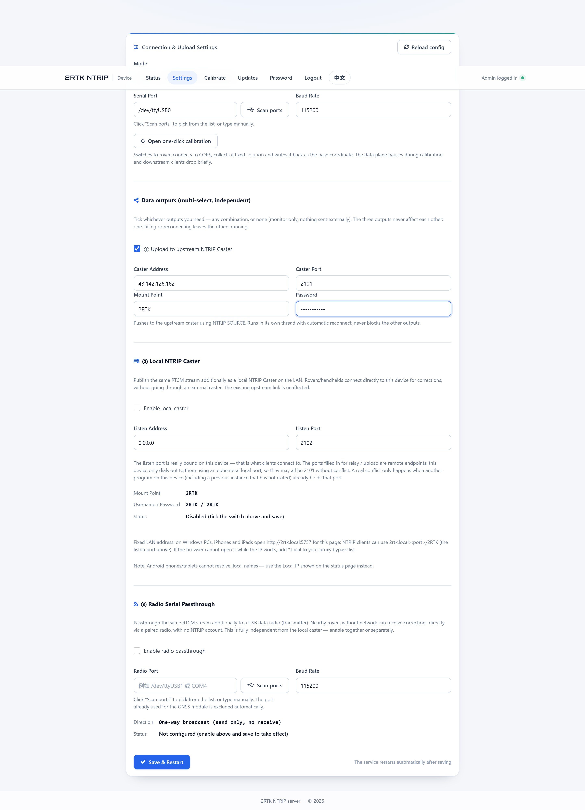

*Cloud caster upload enabled and filled in.*

| Field | What to enter |
|---|---|
| Caster address | Your caster's hostname or IP |
| Caster port | The upload port, usually `2101` |
| Mount point | The mount point name you created |
| Password | The mount point password |

Note there is **no username field** for uploads. NTRIP uploaders identify themselves by mount point and password; the upload account credentials are enforced by the caster itself or are not required for a source connection.

### 8.3 Save and verify

Click **Save & Restart**, then confirm in three places:

1. **Status page** — the output card shows `Authenticated · streaming` and a growing byte counter.
2. **Caster side** — the mount point appears in the caster's source table.
3. **Log** — the server logs an authenticated upload connection.

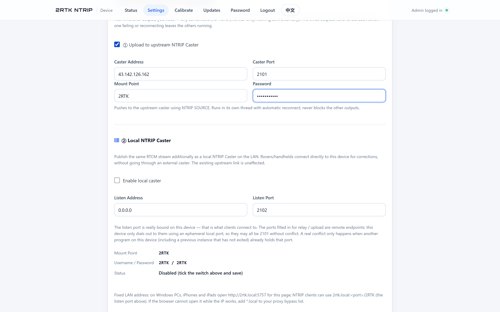

*The four fields filled in, ready to save.*


*After saving: the output card reports the caster as authenticated, with bytes and frames counting up.*

Here is what a successful start looks like in `/opt/2RTKserver/server.log`:

```text
上传出口已启动：43.142.126.162:2101/2RTK（独立线程，断线自动重连）
成功连接到43.142.126.162:2101
上传出口认证通过，开始推送：43.142.126.162:2101/2RTK
```

The third line is the one that matters. If you see the first two but never the third, the caster rejected the handshake — wrong mount point name or wrong password.

**Verify from the caster side too.** A TCP connection staying open only proves the handshake succeeded; querying the source table proves the stream is actually registered. On any NTRIP 1.0 caster:

```bash
# Raw socket — caster port 2101 speaks a custom TCP protocol, not HTTP,
# so curl/browser will fail with "HTTP/0.9 when not allowed".
python3 - <<'EOF'
import socket
s = socket.create_connection(("43.142.126.162", 2101), timeout=10)
s.sendall(b"GET / HTTP/1.0\r\nUser-Agent: NTRIP check\r\n\r\n")
buf = b""
while b"ENDSOURCETABLE" not in buf:
    d = s.recv(4096)
    if not d: break
    buf += d
print(buf.decode(errors="ignore"))
EOF
```

A live mount point appears as a `STR;` line. From the field test:

```text
STR;2RTK;Guilin;RTCM3.x;1084(2),1094(2),1114(2),1134(2),1005(2),1124(3),1074(2);
    B2I+E5a+G3+L1+L5;BDS+GAL+GLO+GPS+IRNSS;2rtk;CHN;25.2035;110.2775;0;0;...
```

Three things to check in that line: the mount point name, the message list (it must include `1005`), and the coordinates (they must match your surveyed position, not `0.0`).

> **Test with a rover, not just a client.** A plain NTRIP client connects and shows bytes flowing even if the stream is unusable. Real RTK performance requires the `1005` message to be present and the correction frame to match.

---

## 9. Relay Mode

Relay mode makes 2RTKserver a **re-distributor**: it pulls a stream from an upstream caster and re-publishes it.

**Why use it?**

- **Bridging networks.** Your rovers sit on a private network that cannot reach the provider directly, but this box can reach both.
- **Extending a stream's reach.** You have one good mount point and several consumers that need it.
- **Testing.** Verify an upstream stream is healthy before pointing production traffic at it.

### 9.1 Configure the relay source

Go to **Configuration** and set **Mode → `relay`**.

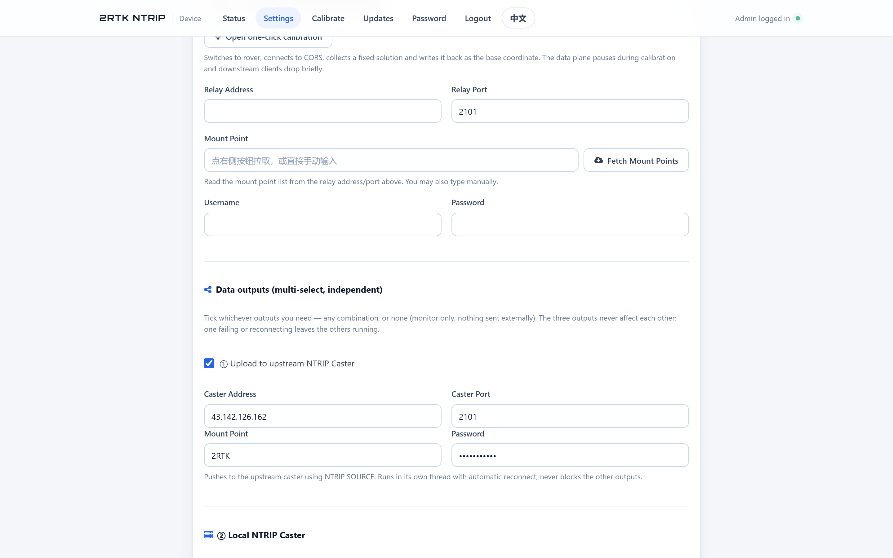

*Mode set to `relay`. The source fields appear; the serial fields disappear.*

| Field | What to enter |
|---|---|
| Relay address | The upstream caster's host |
| Relay port | The upstream caster's port, usually `2101` |
| Username | Your account on the upstream caster |
| Password | That account's password |

### 9.2 Fetch the mount point list

Click **Fetch Mount Points**. The box connects to the upstream caster on your behalf and parses its source table — the browser cannot do this itself, because port 2101 is a custom TCP protocol rather than HTTP.

This step is also a credential test: if the fetch succeeds, the host, port, and account are all correct.

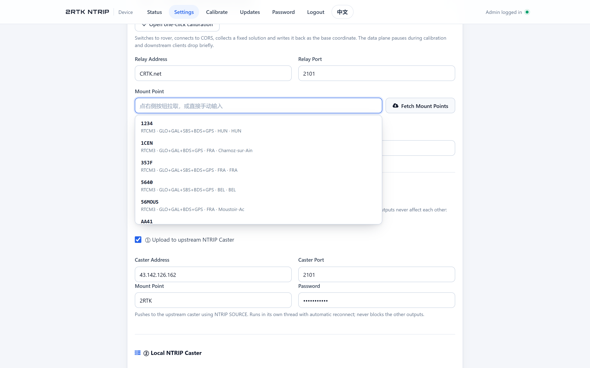

*The upstream source table retrieved — 1323 mount points in this case.*

Pick one and enter it in the mount point field:

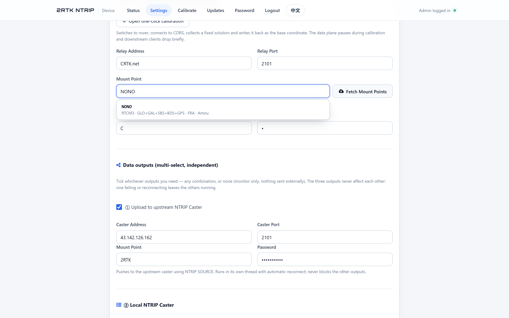

*Upstream credentials filled in and a mount point selected.*

> **Example — CRTK.net:** a public caster reachable at `CRTK.net:2101` with username `C` and password `C`. Its source table listed **1323 mount points** during testing, nearly all carrying `1005,1006,...,1230` — a full RTCM 3.x set. Any of them works for a relay demo. The example here uses `NONO` (Amou, France).

### 9.3 Verify the pull

Save and restart. The relay connection is logged as:

```text
进入中继模式
收到realy caster服务器响应: ['HTTP/1.1 200 OK', 'Server: NTRIP Millipede Server 0.8.1', ...]
Relay NTRIP server authentication passed, receiving RTCM data
```

The status page then reports the relay as the data source:

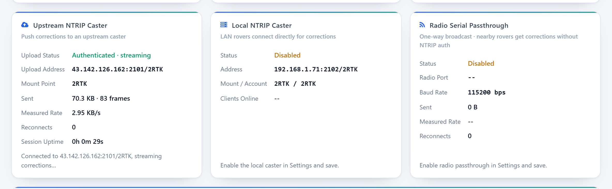

*Relay mode active: source `CRTK.net:2101/NONO`, forwarded to the cloud caster, bytes accumulating.*

Notice the source line reads `CRTK.net:2101/NONO` — the upstream host *and* mount point, so you can always tell which stream is being redistributed.

### 9.4 Where the relayed data goes

Relay output is governed by the same **Data Outputs** checkboxes as serial mode. All three can run at once:

- Pull from the upstream caster and push to your own cloud caster.
- Pull and serve on the built-in local caster.
- Pull and output to a radio.

> **Bandwidth note:** relay mode uses bandwidth for both the incoming and outgoing stream. On a metered or slow link, watch for dropped frames — the status page byte counters show throughput.

---

## 10. Built-in Local Caster

Rather than pushing to an external server, 2RTKserver can serve NTRIP **directly** on your LAN. For a private base station this is often the better choice: no public server, no internet dependency, lower latency.

### 10.1 Enable it

In **Configuration**, under **Data Outputs**, tick **② Local NTRIP Caster**.


*The built-in local caster enabled.*

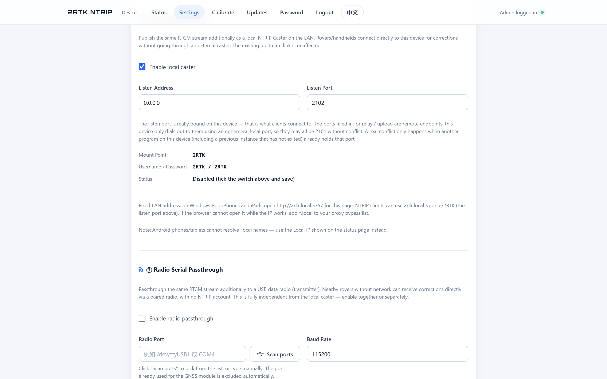

*Ticked and saved — the listen address and port are set below.*

| Field | What to enter |
|---|---|
| Listen address | Bind address, e.g. `0.0.0.0` for all interfaces, or a specific LAN IP |
| Listen port | TCP port to serve on, e.g. `2102` |

Once enabled and saved, the status page shows the mount point, credentials, and current client count:

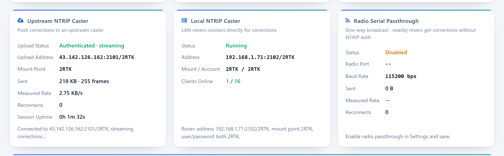

*`Running`, `1 / 16` clients connected. That count is live — it goes up as rovers connect.*

### 10.2 Connect a rover

Point your rover or NTRIP client at:

```
Host:         <box-ip>   (or 2rtk.local on mDNS-capable networks)
Port:         <listen port>
Mount point:  2RTK       (shown on the configuration page)
Credentials:  as displayed on the configuration page
```

The default credentials are fixed: username `2RTK`, password `2RTK`. Change them only if you need to.

### 10.3 Verify it like a real client

The built-in caster follows the NTRIP spec closely enough that any client works. You can confirm this without one, using two raw sockets:

```bash
# 1) Source table — served without credentials, so clients can discover the mount point
python3 - <<'EOF'
import socket
s = socket.create_connection(("192.168.1.71", 2102), timeout=8)
s.sendall(b"GET / HTTP/1.0\r\nUser-Agent: NTRIP probe\r\n\r\n")
print(s.recv(4096).decode(errors="ignore"))
EOF
```

```text
SOURCETABLE 200 OK
CAS;192.168.1.71;2102;2RTK NTRIP Caster;2RTK;0;CHN;43.578903011;-0.739368313;0.0.0.0;0;none
NET;2RTK;2RTK;B;N;none;none;none;none
STR;2RTK;2RTK-Base;RTCM 3.2;1004(1),1005(1),1008(1),1012(1),1019(1),1033(1),1077(1),1087(1),1097(1),1107(1),1127(1);2;GPS+GLO+GAL+SBAS+BDS;;;43.578903011;-0.739368313;0;0;2RTK;none;B;N;0;
ENDSOURCETABLE
```

Two details worth reading out of that table. The **mount point is `2RTK`** and the **credentials are `2RTK`/`2RTK`**, both fixed. And the coordinates `43.578903011, -0.739368313` are the relayed station's position — proof that the data being served is genuinely the upstream stream, passed through unchanged.

```bash
# 2) Stream — correct password gets 200 + data, wrong password gets 401
python3 - <<'EOF'
import base64, socket
def probe(pw):
    s = socket.create_connection(("192.168.1.71", 2102), timeout=8)
    auth = base64.b64encode(f"2RTK:{pw}".encode()).decode()
    s.sendall((f"GET /2RTK HTTP/1.0\r\nUser-Agent: NTRIP probe\r\n"
               f"Authorization: Basic {auth}\r\nNtrip-Version: Ntrip/2.0\r\n\r\n").encode())
    head = s.recv(256).split(b"\r\n")[0].decode()
    s.settimeout(3)
    total = 0
    try:
        while total < 60000:
            d = s.recv(8192)
            if not d: break
            total += len(d)
    except socket.timeout:
        pass
    print(f"password={pw!r:8} -> {head}  {total} bytes")
probe("2RTK")
probe("bad")
EOF
```

```text
password='2RTK'   -> HTTP/1.1 200 OK  60828 bytes
password='bad'    -> HTTP/1.1 401 Unauthorized  0 bytes
```

That `401` matters: it means the caster enforces credentials rather than serving everyone. A rover that shows "connected but no fixed solution" against an open caster is usually the opposite problem, so knowing which you have saves a lot of debugging.

### 10.4 Port conflicts

A detail worth understanding: the **listen port** genuinely occupies that TCP port on the box. The **relay port** and **caster port** are *outbound* destinations — the box connects to them from an ephemeral source port. So you can have the local caster on `2102` while also relaying from an upstream caster on `2101`; they do not conflict.

What *does* conflict is two local processes binding the same port — including a previous instance that has not fully exited. If the local caster fails to start, check for a stale process.

---

## 11. Radio Telemetry Passthrough

Where rovers are out of network range, corrections can go out over a UHF radio instead. The box sends the RTCM stream to a second serial port, which drives a radio modem.

### 11.1 Enable it

In **Configuration**, under **Data Outputs**, tick **③ Radio telemetry passthrough**.

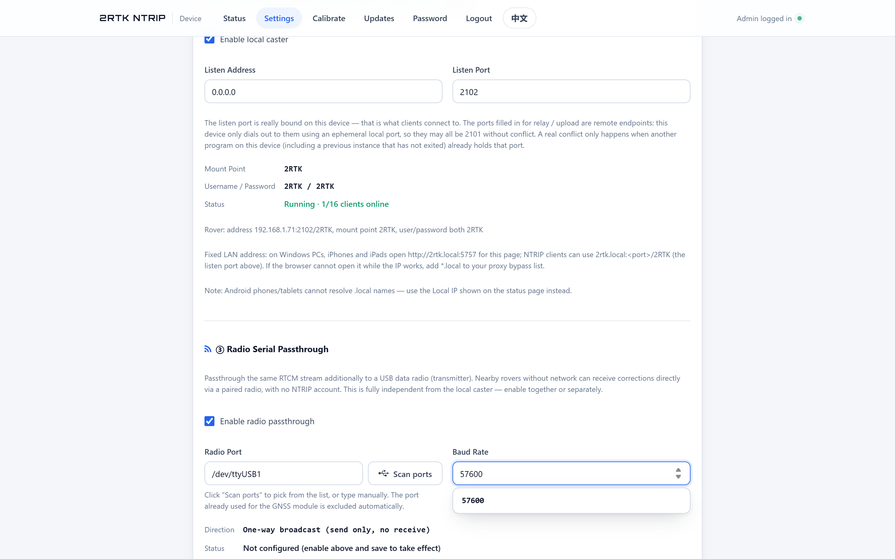

*Radio telemetry passthrough enabled: port and baud rate fields appear.*

| Field | What to enter |
|---|---|
| Radio port | The serial device your radio's data cable is connected to, e.g. `/dev/ttyUSB1` |
| Baud rate | **Must match the radio's configured rate.** Default `115200`. |

### 11.2 How it behaves

- **Direction is one-way: transmit only.** The box broadcasts corrections and does not read anything back from the radio. This suits standard broadcast-RTK setups where rovers only listen.
- **The radio is a second serial device.** If it is also a CH340-class adapter, it will appear as the next available `/dev/ttyUSB*` — typically `ttyUSB1` if the GNSS module took `ttyUSB0`. Use **Scan Ports** next to the radio field to enumerate them.
- **Baud rate must match hardware.** Unlike the GNSS side, there is no auto-probing here. Configure the radio itself (via its own utility or DIP switches) and enter the same rate here.
- **It needs its own port.** If the box has only one USB serial adapter and it is taken by the GNSS module, there is nothing to send to. The setting saves, but the output will report that it is enabled and not running.

Check what you actually have before configuring:

```bash
ls -l /dev/ttyUSB* /dev/ttyACM*
```

```text
crw-rw---- 1 root dialout 188, 0 Nov 11 07:54 /dev/ttyUSB0
```

One device means one port. With the GNSS module on `ttyUSB0`, a radio needs a second adapter — usually a second CH340 or a USB-to-RS232 cable.

### 11.3 Choosing a radio and rate

RTCM MSM4 from a multi-constellation receiver runs at roughly **2–4 kbit/s**, but transient peaks are higher. A 9600 baud link is usually too narrow and will drop messages, which degrades rover accuracy. Practical minimums:

| Link rate | Suitability |
|---|---|
| 9600 baud | Marginal — expect dropped messages |
| 19200 baud | Workable for MSM4 with reduced message set |
| 38400 baud and above | Comfortable |

If your rovers fix slowly or intermittently over radio, the link rate is the first thing to check.

### 11.4 Range, and why the base height matters

A radio link is line-of-sight in practice. A 1 W UHF modem gives a few kilometres in open terrain and considerably less in hilly or built-up areas. Two things compensate:

- **Antenna height.** A base antenna 10 m up reaches substantially further than one at 2 m. This is the single biggest range improvement.
- **A second radio at a repeater site**, if you need to cover a valley.

Because RTCM is a one-way broadcast, you cannot retransmit lost messages. Rovers simply wait for the next epoch, so a marginal link shows up as slow fixes rather than disconnection.

> **📷 PHOTO PLACEHOLDER — radio-setup**
> *Needed: the radio modem cabled to the box, showing the data port and the antenna.*

---

## 12. Maintenance

### Checking service health

```bash
systemctl status 2rtkserver          # is it running?
journalctl -u 2rtkserver -n 100      # recent log
journalctl -u 2rtkserver -f          # follow live
```

### Restarting

```bash
sudo systemctl restart 2rtkserver
```

You can also restart from the web UI — the **Save & Restart** button on the configuration page does this automatically after saving.

### Updating

```bash
cd /opt/2RTKserver
sudo bash update.sh
```

The updater preserves your configuration and calibration history.

### Uninstalling

```bash
cd /opt/2RTKserver
sudo bash uninstall.sh
```

### Backing up

Two things matter:

| What | Where |
|---|---|
| Configuration and calibration history | `/opt/2RTKserver/2RTKserver.db` and `calibration.db` |
| Calibration working data | `/opt/2RTKserver/.calibration/` |

Copy these off the box periodically. Restoring them into a fresh installation brings back your calibration without re-running it — useful if the hardware dies but the antenna position is unchanged.

### A note on uptime

The service is registered with `Restart=always`. If it crashes, systemd restarts it automatically. A base station that must stay up should also be on a UPS — a power cut during a calibration write window is the one scenario the restore logic cannot handle (see §7.7).

---

## Appendix A — Supported Modules

| Module | Constellations | Bands | Roles | Calibration methods |
|---|---|---|---|---|
| Quectel LG290P | GPS, GLONASS, Galileo, BDS, QZSS, NavIC | Multi-band | Base + Rover (dual) | All four |
| u-blox ZED-F9P | GPS, GLONASS, Galileo, BDS | L1/L2 | Base + Rover (dual) | All four |
| Unicore UM980 / N4 | GPS, GLONASS, Galileo, BDS, QZSS | Multi-band | Base + Rover (dual) | All four |
| Quectel LC29H | GPS, GLONASS, Galileo, BDS | L1/L5 | Limited | Depends on variant |

**Dual-mode** means the module can act as either a base or a rover. This matters for calibration: the CORS one-click method needs the module to temporarily become a rover, receive corrections, and lock a fixed solution — a base-only receiver cannot do that, and must use survey-in instead.

The calibration page detects the module and only offers the methods it can actually perform. If you expected to see CORS one-click but it is not there, the module either is not reporting dual-mode capability or was not detected correctly.

---

## Appendix B — Common Problems

### The web page does not open

| Check | Command / action |
|---|---|
| Is the service running? | `systemctl status 2rtkserver` |
| Is it listening? | `ss -lntp \| grep 5757` |
| Firewall blocking? | `sudo ufw status` — allow 5757 from your LAN |
| Wrong IP? | Check the installer output, or `ip addr` |
| Proxying `.local`? | Use the IP address instead; add `*.local` to proxy bypass |

### No satellites on the status page

The module is talking but not tracking. Almost always the antenna:

- Is it connected? SMA connectors are fragile — check the centre pin.
- Does it have sky view? Indoors you will get zero or a handful of satellites.
- Is the antenna powered? Active antennas need bias-T power. Most modules supply it, but some carrier boards need a jumper.

### Satellites tracked but position never resolves

The receiver has satellites but no fix. Usually:

- Too few satellites for a fix — needs 4 minimum, realistically 6+ for a stable position.
- Very high PDOP — poor geometry, often caused by a restricted sky view.
- The module is in a mode that suppresses position output.

### Data flows but rovers do not fix

This is the classic `1005` problem. Check the status page RTCM output list:

- **Is `1005` (or `1006`) present?** Without it, the rover has no base position and cannot apply corrections.
- **Is the calibration actually complete?** An uncalibrated base may emit `1005` with a coarse single-point position, which gives metre-level results at best.
- **Does the frame match?** WGS84 versus CGCS2000 mismatch produces a constant offset.

### The calibration keeps timing out at FIX_WAIT

Work through §7.7 in order. The most frequently overlooked causes are the port/frame pairing and the CORS account's permission scope — both let you connect successfully and receive data while never permitting a fixed solution.

### After a failed calibration, the main service will not start the data plane

The module was probably left in rover mode. Re-run calibration: the routine detects rover mode and restores base mode as part of its restore path. If the service cannot reach the module at all, verify the port still exists (`ls /dev/ttyUSB*`) and that nothing else is holding it (`sudo fuser -v /dev/ttyUSB0`).

### Local caster will not start

The listen port is occupied:

```bash
sudo ss -lntp | grep 2101
```

If a stale process from a previous run holds it, restart the service. If another application needs that port, choose a different listen port in the configuration.

---

## Credits

2RTKserver is built on Flask, pyserial, and the NTRIP protocol. Calibration command sequences are derived from each module's public protocol documentation.

Feedback and issue reports are welcome.
