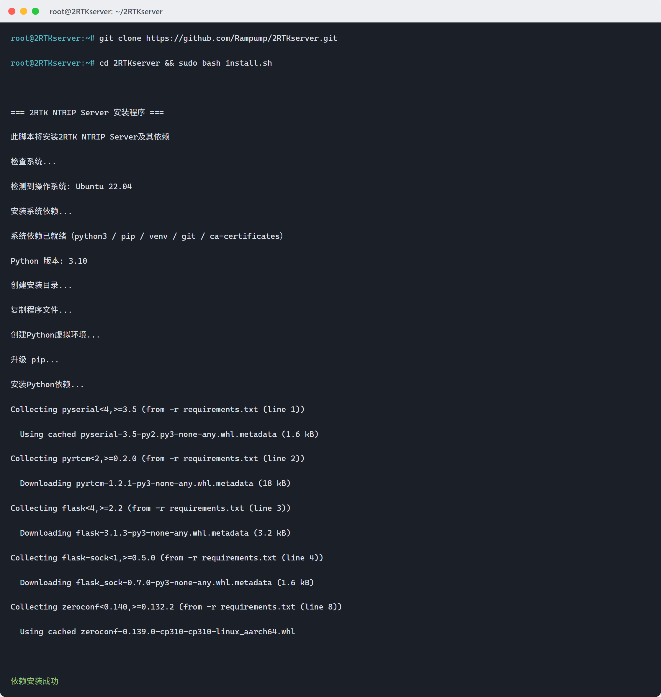
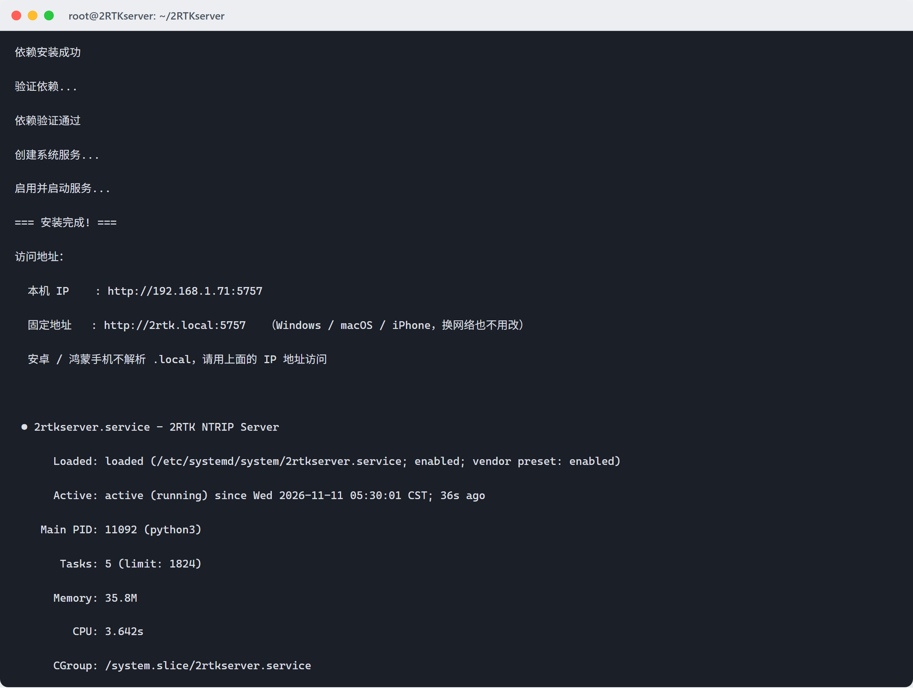
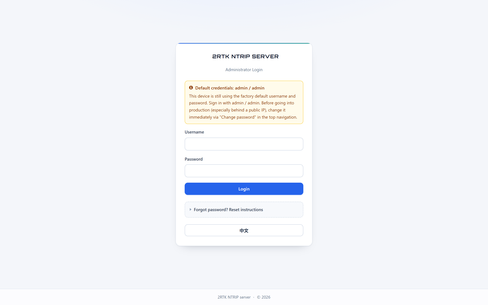
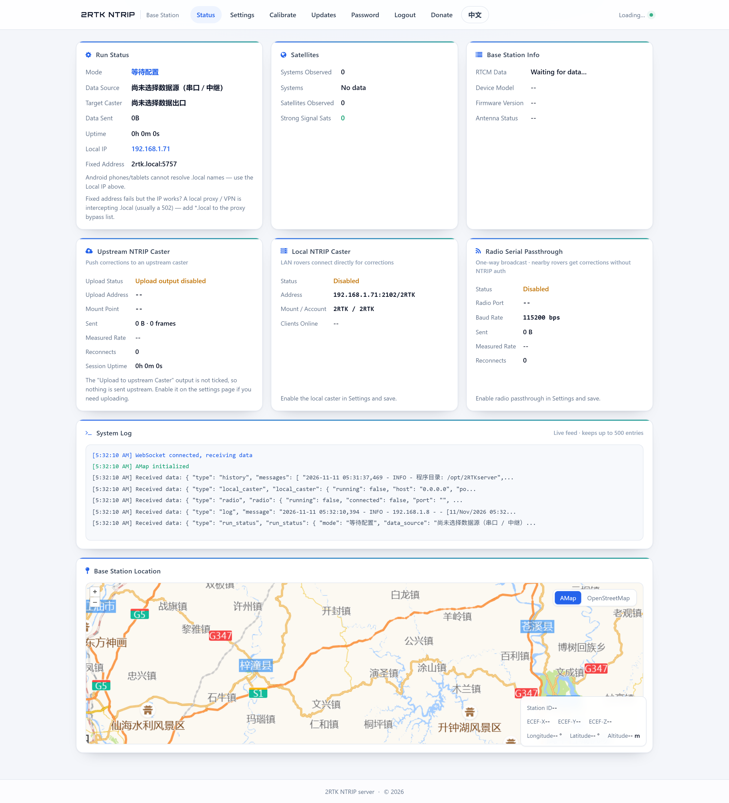
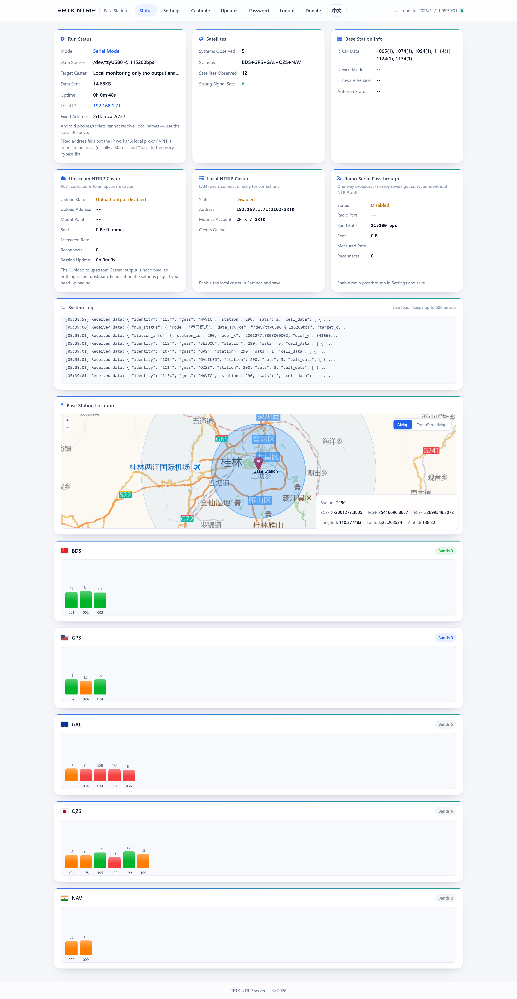
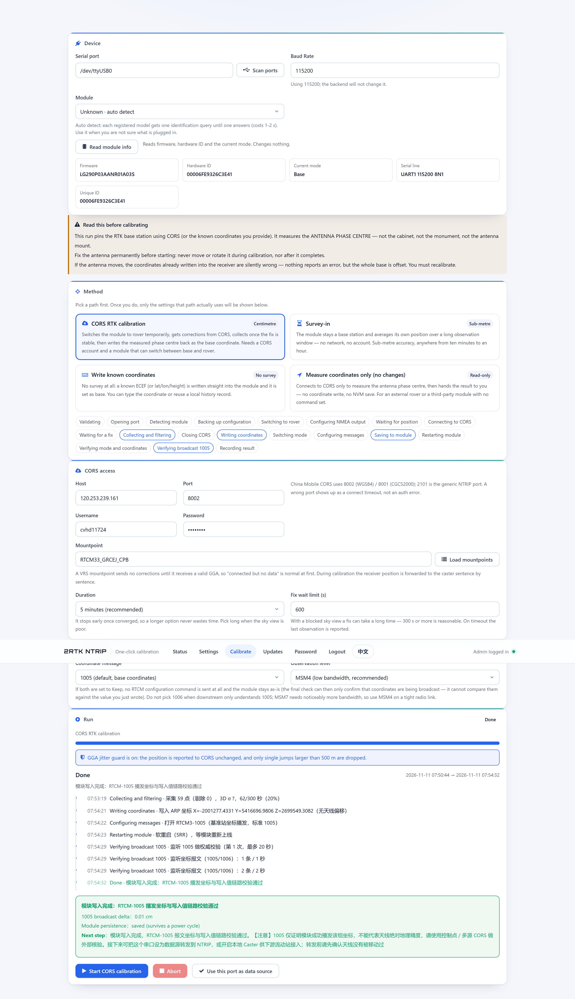
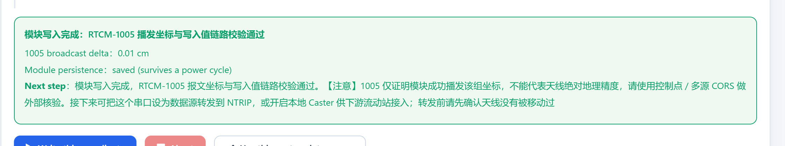
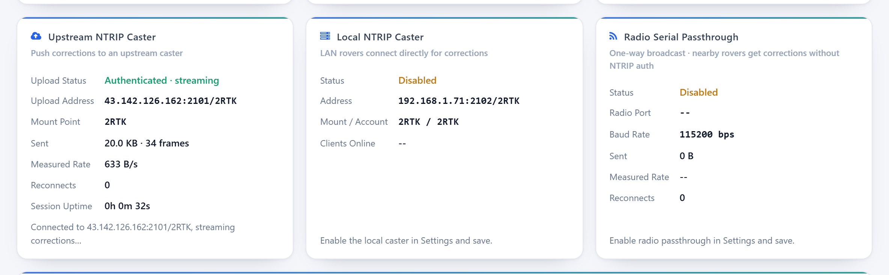
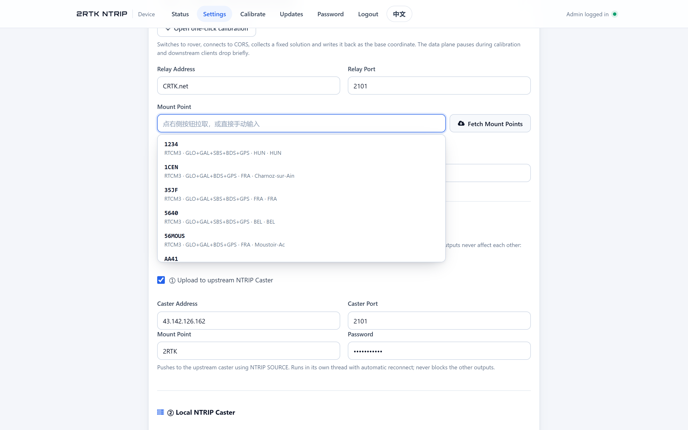
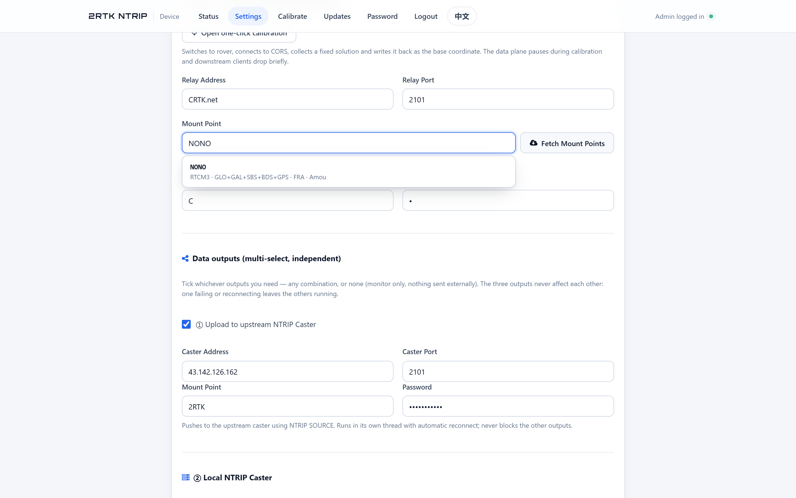

# 2RTKserver 完整使用教程

> 从零开始，在廉价 ARM 盒子、树莓派或任意 Linux 主机上搭一台完整的 RTK 基准站。

**适用版本：** 3.1.3
**实测环境：** Amlogic S905L3B 电视盒子运行 Armbian（Ubuntu 22.04，aarch64），Quectel LG290P 模块经 CH340 USB 转串口连接。

---

## 目录

1. [这个程序是做什么的](#1-这个程序是做什么的)
2. [需要准备什么](#2-需要准备什么)
3. [硬件接线](#3-硬件接线)
4. [全新安装](#4-全新安装)
5. [首次登录与状态页](#5-首次登录与状态页)
6. [串口配置](#6-串口配置)
7. [坐标标定](#7-坐标标定)
8. [上传到云端 NTRIP Caster](#8-上传到云端-ntrip-caster)
9. [中继模式（Relay）](#9-中继模式relay)
10. [内置本地 Caster](#10-内置本地-caster)
11. [数传电台透传](#11-数传电台透传)
12. [日常维护](#12-日常维护)
13. [附录 A — 支持的模块](#附录-a--支持的模块)
14. [附录 B — 常见问题](#附录-b--常见问题)

---

## 1. 这个程序是做什么的

2RTKserver 把一个 GNSS 接收模块变成**独立运行的 RTK 基准站**。它从串口读取模块输出的 RTCM 3 差分数据，通过网络分发出去，让野外的流动站获得厘米级定位。

它不只是个数据搬运工，还会：

- **自动标定基站坐标**到厘米级——自动驱动模块走完所需的命令序列。
- **失败自动回滚**——任何一步出问题都会把模块恢复到标定前的状态，不会把接收机留在半残模式下。
- **注入基站元信息**，让流动站知道基站在哪、用的是哪个坐标系。
- **提供 Web 界面**，用于配置、实时监控和固件检查。

### 三种运行模式

| 模式 | 作用 | 使用场景 |
|---|---|---|
| `none` | 读取模块，只在本地显示，不对外输出 | 台面测试、首次验证 |
| `serial` | 从串口读模块数据并通过 NTRIP 分发 | **基站正常运行状态** |
| `relay` | 从另一个 Caster 拉流后重新分发 | 打通网络、扩展覆盖 |

### 数据可以往哪里去

三个出口互相独立，可以任意组合启用：

1. **云端 NTRIP Caster** —— 把数据流推到公网服务器。
2. **本地 NTRIP Caster** —— 直接在盒子上对局域网提供服务。
3. **无线电数传** —— 通过第二个串口把差分推给 UHF 电台。

---

## 2. 需要准备什么

### 硬件

| 物品 | 说明 |
|---|---|
| Linux 主机 | 任意 ARM 开发板、迷你主机或旧笔记本。实测 Amlogic S905L3B + Armbian。 |
| GNSS 模块 | Quectel LG290P（多频，推荐）、u-blox ZED-F9P、Unicore UM980/N4、Quectel LC29H。 |
| USB 转串口 | CH340、CP2102、FT232，或模块自带的 USB 口。 |
| GNSS 天线 | **必须能看见天空。** 这一项比其他任何因素都关键。 |
| 天线馈线 | 低损耗同轴线，越短越好。每多一米都在损失信号。 |

> **📷 实物照片占位 — hardware-overview**
> *需要：全套设备摆在桌面上的照片——盒子、GNSS 模块、USB 转串口、天线、馈线。*

### 网络

- 主机需要能访问你的 CORS 服务商（用 CORS 标定时）或你的云端 Caster。
- 局域网内访问需要知道主机的 IP 地址。

### 账号

- **CORS 账号** —— 只有用 CORS 一键固定标定才需要。服务商一般会给你：服务器地址、端口、用户名、密码、挂载点名称。
- **云端 Caster 账号** —— 只有要发布数据流时才需要。

---

## 3. 硬件接线

接线就这么几根：

```
   ┌──────────────┐   USB    ┌───────────────┐   UART    ┌─────────────┐
   │   Linux 盒   │ ───────► │ USB 转串口    │ ────────► │ GNSS 模块   │
   │              │          │ (CH340 等)    │           │  (LG290P)   │
   └──────────────┘          └───────────────┘           └──────┬──────┘
                                                                │ SMA
                                                                ▼
                                                         ┌─────────────┐
                                                         │    天线     │
                                                         └─────────────┘
```

1. 把 GNSS 模块接到 USB 转串口：`TX → RX`、`RX → TX`、`GND → GND`。供电按模块数据手册来。
2. 把转接头插到主机的 USB 口，系统里会出现 `/dev/ttyUSB0`（CH340）或 `/dev/ttyACM0`（原生 USB CDC）。
3. 天线拧到模块的 SMA 座上，**放到能看见天空的地方**。别放铁皮屋顶下、别贴墙——收不到卫星，基站没法自己标定。

> **📷 实物照片占位 — wiring-closeup**
> *需要：模块接到 USB 转串口的特写，能看清 TX/RX/GND；以及天线室外安装的照片。*

### 确认系统认到了转接头

装程序之前，先确认系统能看到设备：

```bash
ls -l /dev/ttyUSB* /dev/ttyACM* 2>/dev/null
```

正常会看到类似这样的输出：

```
crw-rw---- 1 root dialout 188, 0 Nov 11 05:20 /dev/ttyUSB0
```

如果什么都没有，说明转接头没被识别。先换个 USB 口或换根线，再往下走。

---

## 4. 全新安装

### 4.1 把源码放到主机上

```bash
cd ~
git clone <你的仓库地址> 2RTKserver
cd 2RTKserver
```

没有 git 访问权限的话，用 `scp` 或 U 盘把整个项目文件夹拷过去即可。安装脚本做的是纯复制、不是 git clone，所以源码压缩包也能用。

### 4.2 运行安装脚本

```bash
sudo bash install.sh
```

安装脚本会依次做这几件事：

1. 安装系统依赖（`python3`、`python3-venv`、`python3-pip`）。
2. 在 `/opt/2RTKserver/venv` 创建虚拟环境。
3. 按 `requirements.txt` 安装 Python 依赖。
4. 把程序复制到 `/opt/2RTKserver`。
5. 注册并启动 `2rtkserver` 的 systemd 服务。



*安装依赖包。在性能弱的 ARM 盒子上这一步可能要几分钟，属正常现象。*



*安装完成。注意末尾输出的访问地址。*

> **📷 实物照片占位 — install-console**
> *需要（可选）：直接拍摄显示器上安装输出的照片，用于"真实控制台"的感觉。上面两张是终端截图。*

### 4.3 确认服务已启动

```bash
systemctl status 2rtkserver
```

应该显示 `active (running)`。如果不是：

```bash
journalctl -u 2rtkserver -n 50 --no-pager
```

日志会直接说明原因——一般是缺 Python 包，或者 `/opt/2RTKserver` 的权限问题。

### 4.4 需要先卸载旧版本

如果要在旧版本上重装，先卸载干净，免得残留文件捣乱：

```bash
cd /opt/2RTKserver
sudo bash uninstall.sh
```

卸载脚本会停止并移除服务。数据库和标定记录会保留；想要彻底清空，再手动删掉 `/opt/2RTKserver` 目录。

> **只是升级而不是重装？** 在 `/opt/2RTKserver` 里执行 `sudo bash update.sh`。它会保留你的配置和数据。

---

## 5. 首次登录与状态页

### 5.1 打开 Web 界面

在同一网络的任意设备上，浏览器访问：

```
http://<主机IP>:5757
```

安装脚本会把确切的地址打印出来。支持 mDNS 的网络还可以用：

```
http://2rtk.local:5757
```

> **注意：** 安卓设备解析不了 `.local` 名字，请直接用 IP。Windows 或 macOS 上 `2rtk.local` 打不开，多半是代理或 VPN 拦截了——把 `*.local` 加进代理的直连（绕过）列表即可。

### 5.2 登录



*登录页。默认账号密码都是 `admin`。*

**登录后立刻改密码。** 首次登录完成后，点顶部导航的「修改密码」。只要还在用默认密码，登录页就会一直显示警示条。

> **安全提示：** 这个 Web 界面是给可信局域网用的，不要把 5757 端口直接暴露到公网。需要远程访问请走 VPN。

### 5.3 状态页



*还没配置时的状态页——没有数据在流动。*

状态页是日常运维的主要视图：

| 字段 | 含义 |
|---|---|
| 模式 | 当前运行模式（`none` / `serial` / `relay`） |
| 串口 | 正在使用的端口与波特率 |
| 卫星数 | 当前跟踪到的卫星数量 |
| 系统 | 有哪些星座在位（GPS、GLONASS、Galileo、BDS、QZSS） |
| 位置 | 基站当前坐标 |
| RTCM 输出 | 正在播发哪些报文类型 |
| 运行时长 | 本次会话已运行的时长 |



*状态页有实时数据了——卫星在跟踪、位置已解算、RTCM 报文在流动。*

> 状态页走 WebSocket 推送，卫星数和位置会持续刷新，不需要手动刷新页面。

---

## 6. 串口配置

进入「运行设置」（`/config`）。


*配置页。此时模式还是 `none`，接下来要改成 `serial`。*

### 6.1 设置模式

选 **Mode → `serial`**。这告诉程序：从串口读模块数据并分发出去。

### 6.2 找到串口

两种方式：

**方式一 —— 扫描。** 点「扫描串口」，程序会枚举系统里的串口设备并填进下拉框。


*扫描后，识别到的端口出现在下拉框里。*

**方式二 —— 手填。** 已经知道端口就直接填 `/dev/ttyUSB0` 或 `/dev/ttyACM0`。

> **怎么区分两种端口：** CH340/CP2102/FT232 这类转接芯片走 `/dev/ttyUSB0`；带原生 USB 的模块（不少 u-blox 板子）走 `/dev/ttyACM0`。如果同时插了好几个 USB 串口设备，拔掉模块再扫一次——消失的那个就是模块。

### 6.3 设置波特率


*端口和波特率填好。*

| 模块 | 常见波特率 |
|---|---|
| Quectel LG290P | 115200 或 460800 |
| u-blox ZED-F9P | 38400（原生 USB 口不看波特率） |
| Unicore UM980 | 115200 |
| Quectel LC29H | 115200 |

**不确定就先试 115200。** 标定程序会自动试探多个波特率，所以标定环节猜错还能救；但正常出数据时，这个值必须对。

### 6.4 验证数据在流动

点「保存并重启」。页面会跳转，服务重启。然后：

1. 回到**状态页**。
2. 10~20 秒内，卫星数应该往上涨，位置应该解算出来。
3. RTCM 输出区应该列出 `1005`、`1074`、`1094`、`1114`、`1124`、`1134` 等报文类型。

有卫星但没位置，天线多半在室内或被遮挡。什么都没有，先回头核对端口和波特率。

> **RTCM 报文编号的含义：**
> `1005`/`1006` = 基站位置与天线元信息 · `1074`/`1084`/`1094`/`1114`/`1124`/`1134` = GPS/GLONASS/Galileo/QZSS/BDS/NavIC 观测数据（MSM4） · `1230` = GLONASS 码相位偏差。
>
> `1005` 这条是告诉流动站*你的基站在哪*的。没有它，流动站收得到差分却用不上。

---

## 7. 坐标标定

基站只有**非常精确地知道自己的位置**，才能产出有用的差分数据。基站坐标差一米，每个流动站的输出就差一米。标定就是让基站学会自己的位置。

点顶部导航的「一键标定」。


*标定页。第一步是确认硬件连接。*

### 7.1 四种标定方式

标定页最多提供四种方式。**能看到哪几种取决于你的模块支持什么**——只能当流动站的接收机做不了自收敛，依此类推。

| 方式 | 做什么 | 精度 | 耗时 | 前提条件 |
|---|---|---|---|---|
| **CORS 一键固定** | 从公共 CORS 网络把差分注入模块，等固定解，再对位置取平均 | 厘米级 | 5~10 分钟 | 双模模块、CORS 账号、网络 |
| **仅测量** | 原理同上，但位置取自**外部流动站**而不是模块自己 | 厘米级 | 5~10 分钟 | 双模模块、外部流动站、CORS 账号 |
| **自收敛（Survey-in）** | 模块对自己的单点位置做长时间平均 | 分米级 | 15~60 分钟 | 单模模块 |
| **手动写入** | 你自己填已知坐标 | 取决于你的测量 | 立即 | 一个已测定的点 |

**该用哪个？** 有 CORS 账号又有双模模块，就用 **CORS 一键固定**——它最准、也最自动。模块切不了流动站模式，用**自收敛**。点位坐标已经测过了，用**手动写入**。

### 7.2 CORS 一键固定

这是主菜。先讲清程序内部在干什么，你就知道该期待什么：

1. **让数据面让出串口。** 一边推流一边标定是做不到的。
2. **识别模块**——发版本查询、读回应答。
3. **备份当前配置**，出问题好回滚。
4. **把模块切到流动站模式**，配置所需的 NMEA 输出。
5. **连上 CORS 挂载点**，把差分数据灌进模块串口。
6. **等固定解。** 这要求良好的天空视野：质量位必须连续 30 秒达到 4。
7. **采集样本**——按设定的时长（默认 300 秒），3σ 剔除异常值后对剩下的取平均。
8. **把平均后的坐标写进模块**，作为固定基站坐标。
9. **把模块恢复成基站模式**，回放报文配置，重启并核验。

#### 第一步 —— 识别模块

点「识别模块」。


*识别进行中——程序正在探测串口。*


*模块识别出来了，连同固件版本和能力位。*

识别失败最常见的原因：串口还攥在主程序的数据线程手里（等几秒重试）、波特率不对、或者模块没供电。

#### 第二步 —— 选择方式


*方式选择。已选中 CORS 一键固定。*

#### 第三步 —— 填写 CORS 账号


*填写 CORS 服务商信息。*

| 字段 | 填什么 |
|---|---|
| 服务器地址 | 服务商给的地址，例如 `120.253.239.161` |
| 端口 | 你要用的坐标系对应的端口——见下面说明 |
| 用户名 | CORS 账号 |
| 密码 | CORS 密码 |

> **端口和坐标系是配对的。** 常见的国内 CORS 服务商会在多个端口上提供*同一批*挂载点，一个基准对应一个端口：
> - `8002` → WGS84
> - `8001` → CGCS2000
>
> 端口选错时，你往往照样能连上、照样能收到数据——但位置永远到不了固定解，因为差分基准和模块预期的不一致。**如果一直卡在浮动解，先查这一项。**

#### 第四步 —— 获取并选择挂载点

点「获取挂载点」。


*从服务商拉回来的挂载点列表。*

挑挂载点时看两点：

- **覆盖你的区域**——挂载点名字一般带地区或网络标识。
- **播发多星座多频数据**——名字里带 `RTCM33`、`5G16F`（五星十六频）之类的就是这个意思。


*挂载点选好。*

信息填完，页面会把任务汇总出来。


*参数都填好了，开始前再核对一遍。*

#### 第五步 —— 启动并确认


*确认对话框。请认真读——它明确要求天线不能动。*

> **点开始之前：** 天线必须固定牢靠，整个标定期间不能动。程序会丢弃跳变超过 500 米的样本，但天线要是本身在晃，固定解压根出不来。

点「开始」。

#### 第六步 —— 让它自己跑


*标定进行中——阶段指示器显示程序走到哪一步了。*


*在 `FIX_WAIT`：实时指标面板显示质量、卫星数、PDOP，以及固定解已经稳住多久。*

`FIX_WAIT` 是最需要耐心的阶段。面板里两个数字告诉你顺不顺：

- **质量（Quality）** —— 必须爬到 `4`。停在 `1` 或 `2`，说明差分没送进模块，或者天空视野太差。
- **已固定（Fixed for）** —— 必须连续到 30 秒。如果一直清零，说明固定解在反复掉；有东西不稳定。


*在 `COLLECT`：样本不断进来，实时显示已采集数、离散度、收敛情况。*

采集比等待短得多。样本离散度收敛后程序会提前结束；顺利时远不到一分钟。



*`DONE`。结果面板出现，给出最终坐标与精度。*



*摘要卡片：样本数、标准差，以及写进模块的坐标。*


*阶段时间线——每个阶段耗时多少。某次跑得慢时，用它判断时间花在哪。*

摘要卡片这样读：

| 字段 | 说明什么 |
|---|---|
| 样本数 | 参与平均的定位样本数。越多越好，但 60 以上已经很扎实。 |
| 标准差 | 水平方向上样本聚得有多紧。**5 cm 以内算好**；超过 20 cm 就该查天线和 CORS 质量。 |
| 坐标 | 写进模块的值。流动站就是相对这个位置定位的。 |

把记录下来的离散度和实时指标对比一下：实时固定解很紧、但最终样本离散度很大，通常是天线动了，或者模块在采集期间掉过固定解又重新固定。

阶段指示器会依次走过这些：

| 阶段 | 正在做什么 |
|---|---|
| `HOLD` | 等待数据线程让出串口 |
| `OPEN` | 独占打开串口 |
| `DETECT` | 识别模块 |
| `BACKUP` | 保存当前配置 |
| `ROVER_SETUP` | 把模块切成流动站 |
| `NMEA_SETUP` | 配置 GGA/GSA 输出 |
| `RTK_REINIT` | 重启模块，启动 RTK 解算 |
| `GGA_RATE_CHECK` | 实测 GGA 输出频率 |
| `GGA_WAIT` | 等定位输出 |
| `CORS_CONNECT` | 连接 CORS 挂载点 |
| `FIX_WAIT` | **等固定解——这一步最久** |
| `COLLECT` | 对位置样本取平均 |
| `CORS_CLOSE` | 断开 CORS |
| `SAVE` | 把坐标写入模块 |
| `RESTART` | 重启模块 |
| `VERIFY_MODE` | 确认模块回到基站模式 |
| `VERIFY_RTCM` | 确认 RTCM 恢复输出 |
| `DONE` | 完成 |

**不要关页面、不要重启服务、不要碰天线。** 程序自己会跑完，不需要任何干预。

#### "固定解"是什么意思

模块在 GGA 语句里报一个质量位：

| 质量位 | 含义 | 能当基站用吗 |
|---|---|---|
| 1 | 单点解 | 不能 |
| 2 | 差分/浮动解 | 不能 |
| 4 | **RTK 固定解** | **能** |
| 5 | RTK 浮动解 | 不能 |

程序要求质量位连续 30 秒为 4，同时卫星数至少 12 颗、PDOP ≤ 2.0。180 秒内没达成，会尝试降级用浮动解——但前提是浮动解足够稳。两者都不行，标定判失败，模块按备份回滚。

**一次顺利的标定长什么样。** 下面是 LG290P 接 CORS 挂载点的实测数据：

| 指标 | 数值 |
|---|---|
| 进入 `FIX_WAIT` 到固定成功 | 约 48 秒 |
| 固定解保持 | 连续 70 秒（要求 30 秒） |
| 质量位 | 4 |
| 卫星数 | 22–35 |
| PDOP | 0.9 |
| 采集样本数 | 81 |
| 标准差 | 1.9 cm |
| `1005` 广播偏差 | 0.01 cm |

最后一行值得解释一下。写完坐标之后，程序会把模块实际广播的 `1005` 读回来，拿里面的 ECEF 坐标和写进去的值比对。偏差接近零，说明模块接受了这个位置并且在原样广播。偏差很大，说明没写进去——通常是模块拒绝执行命令，或者还没应用就重启了。

### 7.3 仅测量（外部流动站）

**仅测量**针对一种特定情形：你想测定基站坐标，但基站模块本身当不了流动站；或者你手头已经有一台在基站位置拿到固定解的流动站。

和 CORS 一键固定的区别在于：

- 基站模块**不会**被切成流动站模式。
- 差分数据**不会**灌进基站模块。
- 位置由**另一台流动站**提供——手机、手簿，或者另一台接收机。

适用于模块不具备流动站能力、但你又不想只做自收敛的情况。

> **说明：** 对于只能当流动站的模块，`external_rover` 是*唯一*被提供的方式。这种情况下坐标由你的测量设备提供。

### 7.4 自收敛（Survey-in）

自收敛是不依赖外部条件的选项——不用 CORS 账号，不用网络。

模块对自己的单点位置做长时间平均。需要配置：

| 参数 | 含义 | 常见取值 |
|---|---|---|
| 观测次数 | 平均多少个定位结果 | 2000~5000 |
| 精度限值 | 估计精度优于这个值就提前结束 | 2.0 米 |
| 最短时长 | 至少跑多久才允许结束 | 5~15 分钟 |

**精度预期：** 自收敛受限于模块的单点精度，一般是 1~2 米。它**不是** CORS 标定的替代品。没有更好办法时用它，或者你的应用只需要分米级。

程序会持续监控收敛情况，只在位置稳定时才收尾——滚动 3σ 离散度低于 2 厘米并保持 60 秒。

### 7.5 手动写入坐标

如果你已经用专业设备测过这个点位，直接填坐标：

| 输入 | 格式 |
|---|---|
| 纬度 | 十进制度，例如 `25.203523` |
| 经度 | 十进制度，例如 `110.277483` |
| 椭球高 | 米，例如 `138.316` |

程序会把它们写进模块作为固定基站坐标。**务必确认坐标系和你的流动站一致**——常用的是 WGS84，国内某些场景用 CGCS2000。弄错了，每个流动站的输出都会带一个固定偏移。

### 7.6 标定到底写了什么

标定成功后，模块里保存的是：

- **平均后的 ECEF 坐标**——经过 3σ 剔除后，被采纳样本的算术平均（不是模块内部卡尔曼滤波的输出）。
- **RTCM 报文配置**——播哪些报文类型、什么频率。
- **基站模式**——模块留在基站状态，不会停在流动站。

程序还会在数据库里记一条**标定历史**：用的哪种方式、采了多少样本、最终离散度、得到的坐标。状态页显示的基站位置就来自这里。

> **为什么 1005 这条报文很关键：** 基站坐标是通过 `1005`（或 `1006`）这条 RTCM 报文播发给流动站的。流动站收得到 `1074` 之类却收不到 `1005`，就完全不知道基站在哪，差分没法用。如果流动站死活不固定，先看状态页的 RTCM 输出列表里有没有 `1005`。

### 7.7 标定失败怎么排查

程序失败时话很多——它会告诉你哪一项检查没过、观测到了什么。常见失败如下。

#### 识别阶段报"模块无应答"

串口被别人攥着了，通常是主程序的数据线程还在收上一轮的尾。

- 等 20 秒再重试。
- 还是不行，就先停服务、标定、再启服务。

#### "等待固定解超时"——质量位卡在 1 或 2

最常见的标定失败。错误信息里按顺序列了要查的项：

1. **CORS 账号权限。** 有些账号只给伪距（DGPS）差分，或者只授权某个坐标系。你能连上、能收到数据，但模块就是不采用这些差分。跟服务商确认。
2. **挂载点是否对口。** 距离太远的网络、或者精度等级不同的挂载点可能没用。优先选标明基站级、且覆盖你所在区域的。
3. **端口与坐标系配对。** 见 §7.2——`8002` 是 WGS84，`8001` 是 CGCS2000。对不上就是这个症状。
4. **天线遮挡。** 质量位在 4~5 附近徘徊却始终锁不住，就是这个原因。把天线挪到天顶开阔处。

#### "有 GLONASS 观测但没有 MT1230"

这是警告，不是失败：

> *该挂载点播发了 GLONASS 观测（1084）却没有播 MT1230 码相位偏差。模块虽然能跟踪 GLONASS，但通常无法把它们纳入模糊度固定，会明显降低固定成功率。*

把它当成**对差分流完整度的提示**，而不是对你 CORS 账号的判决。下面把话说全，因为这行警告最容易被误读——我们实测过。

触发这条警告的体检行长这样：

```
[CORS_DOWNLINK] 976 B/s，MSM4=GPS+GLONASS+Galileo+QZSS+BDS，1005=30帧，1230=缺失
```

五个星座、接近 1 KB/s、基站位置也在——唯独 `1230` 缺失。这一行里没有任何一项像故障，所以它值得被打印出来：链路是健康的，字节数一直在涨，卫星数甚至还在变好。没有这道体检，你根本不会发现这条流是不完整的。

**但"不完整"不等于"不能用"。** 同一块模块、同一个账号、同一根天线、同一天，唯一变量是挂载点：

| 挂载点 | MT1230 | 结果 | 样本数 | 收敛后原始标准差（E/N/U） | `verify_delta` |
|---|---|---|---|---|---|
| `RTCM33_GRCEJ` | 无 | **DONE** | 60 | **5.4 / 7.9 / 1.2 cm** | 0.0001 m |
| `RTCM33_GRCEJ_CPB` | 有 | **DONE** | 81 | 19.8 / 75.8 / 6.0 cm | 0.0000 m |

两次都固定成功了。**不带** `1230` 的那个挂载点反而给出了更紧、更一致的解：整体精度 9.6 cm，而带 `1230` 的那个是 78.6 cm。所以 `1230` 确实是差分流一个真实且值得追求的属性，但它并不是决定你能不能固定的那件事。

那一周真正决定结果的，完全在挂载点的上游：

| 已用时 | 质量位 | 卫星 | PDOP | 阶段提示 | 备注 |
|---|---|---|---|---|---|
| 0 s | 1 | 11 | 99.99 | 等待 0/300 秒 | 模块刚上电 |
| 60 s | 1 | 13 | 4.44 | 等待 29/300 秒 | |
| 180 s | 1 | 14 | 3.58 | 等待 117/300 秒 | |
| 250 s | 2 | 18 | 1.96 | 等待 242/300 秒 | |
| 370 s | 2 | 20 | 2.7 | 超时 | 浮动解命中率 0/560 |

那一次里质量位从 `1` 爬到了 `2`，说明差分**确实**被采用了——链路没问题。但质量位始终没到 `4`。**把模块显式重启一次**，天线原地不动、挂载点也用同一个，再跑一遍，一分钟内质量位就到 `4`，正常完成（就是上表里的记录 #1）。

四点值得记住：

1. **`1230` 是质量信号，不是准入门。** 有得选就优先选播发它的挂载点；没得选也照常标定，多半照样能固定。别为了找一个带 `1230` 的挂载点耗掉几个小时——真正的问题往往是你的模块已经连续跑了六个钟头。
2. **先重启模块，再去怀疑 CORS 账号。** 长时间上电的模块会攒下过期的星历、漂掉的钟模型、或者卡住的跟踪通道，质量位会稳稳停在 `2`，不管差分有多好。断电重上电，等它完整重新捕获一遍，再试。这一个习惯能解决绝大多数"CORS 坏了"的报告。
3. **失败诊断列的是原因清单，不是优先级排序。** 程序会指向账号权限、挂载点匹配度、模块状态。上面那次失败里这三项都"正确"——而真正的原因一个都不在里头。
4. **卫星多不能当证据。** 20 颗卫星、PDOP 1.96、质量位却卡在 `2`，那是接收机跟踪的问题，不是视野的问题。

#### "浮动解不稳定"

程序尝试降级用浮动解，但拿不到稳的——349 个候选历元里只有 7 个满足准入。原因同上：坐标系不匹配、账号权限、或者天线遮挡。

#### 质量位卡在 1 且"浮动解不稳定"——先查模块的 MSM 输出

这一条值得单独讲，因为所有外在迹象都指向 CORS 账号，而没有一条是真正的原因。

按出现顺序看症状：

1. 模块走到 `FIX_WAIT` 就不动了，质量位从头到尾停在 `1`（单点解）。
2. 程序报 `[FLOAT-DOWNGRADE]`，但浮动解命中率极差——好的一轮能看到 `292/344`，坏的一轮只有 `7/349`。
3. 标定以 `FAILED` 结束，理由是"浮动解不稳定"。
4. 与此同时状态页显示数据流很健康，每秒几百字节。

陷阱在这里：**每秒几百字节不等于这条流能用**。只播 `1005` 的基站是一条完全合法、也完全没用的流——它只携带天线位置，别的什么都没有。没有卫星观测数据，任何地方的流动站都不可能对着它固定。

**从模块侧验证，别看界面。** 直接问模块它到底被配置成播什么：

```
$PQTMCFGMSGRATE,W,RTCM3-107X,1,0        # GPS MSM4   }
$PQTMCFGMSGRATE,W,RTCM3-108X,1,0        # GLONASS    }
$PQTMCFGMSGRATE,W,RTCM3-109X,1,0        # Galileo    } 六个星座共用
$PQTMCFGMSGRATE,W,RTCM3-111X,1,0        # QZSS       } 同一个速率档
$PQTMCFGMSGRATE,W,RTCM3-112X,1,0        # 北斗        }
$PQTMCFGMSGRATE,W,RTCM3-113X,1,0        # NavIC      }
$PQTMCFGMSGRATE,W,RTCM3-1005,1          # 基站坐标
```

回读，看第二个字段。坏掉的模块对每一条 MSM 都回 `...,0,0`（速率 0），而 `1005` 仍然是 `1`：

```
$PQTMCFGMSGRATE,OK,RTCM3-107X,0,0*7D     ← 0 = 关闭
$PQTMCFGMSGRATE,OK,RTCM3-112X,0,0*79     ← 0 = 关闭
$PQTMCFGMSGRATE,OK,RTCM3-1005,1*0A       ← 1 = 开启
```

**这是怎么发生的。** 一次中途失败的标定会按 `BACKUP` 阶段留下的备份回滚，而那份备份是标定**开始前**的模块状态。如果那一刻 MSM 速率本来就是 0——因为更早一次被中断的运行、一次恢复出厂、或者模块出厂就是流动站配置——回滚就会忠实地还原成一个只播 `1005` 的模块。`MSG_SETUP` 本该配置 MSM4，但回滚发生在它之前；而下一轮标定时模块也帮不上忙：它作为流动站收到了 CORS 差分，却没有自己的观测数据去和差分合成，于是质量位永远离不开 `1`。

这是个自我强化的状态。每一次失败都在把坏配置再还原一遍。

**修复办法。** 把速率写回去并落盘：

1. 先把 `RTCM3-1005` 设成 `0`。这一步是为了让串口静下来——`1005` 以 10 Hz 单独输出就能填满接收缓冲，把你自己的命令回复挤掉。
2. 给六条 MSM 全部写 `1,0`。
3. 逐条回读确认。
4. 把 `RTCM3-1005` 恢复成 `1`。
5. 发 `$PQTMSAVEPAR` 写进 NVM，再发 `$PQTMSRR` 重启。

之后串口上应该能看到完整的一套：

```
1005 x15   1074 x14   1094 x15   1114 x3   1124 x15
```

重跑标定。在我们的测试机上，浮动解命中率从 `7/349` 变成 `292/344`，结果从 `FAILED` 变成 `DONE`，播发的 `1005` 坐标与写入坐标相差不到 0.1 毫米。

> **`PQTMCFGMSGRATE` 的两个坑。** MSM 的语句名固定是 `RTCM3-107X`——所有星座共用一档。按星座名写（例如 `RTCM3-1074`）会回 `ERROR,1`。另外 `<Offset>` 字段是必填的：`PQTMCFGMSGRATE,W,{name},{rate},{offset}`，少写这一项同样回 `ERROR,1`。

#### 一切看起来都正常，但质量位就是到不了 4

这是另一个问题，属于物理层面而不是逻辑层面。看程序在 `FIX_WAIT` 时报的数：

```
quality=1  sats=9  pdop=99.99
```

`FIX_MIN_SATS` 是 **12**，`FIX_MAX_PDOP` 是 **2.0**。九颗星加一个无穷大的 PDOP 永远不会达标，账号再好也没用。这是天空视野问题，不是软件问题：

- 把天线移到开阔处，理想情况是 30° 仰角以上没有墙、屋檐或树。
- 开机后给模块 2~3 分钟再标定；冷启动的星历会把 PDOP 撑得很大。
- 把"等待固定解上限"提到 300 秒以上。`FIX_WAIT_TIMEOUT` 默认是 180。
- 如果确实凑不到 12 颗星，在设置了 `allow_float_collect` 的情况下程序会降级用浮动解，并如实记录精度写入坐标。这是一个正当的结果——收敛到几厘米的浮动坐标，胜过没有基站——但日志会写明，你不该把它当作厘米级站点来宣传。

#### 模块被留在了流动站模式

如果标定在切流动站之后、回滚之前被打断（断电、杀进程），模块可能停在流动站。症状：主程序起不了数据面，模块也不输出基站 RTCM。

程序在所有它能捕获的失败（包括重启）上都会按备份回滚。硬断电正好落在写入窗口里，是唯一覆盖不到的情况。这时重跑一次标定——程序会检测到模块处于流动站模式，并在回滚路径里把它恢复成基站模式。

---

## 8. 上传到云端 NTRIP Caster

基站标定完、数据在流了，把它发布出去，别处的流动站就能用。

### 8.1 在 Caster 那边建好

在你的 NTRIP Caster 服务器上创建：

- 一个**挂载点**——给你的数据流起个名字，例如 `2RTK`。
- 该挂载点的**密码**，上传端必须提供。
- 一个**上传账号**——用户名和密码。

记下 Caster 的**地址**和接收上传的**端口**（通常是 `2101`）。

### 8.2 在 2RTKserver 里配置上传

进入「运行设置」，在**数据出口**里勾选 **① 上传到云端 NTRIP Caster**。


*云端 Caster 上传已启用并填好。*

| 字段 | 填什么 |
|---|---|
| 上传地址 | Caster 的域名或 IP |
| 上传端口 | 接收上传的端口，通常 `2101` |
| 挂载点 | 你创建的那个挂载点名 |
| 上传密码 | 挂载点密码 |

注意上传这里**没有用户名字段**。NTRIP 的上传端只靠挂载点+密码标识自己；上传账号的凭据由 Caster 侧校验，或者在源连接上并不要求。

### 8.3 保存并验证

点 **保存并重启**，然后到三个地方确认：

1. **状态页** —— 出口卡片显示 `已认证 · 正在推送`，字节数持续增长。
2. **Caster 那边** —— 挂载点出现在源表里。
3. **日志** —— 服务记录了上传认证通过的连接。

上例填完后的样子：


*四项填写完成，待保存*
>


*保存后：出口卡片显示已认证，字节与帧数在累加*

`/opt/2RTKserver/server.log` 里成功的启动长这样：

```text
上传出口已启动：43.142.126.162:2101/2RTK（独立线程，断线自动重连）
成功连接到43.142.126.162:2101
上传出口认证通过，开始推送：43.142.126.162:2101/2RTK
```

关键是第三行。只出现前两行、始终没有第三行，说明 Caster 拒绝了握手 —— 挂载点名写错或密码不对。

**从 Caster 那边再确认一次。** TCP 连接保持打开只能证明握手成功，查到源表才能证明流真的注册上了。任何 NTRIP 1.0 Caster 都可以这样查：

```bash
# 裸 socket —— Caster 的 2101 端口是自定义 TCP 协议，不是 HTTP，
# 用 curl 或浏览器会报 "HTTP/0.9 when not allowed"。
python3 - <<'EOF'
import socket
s = socket.create_connection(("43.142.126.162", 2101), timeout=10)
s.sendall(b"GET / HTTP/1.0\r\nUser-Agent: NTRIP check\r\n\r\n")
buf = b""
while b"ENDSOURCETABLE" not in buf:
    d = s.recv(4096)
    if not d: break
    buf += d
print(buf.decode(errors="ignore"))
EOF
```

在线的挂载点会呈现为一行 `STR;`。实测拿到的是：

```text
STR;2RTK;Guilin;RTCM3.x;1084(2),1094(2),1114(2),1134(2),1005(2),1124(3),1074(2);
    B2I+E5a+G3+L1+L5;BDS+GAL+GLO+GPS+IRNSS;2rtk;CHN;25.2035;110.2775;0;0;...
```

这一行要看三件事：挂载点名对不对、消息列表里有没有 `1005`、坐标是不是你测出来的位置（而不是 `0.0`）。

> **用流动站试，不要只用普通客户端。** 普通 NTRIP 客户端即使收到的是不能用的流，也照样连接成功、字节数照涨。真正能不能定位，取决于 `1005` 在不在、差分帧对不对。

---

## 9. 中继模式（Relay）

中继模式让 2RTKserver 变成**再分发器**：从上游 Caster 拉一路流，再转发出去。

**什么时候用它？**

- **跨网络桥接。** 流动站在一个到不了服务商的内网里，而这台盒子两边都能通。
- **扩大覆盖。** 手上只有一个好用的挂载点，但有好几个消费方需要它。
- **测流。** 把生产流量切过去之前，先验证上游那路流是健康的。

### 9.1 配置中继源

进 **配置** 页，把 **运行模式** 改成 `relay`。


*模式选为 relay，源字段出现、串口字段消失*

| 字段 | 填什么 |
|---|---|
| 中继地址 | 上游 Caster 的主机名或 IP |
| 中继端口 | 上游端口，通常是 `2101` |
| 用户名 | 你在上游 Caster 的账号 |
| 密码 | 该账号的密码 |

### 9.2 获取挂载点列表

点 **获取挂载点**。盒子会代替浏览器去连上游并解析源表 —— 浏览器自己做不到，因为 2101 是自定义 TCP 协议而不是 HTTP。

这一步同时也是凭据测试：能拉下来，就说明主机、端口、账号全对。



*源表已取回，本例 **1323** 个挂载点*

选中一个填进挂载点字段：



*上游凭据填好，挂载点已选*

> **实战例子 —— CRTK.net：** 公共 Caster，`CRTK.net:2101`，用户名密码都是 `C`。实测源表列出 **1323 个挂载点**，几乎每个都带 `1005,1006,...,1230` 全套 RTCM 3.x。随便挑一个都能做中继演示，本例用的是 `NONO`（法国 Amou）。

### 9.3 验证拉流

保存重启。中继连接会在日志里留下：

```text
进入中继模式
收到realy caster服务器响应: ['HTTP/1.1 200 OK', 'Server: NTRIP Millipede Server 0.8.1', ...]
Relay NTRIP server authentication passed, receiving RTCM data
```

状态页随后把中继报告为数据源：


*中继运行中：源 `CRTK.net:2101/NONO`，转发到云端 Caster，字节在增长*

注意数据源那行读作 `CRTK.net:2101/NONO` —— 上游主机**和**挂载点都在，任何时候都能看出正在转发哪一路。

### 9.4 中继的数据往哪去

中继输出和串口模式共用同一组 **数据出口** 勾选框，三个可以同时开：

- 从上游拉流，推到你自己的云端 Caster。
- 拉流并在内置本地 Caster 上发布。
- 拉流并输出到数传电台。

> **带宽提醒：** 中继模式进出两个方向都占带宽。在计费链路或慢链路上要注意丢帧 —— 状态页的字节计数能看出吞吐。

---

## 10. 内置本地 Caster

不必推到外部服务器，2RTKserver 可以直接在局域网里提供 NTRIP 服务。对私有基准站来说这往往更合适：不需要公网服务器、不依赖外网、延迟更低。

### 10.1 启用

在 **配置** 页的 **数据出口** 里勾选 **② 本地 NTRIP Caster**。


*本地 Caster 已启用*
>


*已勾选并保存，下面可设监听地址与端口*

| 字段 | 填什么 |
|---|---|
| 监听地址 | 绑定地址，`0.0.0.0` 表示所有网卡，也可以指定某个内网 IP |
| 监听端口 | 提供服务的 TCP 端口，例如 `2102` |

启用保存后，状态页会给出挂载点、凭据和当前客户端数：


*`运行中`，`1 / 16` 个客户端已连接。这个计数是实时的，流动站一接就涨。*

### 10.2 连接流动站

把流动站或 NTRIP 客户端指向：

```
主机:    <盒子 IP>   （支持 mDNS 的网络可用 2rtk.local）
端口:    <监听端口>
挂载点:  2RTK       （配置页上有显示）
账号:    以配置页显示为准
```

默认凭据是固定的：用户名 `2RTK`，密码 `2RTK`。没有特殊需要不必改。

### 10.3 当真实客户端验证它

内置 Caster 严格按 NTRIP 规范实现，任何客户端都能用。不用客户端也能确认 —— 两个裸 socket 就够：

```bash
# 1) 源表 —— 不需要账号就能取，客户端靠它发现挂载点
python3 - <<'EOF'
import socket
s = socket.create_connection(("192.168.1.71", 2102), timeout=8)
s.sendall(b"GET / HTTP/1.0\r\nUser-Agent: NTRIP probe\r\n\r\n")
print(s.recv(4096).decode(errors="ignore"))
EOF
```

```text
SOURCETABLE 200 OK
CAS;192.168.1.71;2102;2RTK NTRIP Caster;2RTK;0;CHN;43.578903011;-0.739368313;0.0.0.0;0;none
NET;2RTK;2RTK;B;N;none;none;none;none
STR;2RTK;2RTK-Base;RTCM 3.2;1004(1),1005(1),1008(1),1012(1),1019(1),1033(1),1077(1),1087(1),1097(1),1107(1),1127(1);2;GPS+GLO+GAL+SBAS+BDS;;;43.578903011;-0.739368313;0;0;2RTK;none;B;N;0;
ENDSOURCETABLE
```

这张表里有两处值得读出来：**挂载点是 `2RTK`**、**凭据是 `2RTK`/`2RTK`**，两者都是固定的。而坐标 `43.578903011, -0.739368313` 正是被中继的那个站的坐标 —— 这证明对外发布的确实是上游那路流，原样透传。

```bash
# 2) 取流 —— 密码对返回 200 且有数据，密码错返回 401
python3 - <<'EOF'
import base64, socket
def probe(pw):
    s = socket.create_connection(("192.168.1.71", 2102), timeout=8)
    auth = base64.b64encode(f"2RTK:{pw}".encode()).decode()
    s.sendall((f"GET /2RTK HTTP/1.0\r\nUser-Agent: NTRIP probe\r\n"
               f"Authorization: Basic {auth}\r\nNtrip-Version: Ntrip/2.0\r\n\r\n").encode())
    head = s.recv(256).split(b"\r\n")[0].decode()
    s.settimeout(3)
    total = 0
    try:
        while total < 60000:
            d = s.recv(8192)
            if not d: break
            total += len(d)
    except socket.timeout:
        pass
    print(f"password={pw!r:8} -> {head}  {total} bytes")
probe("2RTK")
probe("bad")
EOF
```

```text
password='2RTK'   -> HTTP/1.1 200 OK  60828 bytes
password='bad'    -> HTTP/1.1 401 Unauthorized  0 bytes
```

那个 `401` 是有意义的：说明 Caster 真的在校验凭据，不是谁都能取。反过来，如果对着一个完全不校验的 Caster 还定不了位，那就是另一类问题 —— 知道手上是哪种，能省掉很多排查。

### 10.4 端口冲突

有个细节值得弄明白：**监听端口**是真的占用了盒子上那个 TCP 端口；而 **中继端口** 和 **Caster 端口** 是*出站*目标 —— 盒子从临时源端口连出去。所以本地 Caster 用 `2102`、同时从 `2101` 的上游 Caster 拉流，两者并不冲突。

真正会冲突的是两个本地进程绑同一个端口 —— 包括上一个还没完全退出的实例。本地 Caster 起不来时，先查有没有残留进程。

---

## 11. 数传电台透传

流动站出了网络覆盖范围时，差分可以改走 UHF 电台。盒子把 RTCM 流送往第二个串口，由它驱动电台。

### 11.1 启用

在 **配置** 页的 **数据出口** 里勾选 **③ 数传电台透传**。


*数传透传已启用，出现端口与波特率字段*

| 字段 | 填什么 |
|---|---|
| 数传串口 | 电台数据线所在的串口设备，例如 `/dev/ttyUSB1` |
| 波特率 | **必须和电台本身的设置一致。** 默认 `115200` |

### 11.2 它的行为

- **单向，只发不收。** 盒子单向广播差分，不从电台读任何东西。这适用于标准广播式 RTK —— 流动站只负责听。
- **电台是第二个串口设备。** 如果也是 CH340 一类，会呈现为下一个可用的 `/dev/ttyUSB*` —— GNSS 模块占了 `ttyUSB0` 的话通常就是 `ttyUSB1`。用字段旁的 **扫描串口** 枚举。
- **波特率必须对上硬件。** GNSS 那边有自动探测，这里没有。先在电台自己的软件或拨码上设好，这里填一样的。
- **它需要独立的端口。** 盒子只有一个 USB 串口且被 GNSS 模块占着时，就没有口可发。设置能保存，但出口会报"已启用但未运行"。

配置前先确认手上到底有什么：

```bash
ls -l /dev/ttyUSB* /dev/ttyACM*
```

```text
crw-rw---- 1 root dialout 188, 0 Nov 11 07:54 /dev/ttyUSB0
```

只有一个设备，就只有一个口。GNSS 模块在 `ttyUSB0` 上时，数传需要再一个转接器 —— 通常是第二个 CH340 或一根 USB 转 RS232 线。

### 11.3 电台与速率的选型

多星座接收机的 RTCM MSM4 大约在 **2–4 kbit/s**，但瞬时峰值更高。9600 波特通常太窄，会丢消息，进而拉低流动站精度。实际下限：

| 链路速率 | 适用性 |
|---|---|
| 9600 波特 | 勉强 —— 会丢消息 |
| 19200 波特 | 精简消息集下可用 |
| 38400 波特及以上 | 比较从容 |

流动站通过电台定位慢或不稳定时，先查链路速率。

### 11.4 距离，以及基准站高度为什么重要

电台链路在实际使用中是视距的。1 W 的 UHF 电台在开阔地形能到几公里，丘陵或建筑密集的区域会短得多。两件事可以补偿：

- **天线高度。** 架到 10 m 的基站天线，覆盖距离远大于架在 2 m 的 —— 这是提升距离最有效的一招。
- **在制高点加一台中继电台**，需要覆盖山谷时这么做。

RTCM 是单向广播，丢了的消息没法补发，流动站只能等下一个历元。所以链路勉强时，表现为"定位慢"而不是"断线"。

> **📷 实物图占位 —— 数传电台**
> *需要：电台连到盒子上，能看出数据口和天线。*

---

## 12. 日常维护

### 查看服务状态

```bash
systemctl status 2rtkserver          # 在跑吗
journalctl -u 2rtkserver -n 100      # 最近日志
journalctl -u 2rtkserver -f          # 实时跟踪
```

### 重启

```bash
sudo systemctl restart 2rtkserver
```

也可以在 Web 界面上重启——配置页的「保存并重启」保存完就会自动重启。

### 升级

```bash
cd /opt/2RTKserver
sudo bash update.sh
```

升级脚本会保留你的配置和标定历史。

### 卸载

```bash
cd /opt/2RTKserver
sudo systemctl stop 2rtkserver
sudo bash uninstall.sh
```

### 备份

真正要紧的只有两处：

| 内容 | 位置 |
|---|---|
| 配置与标定历史 | `/opt/2RTKserver/2RTKserver.db`、`calibration.db` |
| 标定工作数据 | `/opt/2RTKserver/.calibration/` |

定期把这几样拷出盒子。恢复到全新安装里，就不用重跑标定——硬件坏了但天线位置没变时特别有用。

### 关于持续运行

服务注册时带了 `Restart=always`，进程挂了 systemd 会自动拉起。长期值守的基站建议配 UPS——标定写入窗口中途断电是回滚逻辑唯一覆盖不到的场景（见 §7.7）。

---

## 附录 A — 支持的模块

| 模块 | 星座 | 频点 | 角色 | 可用标定方式 |
|---|---|---|---|---|
| Quectel LG290P | GPS、GLONASS、Galileo、BDS、QZSS、NavIC | 多频 | 基站 + 流动站（双模） | 全部四种 |
| u-blox ZED-F9P | GPS、GLONASS、Galileo、BDS | L1/L2 | 基站 + 流动站（双模） | 全部四种 |
| Unicore UM980 / N4 | GPS、GLONASS、Galileo、BDS、QZSS | 多频 | 基站 + 流动站（双模） | 全部四种 |
| Quectel LC29H | GPS、GLONASS、Galileo、BDS | L1/L5 | 有限 | 视具体型号 |

**双模**指模块既能当基站也能当流动站。这对标定很关键：CORS 一键固定需要模块临时变成流动站、收差分、锁固定解——只能当基站的接收机做不到这一点，只能用自收敛。

标定页会自动识别模块，只提供它真正能执行的方式。你预期能看到 CORS 一键固定但没出现，要么模块没有上报双模能力，要么没被正确识别。

---

## 附录 B — 常见问题

### 网页打不开

| 检查项 | 命令 / 动作 |
|---|---|
| 服务在跑吗 | `systemctl status 2rtkserver` |
| 端口在听吗 | `ss -lntp \| grep 5757` |
| 防火墙拦了 | `sudo ufw status`——放行局域网访问 5757 |
| IP 记错了 | 看安装脚本输出，或 `ip addr` |
| 代理动了 `.local` | 改用 IP；把 `*.local` 加进代理直连列表 |

### 状态页没有卫星

模块在通信但没跟踪到卫星。几乎都是天线问题：

- 接了吗？SMA 接头比较娇气，检查中心针。
- 能看见天空吗？室内基本是零到几颗。
- 天线供电了吗？有源天线需要偏置供电。多数模块会供，部分载板要跳线。

### 有卫星但位置一直解不出来

接收机有卫星却没定位。通常是：

- 卫星太少——理论最少 4 颗，稳定定位实际上要 6 颗以上。
- PDOP 很高——几何构型差，多半是天空视野受限。
- 模块处于抑制定位输出的模式。

### 数据在流但流动站不固定

经典的 `1005` 问题。看状态页的 RTCM 输出列表：

- **有没有 `1005`（或 `1006`）？** 没有它，流动站不知道基站在哪，差分用不上。
- **标定真的做完了吗？** 没标定的基站可能播 `1005`，但里面是粗糙的单点坐标，最好也就是米级。
- **坐标系对得上吗？** WGS84 和 CGCS2000 不匹配会产生固定偏移。

### 标定一直卡在 FIX_WAIT 超时

按 §7.7 的顺序逐项排查。最常被忽略的两个原因是端口与坐标系配对、以及 CORS 账号的权限范围——这两者都允许你成功连接、正常收数据，却永远给不出固定解。

### 标定失败后主程序起不了数据面

模块大概被留在流动站模式了。重跑一次标定：程序会检测到流动站模式，并在回滚路径里恢复成基站模式。如果服务完全碰不到模块，先确认串口还在（`ls /dev/ttyUSB*`），以及没别人占着（`sudo fuser -v /dev/ttyUSB0`）。

### 本地 Caster 起不来

监听端口被占了：

```bash
sudo ss -lntp | grep 2101
```

如果是上一轮残留的进程占着，重启服务即可。如果是别的程序需要这个端口，在配置里换一个监听端口。

---

## 结语

2RTKserver 建立在 Flask、pyserial 和 NTRIP 协议之上。标定命令序列依据各模块公开的协议文档实现。

欢迎反馈问题、提出改进建议。
